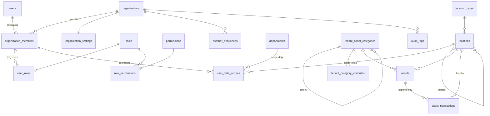

# Audit & Gap Analysis — Asset Tracker

| | |
|---|---|
| Tanggal audit | 2026-10-24 |
| Commit yang diaudit | `1c6fa04` (branch `main`, working tree bersih) |
| Cakupan | `backend/` (Laravel), `frontend/` (React), migrasi PostgreSQL, dokumentasi `docs/01–08` |
| Sifat | Audit baca-saja. Tidak ada kode, database, konfigurasi, atau dependency yang diubah; tidak ada migrasi yang dijalankan. |

Konvensi bukti: `path:baris` relatif terhadap root repo. **[Terkonfirmasi]** = dibuktikan langsung dari kode/perintah. **[Asumsi]** = belum dapat diverifikasi dan perlu dicek.

---

## 1. Executive Summary

### Kondisi saat ini

Project ini **bukan prototipe**. Fondasinya matang dan dibangun dengan disiplin keamanan yang baik:

- Multi-tenant dengan **tiga lapis isolasi**: global scope Eloquent yang fail-closed, *composite foreign key* `(organization_id, id)` di semua tabel tenant, dan **PostgreSQL Row-Level Security (FORCE)** dengan role runtime `ate_app` yang terpisah dari role pemilik `ate_owner`.
- Satu akun bisa menjadi anggota banyak organisasi (`organization_members`), dengan role dan data scope per organisasi.
- RBAC berbasis permission dengan template role terkunci, role kustom, proteksi anti-privilege-escalation, dan invarian "minimal satu admin aktif".
- Modul aset dan transaksi memakai row lock (`FOR UPDATE`), `lock_version`, nomor dokumen dari `number_sequences` (upsert row-locked), dan tabel transaksi **append-only** yang dijaga trigger DB.
- Audit trail append-only (trigger + `REVOKE UPDATE/DELETE`), dengan before/after diff, IP, user agent, dan request id.
- 183 metode test backend (termasuk suite `tests/Feature/Security` yang mengiterasi semua route) dan 37 test frontend.

Arah produk saat ini sengaja disederhanakan (`docs/08-asset-tracker-sederhana.md`): **tanpa approval, tanpa transaksi multi-aset, tanpa barcode/RFID**. Sebagian besar gap terhadap target berasal dari keputusan ini, bukan dari bug.

### Kesiapan arsitektur

| Aspek | Penilaian |
|---|---|
| Tenant isolation | **Kuat.** Desain dan test sudah melampaui kebanyakan aplikasi sejenis. |
| Auth & keanggotaan | **Cukup, tetapi ada celah pada alur penambahan anggota** (lihat SEC-01). Tidak ada undangan, verifikasi email, atau reset password mandiri. |
| Otorisasi | **Kuat pada permission**, tetapi **data scope (cakupan lokasi) dapat dilompati** lewat dua jalur (SEC-03, SEC-04). |
| Master data | **Baik.** Kategori dan lokasi bertingkat, atribut dinamis per kategori dengan validasi server. |
| Aset & transaksi | **Baik untuk versi sederhana.** Perlu perluasan untuk multi-aset, approval, koreksi/reversal, dan barcode/RFID. |
| Kualitas | Lint, typecheck, Pint, dan test frontend lulus. Suite backend **tidak dijalankan** pada audit ini (lihat §11). |

### Risiko utama

1. **[High] Pembajakan akun lewat penambahan anggota tanpa persetujuan** (SEC-01). Admin organisasi bisa menambahkan *akun yang sudah ada* hanya dengan email, tanpa undangan atau persetujuan pemilik akun, dan email tidak pernah diverifikasi. Penyerang bisa mendaftar lebih dulu memakai email karyawan target, lalu otomatis mendapat akses saat admin "menambahkan" email tersebut.
2. **[Medium] Eskalasi cakupan data lewat `PUT /api/users/{id}/scopes`** (SEC-03). Endpoint ini tidak punya pemeriksaan anti-eskalasi dan tidak melarang pengguna mengubah scope dirinya sendiri. *(Pembaruan 2026-10-26: diperbaiki, belum di-commit. Lihat §5, "Status perbaikan SEC-03 / SEC-04".)*
3. **[Medium] Lolos dari cakupan lokasi dengan memindah induk lokasi** (SEC-04). Pengguna ber-scope lokasi yang punya `master.tenant.update` (default: Asset Manager) bisa memindahkan lokasi mana pun ke bawah lokasi scope-nya, lalu melihat dan mentransaksikan semua aset di sana. *(Pembaruan 2026-10-26: diperbaiki, belum di-commit. Lihat §5.)*
4. **[Medium] Enumerasi email lintas platform** (SEC-02) melalui aturan validasi saat membuat pengguna.
5. **Gap fungsional terhadap target**: tidak ada onboarding untuk pengguna tanpa organisasi (login ditolak), tidak ada undangan, tidak ada transaksi multi-aset/approval/reversal, dan belum ada barcode/RFID.

---

## 2. Existing Architecture

### 2.1 Stack aktual [Terkonfirmasi]

| Lapisan | Teknologi | Bukti |
|---|---|---|
| Backend | Laravel `^13.17`, PHP `^8.3` (README menyebut 8.4+; CLI lokal 8.5.12) | `backend/composer.json` |
| Auth | Laravel Sanctum `^4.0`, **session cookie stateful** (bukan token) | `backend/bootstrap/app.php:240`, `frontend/src/lib/api/client.ts:1-8` |
| Database | PostgreSQL 17, ekstensi `citext`, RLS FORCE | `README.md`, migrasi `0001_01_01_000000_*` |
| Frontend | React 19, TypeScript ~6.0, Vite 8, Tailwind 4, React Router 8, TanStack Query 5, react-hook-form + zod | `frontend/package.json` |
| Test | PHPUnit 12 (backend), Vitest 5 + Testing Library (frontend), oxlint | `composer.json`, `package.json` |
| Infra | **Tidak ada** Dockerfile atau docker-compose di repo. Queue, cache, dan session memakai driver `database`. Mail memakai driver `log`. | `backend/.env.example` |

### 2.2 Struktur backend

Modular monolith dengan folder per domain di `backend/app/Domain`:

| Domain | Isi utama |
|---|---|
| `Shared/Tenancy` | `Tenancy` (mode none/tenant/platform/system, menulis GUC `app.organization_id` dan `app.platform_context`), `BelongsToOrganization`, `OrganizationScope` |
| `Shared/Database` | `TenantSchema` (helper RLS, composite FK, append-only) |
| `Shared/Numbering` | `NumberSequence` (format `{YYYY} {YY} {MM} {TYPE} {SEQ:n}`) |
| `Shared/Masters` | `MasterWriter`, `MaterializedPath`, `MasterUsage` (interface) |
| `Identity` | `User`, `OrganizationMember`, `OrganizationAccess`, `UserManagement`, `CrossOrganizationMembers`, `SessionTerminator` |
| `Authorization` | `PermissionCatalog`, `PermissionResolver`, `RoleTemplates`, `DataScope`, `RoleManagement`, `OrgAdminGuard` |
| `Organization` | `Organization`, `OrganizationSetting`, `Department`, `Location`, `OrganizationStructureService` |
| `TenantMaster` | Kategori tenant, atribut kategori (`CategoryAttributeService`), dan **sistem definisi/versi lama** (tidak dipakai UI) |
| `GenericMaster` | Katalog platform (kategori/definisi/versi/atribut generik, unit, jenis lokasi, jenis transaksi) |
| `Assets` | `Asset`, `AssetService`, `AssetScope`, `AssetStatus` |
| `AssetTransactions` | `AssetTransaction`, `AssetTransactionService`, `TransactionLog`, `TransactionType` |
| `Analytics` | `AssetAnalytics` (dashboard) |
| `Audit` | `AuditLogger`, `AuditLog` |
| `Platform` | `OrganizationProvisioner` |

- Routing: `routes/api.php` (auth, platform, tenant) dan `routes/modules/{assets,transactions,analytics}.php`. Total **132 route** API (`php artisan route:list --path=api`).
- Middleware: `ResolveTenant`, `ResolvePlatform`, `RequirePermission`, `EnsureModuleAvailable`, `AssignRequestId`, `SecurityHeaders`. Middleware konteks dan permission sengaja dijalankan **sebelum** route model binding (`bootstrap/app.php:256-260`).
- Validasi dilakukan inline di controller (`$request->validate`); folder `app/Http/Requests` kosong. Output memakai API Resources.
- Laravel Policies tidak dipakai; otorisasi dilakukan di middleware `permission:` dan di service.

### 2.3 Struktur frontend

- `src/app`: `router.tsx`, `guards.tsx` (`RequireAuth`, `RequireUserType`, `RequirePermission`), `navigation.ts`, `AppLayout`, `ModuleBoundary`.
- `src/features/*`: assets, transactions, dashboard, master, organization(s), users, roles, audit, auth, platform.
- `src/components/ui`: Badge, Button, Card, PageHeader, Spinner, Skeleton, EmptyState, Alert, ErrorState, Field, FilterPanel, SearchForm, DateRangeFilter, ActiveFilters, Modal, DataTable, Pagination.
- `src/lib/api/client.ts`: fetch same-origin, CSRF lewat cookie `XSRF-TOKEN`, header `X-Organization-Id` untuk mendeteksi organisasi yang berganti di tab lain, serta listener untuk 401 dan perubahan organisasi.
- State server dikelola TanStack Query; profil sesi diambil dari `/auth/me`.

### 2.4 Database & autentikasi

- Dua koneksi: `pgsql` (role `ate_app`, terkena RLS) dan `pgsql_owner` (khusus migrasi dan seeder).
- Login: `POST /api/auth/login`, session diregenerasi; logout meng-invalidate sesi; ganti password memutus sesi lain (`AuthController.php:179-201`).
- Organisasi aktif disimpan di **sesi server** dan divalidasi ulang di setiap request (`ResolveTenant.php`, `OrganizationAccess.php`). Input request tidak pernah memilih organisasi.
- Rate limit: login 5/menit per email+IP dan 30/menit per IP; registrasi 3/jam per IP; aksi sensitif 5/menit; API 240/menit (`AppServiceProvider.php:35-42`).

### 2.5 Integrasi yang sudah ada

Tidak ada integrasi eksternal (ERP, SSO, email transaksional, barcode/RFID, storage file). Perintah developer `php artisan asset:inspect` tersedia untuk memutar ulang riwayat transaksi dan memeriksa konsistensi aset.

---

## 3. Feature Inventory

### 3.1 Sudah berfungsi [Terkonfirmasi dari kode + test yang ada]

| Area | Fitur | Bukti |
|---|---|---|
| Auth | Login, logout, `/auth/me`, ganti password (kebijakan min 12, huruf besar/kecil, angka) | `AuthController.php` |
| Auth | Registrasi mandiri yang langsung membuat organisasi, dengan pendaftar sebagai Org Admin | `AuthController.php:80-112` |
| Multi-org | Satu akun banyak organisasi; ganti organisasi aktif; buat organisasi tambahan | `AuthController.php:114-149`, `OrganizationSwitcher.tsx` |
| Multi-org | Auto-pilih jika hanya satu organisasi aktif; halaman pilih organisasi | `OrganizationAccess.php:90-98`, `context.ts:42-47` |
| Organisasi | Lihat dan edit profil (nama, legal name, zona waktu, locale, mata uang, kontak, NPWP, alamat) | `OrganizationProfileController.php:27-53` |
| Pengguna | Tambah, edit, suspend/aktifkan/nonaktifkan keanggotaan, reset password (hanya akun eksklusif), atur role dan data scope, beri akses ke organisasi lain | `UserController.php`, `UserManagement.php`, `CrossOrganizationMembers.php` |
| Role | Template role terkunci + role kustom, picker permission per modul, anti-eskalasi, larangan menghapus role yang masih dipakai | `RoleManagement.php`, `RoleTemplates.php` |
| Pengaturan | Format nomor aset dan transaksi (prefix, `{YYYY}/{YY}/{MM}`, `{TYPE}`, `{SEQ:n}`), counter reset per tahun/bulan | `OrganizationProfileController.php:60-81`, `NumberSequence.php` |
| Audit | Audit trail organisasi dan platform, append-only, diff before/after, redaksi kunci sensitif | `AuditLogger.php`, migrasi `000300` |
| Kategori | Hierarki (materialized path), arsip/restore, larangan arsip saat masih dipakai aset aktif | `TenantCategoryService.php` |
| Atribut dinamis | 7 tipe (string, text, integer, decimal, boolean, date, enum), wajib/opsional, opsi pilihan, pewarisan dari induk, key immutable (trigger) | `CategoryAttributeService.php`, migrasi `001000` |
| Lokasi | Hierarki, jenis lokasi (bawaan platform + milik organisasi), arsip | `OrganizationStructureService.php`, migrasi `000900` |
| Data scope | Scope organisasi / departemen / lokasi (termasuk sub-lokasi), fail-closed | `AssetScope.php`, `PermissionResolver.php:52-64` |
| Aset | CRUD deskriptif, nomor otomatis, nomor seri unik per organisasi (case-insensitive), status, nilai dan tanggal perolehan, atribut, arsip/restore, `lock_version`, riwayat transaksi per aset | `AssetService.php`, `AssetController.php` |
| Transaksi | Pemindahan, perubahan status, peminjaman, pengembalian, catatan; validasi status, lokasi aktif, dan scope; append-only | `AssetTransactionService.php` |
| Dashboard | Ringkasan, distribusi, tren 12 bulan, transaksi terbaru, dalam scope pengguna | `AssetAnalytics.php` |
| Platform | Provisioning dan suspend organisasi, katalog Generic Master, audit platform | `routes/api.php:51-96` |
| Operasional | Mematikan modul tertentu dengan `MODULES_DISABLED` (503 per modul) | `EnsureModuleAvailable.php` |

### 3.2 Baru sebagian

| Fitur | Yang ada | Yang kurang |
|---|---|---|
| Pemilihan organisasi saat login | Frontend memaksa halaman pilih bila >1 organisasi (`context.ts:45`) | Backend sudah otomatis memilih organisasi terakhir di sesi (`OrganizationAccess.php:59-62, 97`), jadi pemaksaan hanya terjadi di UI |
| Onboarding | Pengguna yang sudah login bisa membuat organisasi baru | Pengguna tanpa organisasi aktif **ditolak saat login** (`AuthController.php:60-63`), sehingga tidak bisa sampai ke onboarding. Tidak ada penerimaan undangan. |
| Registrasi | Ada | Registrasi selalu membuat organisasi; belum ada pilihan "daftar akun saja lalu terima undangan"; tidak ada verifikasi email |
| Undang pengguna | "Tambah pengguna" dengan password awal, atau menempelkan akun yang sudah ada | Tidak ada undangan berbasis token/email dan tidak ada persetujuan pemilik akun (SEC-01) |
| Format penomoran | Satu format aset + satu format transaksi | Belum ada format per jenis transaksi, pratinjau, validasi tabrakan, atau pilihan periode reset yang eksplisit (periode diturunkan dari token) |
| Atribut dinamis | Tipe, wajib, opsi | Belum ada **satuan (unit)**, aturan validasi (min/max/panjang/pola), nilai default, multi-pilihan, atau penanda "dapat dicari" |
| Audit trail | Aktor, waktu, organisasi, aksi, objek, before/after, IP, UA, request id | Kolom **hasil tindakan** (berhasil/gagal) belum ada; percobaan yang ditolak (403) tidak dicatat kecuali login gagal; belum ada hash-chain |
| Riwayat perubahan aset | Perubahan deskriptif tercatat di `audit_logs` (`AssetService.php:112-113`) | Halaman detail aset hanya menampilkan transaksi (`AssetDetailPage.tsx:34-35` memanggil `/assets/{id}/transactions`); perubahan deskriptif tidak terlihat tanpa `audit.view` |
| Reset password | Admin dapat mereset password akun yang eksklusif di organisasinya | Tidak ada "lupa password" mandiri. Akun yang tergabung di beberapa organisasi **tidak punya jalur pemulihan sama sekali** (`UserManagement.php:182-185, 208-214`) |
| Koreksi transaksi | Kesalahan diperbaiki dengan transaksi baru | Belum ada kolom yang menautkan "transaksi ini mengoreksi/membalik transaksi X" |

### 3.3 Belum tersedia

- Transaksi **multi-aset** (satu dokumen, banyak baris). `asset_transactions.asset_id` bernilai tunggal, dan form hanya mengirim satu `asset_id` (`TransactionFormModal.tsx:53`).
- **Workflow approval** dan status draft/submit/approve/post. Ini dihapus dengan sengaja (`docs/08 §1`), tetapi permission `transaction.submit/approve/reject/post/reverse/correct` masih ada di katalog.
- **Barcode/QR/RFID**: tidak ada satu pun referensi di kode maupun skema.
- Verifikasi email, MFA, lockout akun, dan "lupa password" mandiri.
- Undangan organisasi beserta penerimaannya.
- Ekspor/laporan, lampiran dokumen, dan depresiasi (di luar lingkup `docs/08`).
- Infrastruktur container (Docker) dan pipeline CI di repo.

### 3.4 Tidak dapat diverifikasi pada audit ini

- **Hasil suite test backend.** Tidak dijalankan karena suite memakai `RefreshDatabase` (migrasi ulang DB test), yang bertentangan dengan aturan audit.
- Perilaku runtime di browser (tidak ada E2E dan tidak ada smoke test HTTP yang dijalankan).
- Konfigurasi produksi (proxy, HTTPS, `SESSION_SECURE_COOKIE`, backup, worker queue).
- Performa pada volume besar (mis. 100k aset), termasuk query `LIKE '%/id/%'` pada `path` yang tidak memakai index prefix.
- Kualitas responsif per halaman. Ada 76 penggunaan breakpoint `sm:/md:/lg:`, tetapi belum ada pemeriksaan visual.

---

## 4. Database Relationship Map

### 4.1 Tabel aktif (setelah migrasi `000000`–`001000`)

| Kelompok | Tabel | Batas tenant | Catatan |
|---|---|---|---|
| Identitas global | `organizations` | — | `code` unik global, CHECK format |
| | `users` | **Global** (tanpa RLS) | `email citext` unik global; `user_type` immutable (trigger); tidak bisa dihapus |
| | `sessions`, `password_reset_tokens`, `cache*`, `jobs*` | — | `password_reset_tokens` belum dipakai |
| Keanggotaan | `organization_members` | RLS + `org_id` | UNIQUE `(organization_id, user_id)`, UNIQUE `(organization_id, employee_number)`; tidak bisa dihapus; org/user immutable |
| RBAC | `permissions` | Global | `scope ∈ {platform, tenant}` |
| | `platform_roles`, `platform_role_permissions`, `platform_user_roles` | Global | Trigger: hanya user platform |
| | `roles` | RLS | UNIQUE `(organization_id, code)` |
| | `role_permissions` | RLS | Composite FK ke `roles`; trigger scope permission = tenant |
| | `user_roles` | RLS | PK `(user_id, role_id)`; composite FK ke `organization_members (organization_id, user_id)` dan `roles` |
| | `user_data_scopes` | RLS | CHECK tipe (organization/department/location); unique `(organization_id, user_id, scope_type, ref)` |
| Pengaturan | `organization_settings` | RLS | PK `organization_id`; format nomor |
| | `number_sequences` | RLS | PK `(organization_id, sequence_key, period_key)` |
| Struktur | `departments` | RLS | UNIQUE `(organization_id, code)` |
| | `locations` | RLS | `parent_id` composite FK ke dirinya sendiri; `path` materialized; trigger validasi jenis lokasi |
| | `location_types` | RLS (baris global terlihat) | `organization_id NULL` = bawaan; unique partial per global/per org |
| Master generik | `units`, `generic_transaction_types`, `generic_asset_categories`, `generic_asset_definitions`, `generic_asset_definition_versions`, `generic_attribute_definitions` | Global, hanya ditulis platform (trigger) | Versi released immutable |
| Master tenant | `tenant_asset_categories` | RLS | Hierarki `parent_id`/`path`; `generic_category_id` dan `code` immutable |
| | `tenant_category_attributes` | RLS | UNIQUE `(organization_id, key)`; `category_id`, `key`, `data_type` immutable |
| | `tenant_asset_definitions`, `tenant_asset_definition_versions`, `tenant_attribute_definitions`, `tenant_attribute_overrides` | RLS | **Warisan desain awal, tidak dipakai UI** (`docs/08 §7` butir 1) |
| Aset | `assets` | RLS | UNIQUE `(organization_id, asset_number)`; unique partial `(organization_id, lower(serial_number))`; CHECK status, pinjaman, biaya ≥ 0, `attribute_values` objek; `asset_number` dan `created_by` immutable; tidak bisa dihapus |
| | `asset_transactions` | RLS | UNIQUE `(organization_id, transaction_number)`; `seq` identity; **append-only**; composite FK ke aset, lokasi, dan anggota |
| Audit | `audit_logs` | RLS (baris `org NULL` hanya untuk platform) | Append-only (trigger + REVOKE) |

### 4.2 Relasi inti

### 4.3 Tenant boundary

- **Semua data bisnis** (aset, transaksi, master tenant, role, scope, pengaturan, audit) memakai `organization_id`, composite FK, dan RLS. [Terkonfirmasi]
- `users` sengaja global karena satu akun bisa lintas organisasi. Semua jalur tenant wajib memakai `User::scopeOfCurrentOrganization()` (`User.php:91-102`); route binding sudah melakukannya (`User.php:105-108`).
- **Pengecualian yang perlu diperhatikan:** beberapa query sengaja dijalankan dalam mode `runAsSystem` (login, registrasi, akses organisasi). Pemeriksaan keberadaan email di `UserController.php:69` membaca tabel `users` global (lihat SEC-02).

### 4.4 Kekurangan constraint / indeks

| # | Temuan | Dampak | Rekomendasi |
|---|---|---|---|
| DB-01 | Query scope dan subtree memakai `path LIKE '%/<id>/%'` (`AssetScope.php:455`, `AssetController.php:234`). Index B-tree `(organization_id, path)` tidak dapat dipakai untuk pola berawalan `%`. | Lambat pada data besar [Asumsi, belum diukur] | Gunakan prefix `LIKE '<path-node>%'` (path induk sudah diketahui) atau `text_pattern_ops`/`ltree` |
| DB-02 | Keunikan label atribut dalam satu garis keturunan hanya dijaga di service (`CategoryAttributeService.php:279-300`) dan tidak diperiksa ulang saat kategori dipindah induknya (`TenantCategoryService.php:53-72`). | Label ganda/atribut wajib baru setelah kategori dipindah | Validasi ulang saat re-parent; tolak bila terjadi konflik |
| DB-03 | `asset_transactions` tidak punya kolom header dokumen atau tautan koreksi (`reverses_transaction_id`). | Tidak ada transaksi multi-aset; koreksi tidak tertelusur | Lihat P5 |
| DB-04 | Belum ada kolom identitas fisik (barcode/RFID EPC) dengan unique per organisasi. | Target barcode/RFID belum didukung | Lihat P4 |
| DB-05 | `users` tidak punya `email_verified_at`. | Tidak ada bukti kepemilikan email (SEC-01) | Lihat P0 |
| DB-06 | `MaterializedPath::move` tidak mengunci pohon (`MaterializedPath.php:22-44`); dua pemindahan bersamaan bisa membentuk siklus. | Rendah; perlu race nyata | Kunci baris induk/node (`FOR UPDATE`) atau `pg_advisory_xact_lock` per organisasi+tabel |
| DB-07 | Tabel warisan definisi tenant (4 tabel) dan permission yang tidak terpakai masih aktif. | Permukaan serangan dan beban pemeliharaan | Putuskan sesuai `docs/08 §7` |

---

## 5. Security Findings

### Kontrol positif yang terverifikasi

- Isolasi tenant tiga lapis dan test enumerasi semua route (`tests/Feature/Security/RouteSecurityTest.php`).
- Route binding aset menerapkan data scope (`Asset.php:70-79`); binding user hanya untuk anggota organisasi aktif.
- Middleware permission dijalankan sebelum binding, sehingga respons 403 tidak membocorkan keberadaan ID.
- Mass assignment terkendali: `forceFill` hanya dengan whitelist (`Asset::EDITABLE`, `TransactionLog::CHANGE_COLUMNS`); `organization_id` dipaksa dari konteks (`BelongsToOrganization.php`).
- Wildcard LIKE di-escape (`ListQuery::like`), kolom sort di-whitelist, dan `per_page` dibatasi 100.
- Pesan error tidak membocorkan detail internal (`ApiExceptionRenderer.php`).
- Sesi diregenerasi saat login dan ganti organisasi; CSRF memakai Sanctum; cookie HttpOnly; `SESSION_ENCRYPT=true` di contoh env.
- Header keamanan (nosniff, X-Frame-Options DENY, HSTS bila HTTPS, `Cache-Control: no-store` untuk API).
- Anti-eskalasi role dan penjaga admin terakhir.
- `.env` tidak ter-commit (hanya `.env.example`); tidak ada secret yang ditemukan di source.
- `composer audit`: tidak ada advisory.

### Temuan

#### SEC-01 — Penambahan akun yang sudah ada tanpa persetujuan + email tidak diverifikasi → pembajakan akses organisasi
**Risiko: High** · [Terkonfirmasi]

Bukti:
- `backend/app/Http/Controllers/Tenant/UserController.php:67-69`: email yang sudah memiliki akun langsung ditambahkan ke organisasi, dan password hanya diwajibkan untuk akun baru.
- `backend/app/Domain/Identity/Services/UserManagement.php:45-63, 66-75`: akun yang ada dipakai ulang tanpa undangan, token, atau notifikasi.
- `backend/app/Http/Controllers/Auth/AuthController.php:80-112`: registrasi mandiri tanpa verifikasi email; `backend/config/auth.php:122` mengaktifkan registrasi mandiri secara default (`SELF_REGISTRATION_ENABLED=true`).
- Perilaku ini memang diuji sebagai fitur: `tests/Feature/Tenant/UserManagementTest.php:82` (`test_existing_account_is_added_as_member_with_the_same_login`).

Skenario:
1. Penyerang mendaftar di `/daftar` memakai email `budi@perusahaan.co.id` (tanpa verifikasi) dengan password miliknya sendiri, sekaligus membuat organisasi dummy.
2. Admin organisasi "PT Perusahaan" kemudian menambahkan `budi@perusahaan.co.id` sebagai pengguna. Sistem menemukan akun yang sudah ada dan langsung menambahkannya sebagai anggota dengan role pilihan admin.
3. Penyerang login dengan password miliknya dan mendapat akses ke data PT Perusahaan.

Varian lain: admin organisasi A membuat akun untuk email tertentu dan masih mengetahui password sementaranya. Ketika organisasi B kemudian menambahkan email yang sama, admin A bisa masuk ke organisasi B.

Dampak: kebocoran data lintas organisasi dan potensi perubahan data oleh pihak luar.

Rekomendasi:
- Ganti penambahan langsung dengan **undangan berbasis token** (berlaku terbatas, sekali pakai, hash disimpan di DB) yang harus diterima oleh pemilik akun yang sudah login.
- Tambahkan **verifikasi email** (`email_verified_at`) sebelum akun dapat menerima undangan atau dipakai.
- Sebagai mitigasi cepat, nonaktifkan jalur "akun yang sudah ada" di `UserManagement::create` sampai alur undangan tersedia.

#### SEC-02 — Enumerasi email lintas platform
**Risiko: Medium** · [Terkonfirmasi]

Bukti:
- `UserController.php:69`: `Rule::requiredIf(fn () => ! User::query()->where('email', ...)->exists())` membaca tabel `users` global. Admin organisasi mana pun bisa mengetahui apakah sebuah email terdaftar di platform dari ada/tidaknya error "password wajib".
- `AuthController.php:93`: registrasi menjawab "Email sudah terdaftar" (dibatasi 3/jam per IP).

Dampak: daftar email pelanggan platform bisa dipetakan, dan ini mempermudah SEC-01.

Rekomendasi: dengan alur undangan, respons selalu "undangan dikirim" tanpa membedakan akun baru atau lama. Untuk registrasi, kirim email verifikasi dengan respons yang seragam.

#### SEC-03 — `PUT /users/{id}/scopes` tanpa anti-eskalasi dan bisa mengubah scope diri sendiri
**Risiko: Medium** · [Terkonfirmasi]

Bukti:
- `backend/routes/api.php:116`: endpoint ini hanya memerlukan `user.update`.
- `backend/app/Domain/Identity/Services/UserManagement.php:171-180`: `syncScopes` tidak memanggil `assertGrantable`, tidak membandingkan dengan scope aktor, dan tidak menolak `user.id === actor`. Bandingkan dengan `changeStatus` (baris 116-123) dan `resetPassword` (baris 185) yang punya pengaman.

Skenario: role kustom "Kepala Gudang" diberi `user.update` dengan scope lokasi Gudang A. Pengguna ini bisa mengubah scope dirinya sendiri menjadi `organization`, lalu melihat semua aset organisasi.

Rekomendasi: (a) tolak perubahan scope diri sendiri; (b) aktor hanya boleh memberi scope yang tercakup dalam scope miliknya; (c) terapkan `assertGrantable(permissionsOf(target))` seperti pada `changeStatus`; (d) tambahkan test.

#### SEC-04 — Lolos dari cakupan lokasi dengan membuat atau memindahkan lokasi
**Risiko: Medium** · [Terkonfirmasi]

Bukti:
- Endpoint master lokasi (`routes/api.php:151-158`) hanya diperiksa dengan permission `master.tenant.*`, tanpa data scope. `OrganizationStructureService::updateLocation` (`OrganizationStructureService.php:71-91`) tidak memeriksa scope aktor terhadap lokasi asal maupun induk baru.
- Scope aset dihitung dari `locations.path` (`AssetScope.php:451-458`), sehingga memindah induk otomatis memasukkan seluruh subtree ke scope.
- Template `ASSET_MANAGER` memiliki `master.tenant.update` (`RoleTemplates.php:27-33`), dan test sendiri memakai Asset Manager ber-scope lokasi (`tests/Feature/Assets/AssetTransactionTest.php:144`).

Skenario: Asset Manager dengan scope "Gedung A" memindahkan lokasi "Gedung B" agar menjadi sub-lokasi "Gedung A". Setelah itu semua aset di Gedung B terlihat dan dapat ditransaksikan olehnya.

Rekomendasi: untuk aktor yang tidak ber-scope organisasi, wajibkan lokasi yang diubah **dan** induk barunya berada dalam scope aktor. Pertimbangkan hanya mengizinkan scope organisasi untuk mengubah struktur lokasi. Tambahkan test.

#### Status perbaikan SEC-03 / SEC-04 (pembaruan 2026-10-26)

**Status: diperbaiki di working tree di atas `0f04885`, belum di-commit dan belum direview.** Tidak ada blocker kritis. Masih ada satu keputusan produk yang tidak kritis (D-1). Status *tuntas* baru layak setelah commit dan review.

Aturan yang diterapkan (docs/05 §3–4, docs/04). Aturan kebijakan lengkap ada di docs/05 §3.1.
1. Tidak ada pengguna yang dapat mengubah scope dirinya sendiri (`422 CANNOT_CHANGE_OWN_SCOPE`).
2. Aktor ber-scope terbatas hanya dapat memberi entri yang tercakup scope miliknya: lokasi itu atau sub-lokasinya, atau departemen yang ia miliki. Entri `organization` hanya dapat diberikan aktor ber-scope organisasi (`403 SCOPE_ESCALATION`).
3. Aktor hanya dapat mengelola anggota yang tidak lebih kuat darinya, yaitu anggota yang semua permission dan entri scope-nya berada dalam milik aktor. Aturan ini berlaku untuk scope, role, status (suspend/aktifkan/nonaktifkan), reset password, data akun, dan data jabatan (`employee_number`, `job_title`, `home_department_id`). Pelanggaran ditolak dengan `403 PRIVILEGE_ESCALATION` atau `403 SCOPE_ESCALATION`. Mengirim ulang nilai yang sama tidak dianggap perubahan.
4. Mengubah permission sebuah role mensyaratkan scope **semua** pemegang role tersebut berada dalam scope aktor.
5. Scope dan role undangan diperiksa saat undangan dibuat, dikirim ulang, diterima (terhadap scope pengundang saat itu), dan **dicabut**.
6. Pada struktur lokasi, aktor ber-scope terbatas hanya dapat mengubah, mengarsipkan, atau memulihkan lokasi dalam scope-nya (`403 LOCATION_OUT_OF_SCOPE`), dan hanya dapat memasang lokasi di bawah induk dalam scope (`422 LOCATION_OUT_OF_SCOPE`, `fields.parent_id`). Lokasi tingkat atas hanya dapat dibuat oleh aktor ber-scope organisasi.
7. Scope tanpa entri lokasi tidak pernah mengizinkan lokasi apa pun (fail-closed). Sebelumnya, grup OR yang kosong cocok dengan semua lokasi.

Komponen utama:
- `backend/app/Domain/Authorization/Services/DataScopeGuard.php` (baru): `assertGrantable`, `assertCovers`, `assertCoversUser`, `assertCoversRoleHolders`, `allowsLocation`.
- `backend/app/Domain/Assets/AssetScope.php`: perbaikan fail-open untuk scope kosong, dan `allowsLocations` (satu query untuk banyak lokasi).
- `backend/app/Domain/Identity/Services/UserManagement.php`: `assertManageable` pada `update`, `changeStatus`, `syncRoles`, `syncScopes`, dan `resetPassword`.
- `backend/app/Domain/Authorization/Services/RoleManagement.php` (`update`).
- `backend/app/Domain/Identity/Services/OrganizationInvitations.php` (`create`, `resend`, `revoke`, `complete`).
- `backend/app/Domain/Organization/Services/OrganizationStructureService.php` (lokasi).
- Test: `backend/tests/Feature/Security/DataScopeEscalationTest.php` (28 test) dan `frontend/src/test/accessErrors.test.tsx` (7 test).

Bukti test:

| | Hasil |
|---|---|
| **Sebelum**: `DataScopeEscalationTest` versi akhir dijalankan pada kode HEAD `0f04885` (worktree terpisah, tanpa patch) | 12 lulus, **16 gagal**. Setiap kegagalan berupa permintaan eskalasi yang **diterima** (200/201/204), padahal seharusnya ditolak dengan 403/422. |
| **Sebelum** (residual): fix data jabatan, fix pencabutan undangan, dan fix N+1 dinonaktifkan sementara | 3 test gagal: 200 alih-alih 403, 200 alih-alih 403, serta 37 query alih-alih 27 untuk role dengan 6 pemegang. |
| **Sesudah**: `DataScopeEscalationTest` | 28/28 lulus |
| **Sesudah**: seluruh backend / frontend | 281/281 · 63/63. `tsc`, oxlint, Pint, dan Vite build lulus. |

Jenis test: test backend adalah *feature test* yang melewati route, middleware (`auth:sanctum`, `tenant`, `permission:*`), validasi, service, dan serialisasi respons yang sebenarnya, dalam proses (HTTP kernel Laravel) dengan PostgreSQL + RLS. Test frontend adalah test komponen (Vitest + jsdom, API di-mock). Test ini memastikan bahwa `SCOPE_ESCALATION` ditampilkan, form/dialog tetap terbuka, dan tidak muncul pesan sukses atau navigasi. **Belum ada** smoke test terhadap server yang berjalan dan **belum ada** E2E browser.

Temuan residual yang dinilai dan sengaja dibiarkan:
- **Nomor seri.** Pemeriksaan unik berlaku untuk seluruh organisasi, sama dengan indeks `assets_serial_unique (organization_id, lower(serial_number))`. Pesannya generik ("No seri sudah dipakai aset lain.") tanpa lokasi, pemilik, atau detail aset. Satu-satunya informasi yang terungkap adalah bahwa nomor seri itu sudah ada di organisasi. Ini konsekuensi yang tak terhindarkan dari keunikan per organisasi. Menyembunyikannya hanya mungkin jika keunikan diubah menjadi per scope, dan itu keputusan produk. Pada race (dua request bersamaan lolos pre-check), indeks DB menolak salah satunya dengan `409 DUPLICATE` generik. Integritas data tetap terjaga dan tidak ada yang bocor; hanya bentuk responsnya yang berbeda dari 422.
- **Race (TOCTOU).** Pemeriksaan scope dilakukan sebelum transaksi. Scope aktor sendiri dibaca sekali per request (`TenantContext`), sehingga lock tidak dapat menutup celah ini. Eskalasi lewat race hanya mungkin jika, pada saat yang sama, admin dengan scope lebih luas memperluas target, misalnya aktor terbatas mengubah role tepat ketika OA menjadikan target ber-scope organisasi. Itu butuh aksi bersamaan dari aktor yang berwenang, dampaknya terbatas pada role yang memang boleh diberikan aktor, dan tercatat di audit. Karena belum ada bukti kebutuhan, lock tidak ditambahkan. Jika nanti diperlukan: di dalam transaksi, kunci `organization_members` target (`FOR UPDATE`), lalu jalankan ulang `assertManageable`. Urutan kunci: organisasi (`OrgAdminGuard::lock`) → membership target → role.
- **N+1 di `RoleManagement::update`.** Diperbaiki: scope semua pemegang role dibaca sebagai satu union (satu query), dan lokasinya diperiksa dalam satu query. Jumlah query tidak bergantung pada jumlah pemegang (dibuktikan oleh test).

Keputusan yang masih memerlukan pemilik produk:
- **D-1 — Pengelolaan departemen oleh aktor ber-scope terbatas.** Dokumen hanya mensyaratkan `master.tenant.*` (docs/04). Saat ini scope departemen tidak memberi akses aset apa pun (aset tidak punya departemen, dan UI menyembunyikan pilihan scope departemen), sehingga **tidak ada jalur eskalasi**. Dampaknya hanya operasional: aktor dapat mengganti nama atau mengarsipkan departemen yang dipakai unit lain. Opsi: (a) tetap seperti sekarang; (b) hanya aktor ber-scope organisasi; (c) hanya departemen yang ada dalam scope departemen aktor. Rekomendasi: (a) untuk sekarang, lalu (b) jika departemen kelak dipakai untuk scope aset.
- **D-2 — Visibilitas daftar (dikonfirmasi, tidak diubah).** Daftar pengguna dan undangan (`user.view`), audit log (`audit.view`), serta lokasi dan departemen (`master.tenant.view`) berlaku untuk seluruh organisasi, sesuai docs/04. Akibatnya, aktor ber-scope terbatas dapat melihat semua anggota dan seluruh pohon lokasi. Pemegang `audit.view` (default hanya OA dan Auditor) juga dapat melihat event aset di luar scope-nya. Jika audit log atau daftar pengguna harus dibatasi scope, itu perubahan kebijakan tersendiri.

#### SEC-05 — Proteksi brute-force terbatas
**Risiko: Low** · [Terkonfirmasi]

`AppServiceProvider.php:35-37`: limit 5/menit per kombinasi email+IP. Serangan terdistribusi ke satu akun dari banyak IP tidak dibatasi per akun. Tidak ada lockout bertahap atau MFA.
Rekomendasi: tambahkan limiter per email (mis. 20/jam), backoff bertahap, notifikasi login mencurigakan, dan MFA opsional untuk admin.

#### SEC-06 — Tidak ada pemulihan akun mandiri
**Risiko: Low (keamanan) / Medium (operasional)** · [Terkonfirmasi]

Tabel `password_reset_tokens` ada tetapi tidak dipakai. Akun yang tergabung di beberapa organisasi tidak bisa direset oleh admin mana pun (`UserManagement.php:208-214`), sehingga lupa password berarti terkunci permanen. Hal ini mendorong praktik buruk seperti berbagi password.
Rekomendasi: alur "lupa password" berbasis email dengan token sekali pakai (broker bawaan Laravel), dilindungi rate limit dan respons yang seragam.

#### SEC-07 — RLS bergantung pada GUC sesi yang dapat diubah oleh role aplikasi
**Risiko: Low (defense-in-depth)** · [Terkonfirmasi]

`ate_current_org()` / `ate_platform_context()` membaca `current_setting('app.*')` (migrasi `000000`, baris 16-23), yang diisi aplikasi (`Tenancy.php:189`). Role `ate_app` dapat menjalankan `set_config` sendiri, sehingga RLS melindungi dari bug query aplikasi, tetapi **tidak** dari SQL injection. Saat ini tidak ditemukan SQL mentah yang memakai input tanpa binding.
Rekomendasi: dokumentasikan batasan ini. Untuk pengamanan tambahan, set konteks lewat fungsi `SECURITY DEFINER` yang memverifikasi token per request, dan pertahankan larangan SQL mentah tanpa binding (lint/review).

#### Status perbaikan SEC-07 (Tahap B, pembaruan 2026-10-26)

**Status: diimplementasikan di working tree (branch `sec-07-stage-b`), belum di-commit, belum direview, belum di produksi.** Diuji hanya di cluster PostgreSQL 17 sekali pakai.

Audit lanjutan (Tahap A) menemukan bahwa masalahnya lebih luas dari GUC: 20 dari 40 tabel tanpa RLS memberi `ate_app` DML penuh (akun, peran platform, organisasi), payload sesi bisa disalin antarbaris `sessions`, dan konteks PHP/DB bisa tidak sinkron setelah rollback. Perbaikan terdiri dari empat bagian yang dapat direview terpisah:

| Bagian | Isi | Berkas utama |
|---|---|---|
| B1 Konteks bertanda tangan | RLS hanya mempercayai `app.context` = klaim HMAC-SHA256 (`v1\|kid\|pid\|backend_start\|exp\|mode\|org\|user`) yang diverifikasi `ate_ctx.verified_context()` (SECURITY DEFINER, milik role NOLOGIN `ate_ctx`, kunci di `ate_private`). Klaim terikat ke satu backend, kedaluwarsa, dan untuk mode tenant mensyaratkan anggota aktif organisasi aktif. Policy memanggil fungsi sebagai `(SELECT f())` (sekali per statement). Kunci dipasang/dirotasi dengan `php artisan db:context-key`. | migrasi `001300`, `ContextClaim`, `DatabaseContextKey`, `Tenancy` |
| B2 Pembatasan tabel | RLS untuk `users`, `organizations`, `platform_user_roles`; katalog platform hanya bisa ditulis dalam mode system; konteks tenant tidak dapat mengubah akun yang juga milik organisasi lain, tidak dapat membuat akun/organisasi, dan tidak dapat mengubah kode/status organisasi; tanpa akses ke `migrations` dan `password_reset_tokens`; tabel baru tertutup secara default. Alur login/akun berjalan dalam mode system hanya pada baca/tulis akun. | migrasi `001400`, `AccountUserProvider`, controller auth |
| B3 Pemisahan role | `sessions`/`cache`/`cache_locks` ke `ate_session`, tabel queue ke `ate_queue`; `ate_app` tidak punya akses ke keduanya. | migrasi `001500`, `config/database.php`, `session.php`, `cache.php`, `queue.php` |
| B4 Lifecycle | Konteks diterapkan ulang setelah setiap rollback/savepoint, pada backend baru (reconnect), dan sebelum klaim lewat separuh umurnya. Kegagalan restore di transaksi yang batal tidak lagi menutupi error aslinya. Klaim tidak pernah masuk query log/event. Test HTTP dimulai tanpa konteks seperti di produksi. | `Tenancy`, `AppServiceProvider`, `tests/TestCase.php` |

Bukti: 7 test reproduksi (`sec-07-repro`) gagal 7/7 sebelum perbaikan dan lulus 7/7 sesudahnya; seluruh suite lulus di cluster terisolasi; migrasi diuji di atas data yang dibuat kode HEAD (naik, rollback, naik lagi; isi tabel identik) dan dengan smoke test HTTP memakai driver sesi/cache `database`.

Risiko sisa: SQL injection yang terjadi saat aplikasi berada dalam mode system tetap berkuasa penuh; kebocoran `DB_CONTEXT_KEY` (RCE di PHP) atau kredensial `ate_owner` meniadakan perlindungan ini; satu verifikasi klaim menambah ±0,2 ms per statement di tabel ber-RLS.

#### SEC-08 — Dependency frontend dengan advisory
**Risiko: Low** · [Terkonfirmasi]

`npm audit --omit=dev`: `zod <4.6.6` — GHSA-mrhx-c7xc-m3w5 (CWE-770, CVSS 7.5, kehabisan memori pada koleksi besar). Zod hanya dipakai di browser untuk validasi form, sehingga dampak praktisnya kecil.
Rekomendasi: perbarui ke `zod >=4.6.6` dalam task terpisah (mengubah lockfile).

#### SEC-09 — Kelengkapan dan integritas audit trail
**Risiko: Low** · [Terkonfirmasi]

- Belum ada kolom hasil tindakan; aksi yang ditolak (403/422) tidak dicatat, kecuali login gagal (`AuthController.php:51-62`).
- Login gagal untuk email yang tidak dikenal menyimpan email mentah di audit platform (`AuthController.php:52-55`). Ini data pribadi yang perlu kebijakan retensi.
- Append-only dijaga trigger + REVOKE, tetapi superuser DB masih bisa mengubah baris. Belum ada hash-chain.

Rekomendasi: kolom `outcome`, pencatatan penolakan untuk aksi sensitif (role, scope, transaksi), hash-chain per organisasi, dan kebijakan retensi.

#### SEC-10 — Hardening konfigurasi & instruksi agen
**Risiko: Low / Info** · [Terkonfirmasi]

- `backend/.env.example` berisi `APP_DEBUG=true` dan `SESSION_SECURE_COOKIE=false` (wajar untuk lokal), tetapi belum ada checklist produksi di repo.
- `backend/CLAUDE.md` dan `backend/AGENTS.md` berisi instruksi bagi agen AI untuk menjalankan skrip instalasi remote (`php.new`) dan `composer require laravel/boost`. Instruksi ini **tidak diikuti** dalam audit, dan perlu ditinjau karena berisiko bagi rantai pasok.

Rekomendasi: tambahkan `docs/deployment-checklist.md`; tinjau atau hapus instruksi otomatis tersebut.

---

## 6. Gap Analysis

| ID | Modul | Kondisi saat ini | Target | Gap | Risiko | Dependensi | Prioritas |
|---|---|---|---|---|---|---|---|
| G-01 | Auth / Anggota | Akun yang ada ditempel langsung ke organisasi; email tidak diverifikasi | Undangan dan penerimaan; akses hanya untuk pemilik email | Alur undangan + verifikasi email | High (SEC-01) | — | **P0** |
| G-02 | Otorisasi | `syncScopes` tanpa anti-eskalasi | Scope hanya bisa diberikan dalam batas aktor | Pengaman scope — *diperbaiki, belum di-commit (2026-10-26)* | Medium (SEC-03) | — | **P0** |
| G-03 | Otorisasi / Lokasi | Master lokasi tanpa pemeriksaan scope | Pembatasan akses berdasarkan cakupan lokasi | Scope check saat create/move/update lokasi — *diperbaiki, belum di-commit (2026-10-26)* | Medium (SEC-04) | — | **P0** |
| G-04 | Auth | Enumerasi email | Respons seragam | Bagian dari G-01 | Medium (SEC-02) | G-01 | **P0** |
| G-05 | Auth / Onboarding | Pengguna tanpa organisasi aktif ditolak saat login | Diarahkan ke onboarding (buat organisasi / terima undangan) | Login tetap diizinkan dengan `organization=null`; halaman onboarding | Medium | G-01 | P1 |
| G-06 | Auth / Pemilihan org | Backend auto-pilih organisasi terakhir; UI memaksa pilih | >1 organisasi ⇒ wajib memilih | Sinkronkan kebijakan backend dan frontend | Low | — | P1 |
| G-07 | Auth / Registrasi | Registrasi wajib membuat organisasi | Daftar akun → onboarding | Pisahkan registrasi akun dari pembuatan organisasi | Low | G-05 | P1 |
| G-08 | Akun | Tidak ada lupa password; akun multi-org tak bisa direset | Reset password mandiri yang aman | Password broker + halaman | Medium (SEC-06) | Mail driver produksi | P1 |
| G-09 | Akun | Tanpa MFA/lockout per akun | Keamanan autentikasi memadai | Limiter per akun; MFA opsional | Low (SEC-05) | — | P2 |
| G-10 | Role & Permission | Permission workflow/dokumen/ekspor tidak terpakai | Katalog sesuai fitur | Rapikan katalog (`docs/08 §7` butir 2) | Low | Keputusan P5 (approval) | P2 |
| G-11 | Pengaturan | 1 format aset + 1 format transaksi; periode implisit; tanpa pratinjau | Prefix, nomor urut, digit, periode | Format per jenis transaksi, pratinjau, deteksi tabrakan, periode eksplisit | Low | — | P2 |
| G-12 | Pengaturan | `allow_self_approval_default`, `max_upload_mb` tanpa fungsi | Pengaturan yang berfungsi | Sembunyikan atau implementasikan | Low | P5 | P2 |
| G-13 | Kategori | Atribut tanpa satuan, aturan validasi, default | Tipe, pilihan, satuan, wajib/opsional | Tambah `unit_id`/`unit`, `rules` (min/max/len), default | Low | — | P3 |
| G-14 | Kategori | Re-parent tidak memvalidasi atribut warisan | Konsistensi atribut | Validasi saat pindah induk | Medium (integritas) | — | P3 |
| G-15 | Master | Sistem definisi tenant lama masih aktif di API | Satu mekanisme atribut | Hapus atau bekukan API/tabel warisan | Low | Keputusan pemilik produk | P3 |
| G-16 | Lokasi | Query subtree `LIKE '%/id/%'` | Skala enterprise | Optimasi index/ltree | Low–Medium | Data uji volume | P3 |
| G-17 | Aset | Tanpa barcode/QR/RFID | Dukungan identifikasi | Kolom tag unik, cetak label QR dari `asset_number`, endpoint lookup by tag | Low | — | P4 |
| G-18 | Aset | Perubahan deskriptif hanya di audit_logs | Detail menampilkan riwayat perubahan | Endpoint riwayat perubahan per aset (dalam scope, tanpa `audit.view` penuh) | Low | — | P4 |
| G-19 | Transaksi | Satu aset per transaksi | Satu atau beberapa aset | Header dokumen + baris; atomik; lock berurutan untuk mencegah deadlock | Medium | — | P5 |
| G-20 | Transaksi | Tanpa approval (sengaja) | Approval bila diperlukan | Status draft/submitted/approved/posted, aturan per jenis | Medium | G-19, G-10 | P5 |
| G-21 | Transaksi | Koreksi = transaksi baru tanpa tautan | Pembatalan/koreksi tertelusur | `reverses_transaction_id`, transaksi pembalik otomatis | Medium | G-19 | P5 |
| G-22 | Transaksi | Visibilitas riwayat mengikuti lokasi aset saat ini | Pembuat tetap melihat transaksinya | Tambah `OR created_by = me` sesuai `docs/05 §3` | Low | — | P5 |
| G-23 | Audit | Tanpa outcome/penolakan/hash-chain | Mencatat hasil tindakan; integritas | Kolom outcome, logging penolakan, hash-chain | Low | — | P5 |
| G-24 | Kualitas | Tanpa test konkurensi, E2E, CI, Docker | Kesiapan produksi | Test paralel nomor/transaksi, Playwright smoke, CI | Medium | — | P6 (test konkurensi ditarik ke P5) |
| G-25 | Dependency | `zod` rentan | Bebas advisory | Upgrade minor | Low | — | P2 |

---

## 7. Recommended Implementation Roadmap

Urutan disesuaikan dengan kondisi aktual: fondasi tenancy, RBAC, master data, aset, dan transaksi sederhana **sudah ada**, jadi P1–P4 lebih berupa penyempurnaan daripada pembangunan dari nol. Celah keamanan pada keanggotaan dan scope harus ditutup sebelum fitur baru.

| Fase | Isi | Alasan urutan |
|---|---|---|
| **P0 — Keamanan kritis** | G-01/G-04 (undangan + verifikasi email; matikan penempelan akun langsung), G-02 (pengaman scope), G-03 (scope check pada master lokasi) | Celah akses lintas organisasi dan lintas lokasi pada sistem yang sudah berjalan |
| **P1 — Fondasi auth & onboarding** | G-05 onboarding tanpa organisasi, G-06 kebijakan pemilihan organisasi, G-07 pemisahan registrasi, G-08 lupa password | Mengikuti target flow A; memanfaatkan undangan dari P0 |
| **P2 — Role, scope, konfigurasi** | G-09 limiter per akun/MFA opsional, G-10 rapikan permission, G-11 penomoran lanjutan, G-12, G-25 | Menyederhanakan halaman Role sebelum menambah permission baru untuk P4/P5 |
| **P3 — Master data** | G-13 satuan/aturan atribut, G-14 validasi re-parent, G-15 keputusan sistem definisi lama, G-16 performa hierarki | Fondasi atribut sebelum pendataan aset diperluas |
| **P4 — Pendataan aset** | G-17 barcode/QR/RFID, G-18 riwayat perubahan aset | Identitas fisik diperlukan oleh transaksi berbasis scan di P5 |
| **P5 — Transaksi & audit** | G-19 multi-aset, G-20 approval (opsional per jenis), G-21 reversal, G-22, G-23, plus test konkurensi | Perubahan terbesar pada model data; butuh P2 (permission) dan P4 (scan) |
| **P6 — Dashboard & penyempurnaan** | Laporan/ekspor, E2E Playwright, CI, Docker/deployment checklist, uji volume | Setelah model data stabil |

---

## 8. File-Level Implementation Plan

> Daftar ini berupa rencana. Tidak ada file yang diubah pada tahap audit.

### P0

**Migration baru**
- `backend/database/migrations/0001_01_01_001100_create_organization_invitations.php`: tabel `organization_invitations` (`id`, `organization_id`, `email citext`, `role_ids jsonb` atau tabel `organization_invitation_roles`, `scopes jsonb`, `token_hash`, `invited_by`, `expires_at`, `accepted_at`, `accepted_user_id`, `revoked_at`, `status`), `tenantKey`, `enableRls`, composite FK `invited_by` → `organization_members`, unique partial `(organization_id, email) WHERE status = 'pending'`. Awali dengan `set_config('app.platform_context','on',true)` bila menyalin data.
- `backend/database/migrations/0001_01_01_001200_add_email_verified_at_to_users.php`.

**File baru**
- `backend/app/Domain/Identity/Models/OrganizationInvitation.php`
- `backend/app/Domain/Identity/Services/InvitationService.php` (buat, kirim ulang, cabut, terima; token hash; menerima = membuat membership melalui `UserManagement` dalam konteks tenant organisasi pengundang)
- `backend/app/Http/Controllers/Tenant/InvitationController.php`
- `backend/app/Http/Controllers/Auth/InvitationAcceptanceController.php` (lihat undangan berdasarkan token, terima saat login sebagai email yang sama dan sudah terverifikasi)
- `backend/app/Http/Controllers/Auth/EmailVerificationController.php`
- `backend/app/Notifications/OrganizationInvitationNotification.php`, `VerifyEmailNotification` (driver `log` di lokal)
- `frontend/src/features/invitations/AcceptInvitationPage.tsx`, `frontend/src/features/auth/VerifyEmailPage.tsx`

**File diubah**
- `backend/app/Http/Controllers/Tenant/UserController.php` (`store`: hapus `requiredIf` berbasis keberadaan email; email yang sudah ada ⇒ buat undangan, bukan membership)
- `backend/app/Domain/Identity/Services/UserManagement.php` (`create`: tolak akun yang sudah ada; `syncScopes`: larang scope diri sendiri, batasi scope ke dalam scope aktor, `assertGrantable` target)
- `backend/app/Domain/Identity/Services/CrossOrganizationMembers.php` (jalur akun yang ada ⇒ undangan)
- `backend/app/Domain/Organization/Services/OrganizationStructureService.php` (`createLocation`/`updateLocation`/`archiveLocation`: induk dan node wajib dalam scope aktor bila aktor tidak ber-scope organisasi)
- `backend/app/Domain/Assets/AssetScope.php` (helper publik `allowsLocationSubtree` untuk dipakai ulang)
- `backend/app/Http/Controllers/Auth/AuthController.php` (registrasi: kirim verifikasi, respons seragam)
- `backend/routes/api.php`
- `frontend/src/features/users/UserCreatePage.tsx`, `frontend/src/features/users/api.ts`, `frontend/src/app/router.tsx`

**Endpoint**
- `GET/POST /api/invitations`, `POST /api/invitations/{id}/resend`, `POST /api/invitations/{id}/revoke` (`user.create` + `role.manage`)
- `GET /api/auth/invitations/{token}`, `POST /api/auth/invitations/{token}/accept` (auth, email terverifikasi)
- `POST /api/auth/email/verification-notification`, `GET /api/auth/email/verify/{id}/{hash}` (signed URL)

**Test wajib**
- `tests/Feature/Tenant/InvitationTest.php`: akun yang ada tidak pernah langsung menjadi anggota; hanya pemilik email yang terverifikasi yang bisa menerima; token kedaluwarsa/dicabut/sekali pakai; undangan organisasi A tidak terlihat dari B (404); respons tidak membedakan email terdaftar atau tidak.
- Perbarui `tests/Feature/Tenant/UserManagementTest.php:82` (perilaku lama menjadi tertolak).
- `tests/Feature/Security/DataScopeEscalationTest.php`: pengguna ber-scope lokasi dengan `user.update` tidak bisa mengubah scope sendiri atau memberi scope di luar miliknya; Asset Manager ber-scope lokasi tidak bisa membuat/memindah lokasi di luar scope.

### P1
- File diubah: `AuthController.php` (login tetap berhasil dengan `organization=null`; hapus penolakan `AuthController.php:60-63` untuk kasus tanpa organisasi, tetapi tetap tolak bila semua organisasi disuspend jika itu yang diinginkan), `OrganizationAccess.php` (`defaultFor`: jangan auto-pilih bila >1 organisasi, atau jadikan konfigurasi), `frontend/src/lib/auth/context.ts`, `frontend/src/app/guards.tsx`, `frontend/src/features/auth/RegisterPage.tsx`.
- File baru: `frontend/src/features/onboarding/OnboardingPage.tsx` (buat organisasi / daftar undangan tertunda), `backend/app/Http/Controllers/Auth/PasswordResetController.php`, `frontend/src/features/auth/ForgotPasswordPage.tsx`, `ResetPasswordPage.tsx`.
- Endpoint: `POST /api/auth/forgot-password`, `POST /api/auth/reset-password`, `GET /api/auth/invitations` (undangan tertunda untuk email saya).
- Test: `tests/Feature/Auth/OnboardingTest.php`, `PasswordResetTest.php`, perluasan `MultiOrganizationTest.php`.

### P2
- Diubah: `backend/app/Domain/Authorization/PermissionCatalog.php`, `RoleTemplates.php`, `database/seeders/PermissionSeeder.php`, `frontend/src/features/roles/PermissionPicker.tsx`, `OrganizationProfileController.php` (validasi tabrakan + pratinjau), `NumberSequence.php` (periode eksplisit), `frontend/src/features/organization/SettingsPage.tsx`, `AppServiceProvider.php` (limiter per akun), `frontend/package.json`/lockfile (zod).
- Migration: `..._add_number_format_options_to_organization_settings.php` (format per jenis transaksi, `reset_period`).
- Endpoint: `GET /api/settings/number-preview?format=...`.
- Test: `tests/Unit/NumberSequenceTest.php` (format per jenis, periode), `tests/Feature/Tenant/OrganizationSettingsTest.php`, test katalog permission.

### P3
- Migration: `..._add_unit_and_rules_to_tenant_category_attributes.php` (`unit_id` FK ke `units` atau teks `unit`, `rules jsonb`, `default_value jsonb`).
- Diubah: `CategoryAttributeService.php`, `AttributeValueValidator.php`, `TenantCategoryService.php` (validasi re-parent), `MaterializedPath.php` (lock), `AssetScope.php` dan `AssetController.php` (prefix match), `frontend/src/features/master/CategoryAttributes.tsx`, `attributeRules.ts`.
- Bila diputuskan menghapus sistem definisi lama: migration drop 4 tabel + hapus `TenantDefinitionController`, `TenantVersionController`, `TenantDefinitionService`, `SchemaResolver`, dan route terkait.
- Test: `CategoryAttributeTest.php` (unit, rules, re-parent), `OrganizationStructureTest.php` (move bersamaan).

### P4
- Migration: `..._add_identification_tags_to_assets.php` (`barcode`/`tag_code`, `rfid_epc`; unique partial per organisasi, case-insensitive).
- Baru: `backend/app/Http/Controllers/Tenant/AssetLookupController.php` (`GET /api/assets/lookup?code=` dalam scope), `GET /api/assets/{id}/changes` (audit per aset dalam scope), `frontend/src/features/assets/AssetLabel.tsx` (QR dari `asset_number`, cetak), `ScanInput.tsx` (input scanner keyboard-wedge).
- Diubah: `AssetService.php`, `AssetController.php`, `AssetResource.php`, `AssetFormModal.tsx`, `AssetDetailPage.tsx`.
- Test: keunikan tag per organisasi, lookup di luar scope = 404, riwayat perubahan menghormati scope.

### P5
- Migration: `..._create_asset_transaction_documents.php` (header: nomor, jenis, status, tanggal, approver, posted_at; baris = `asset_transactions` + `document_id`), `..._add_reversal_to_asset_transactions.php` (`reverses_transaction_id` composite FK), `..._add_outcome_and_hash_to_audit_logs.php`.
- Baru: `backend/app/Domain/AssetTransactions/Services/TransactionDocumentService.php` (lock aset berurutan berdasarkan id, validasi semua-atau-tidak-sama-sekali), `ApprovalPolicy.php`, `ReversalService.php`; controller dan route `POST /api/transaction-documents`, `POST /api/transaction-documents/{id}/submit|approve|reject|post`, `POST /api/transactions/{id}/reverse`; frontend `TransactionDocumentForm.tsx` (pilih banyak aset / scan).
- Diubah: `AssetTransactionService.php` (didelegasikan ke dokumen), `AssetTransactionController.php` (visibilitas `created_by`), `AuditLogger.php`, `AssetInspector.php` (replay dengan reversal).
- Test: `tests/Feature/Assets/TransactionDocumentTest.php`, `ApprovalTest.php`, `ReversalTest.php`, `tests/Feature/Concurrency/NumberingConcurrencyTest.php` dan `TransactionConcurrencyTest.php` (beberapa proses PHP/koneksi PG).

### P6
- Baru: `frontend/e2e/*.spec.ts` (Playwright), `.github/workflows/ci.yml` atau padanannya, `docs/deployment-checklist.md`, opsional `docker-compose.dev.yml`; endpoint laporan/ekspor via queue.

---

## 9. Acceptance Criteria

Setiap fase dianggap selesai bila seluruh test backend dan frontend hijau, lint/typecheck/Pint bersih, dan kriteria berikut dibuktikan oleh test otomatis.

### P0
1. `POST /api/users` dengan email yang sudah terdaftar **tidak** membuat baris `organization_members`; yang tercipta adalah undangan `pending`. Respons untuk email terdaftar dan tidak terdaftar identik (status, struktur, pesan).
2. Undangan hanya dapat diterima oleh pengguna login yang emailnya sama **dan** `email_verified_at` terisi. Token kedaluwarsa, dicabut, atau sudah dipakai ⇒ 410/422, dan tidak ada membership yang terbentuk.
3. **Isolasi lintas organisasi:** admin organisasi B memanggil `GET/POST /api/invitations/{id}/...` dengan ID undangan milik organisasi A ⇒ 404; RLS menyembunyikan baris walau global scope dimatikan.
4. **Akses lintas lokasi:** pengguna dengan scope lokasi L1 dan `user.update` ⇒ `PUT /api/users/{self}/scopes` 403/422; memberi scope `organization` atau lokasi L2 (di luar L1) kepada orang lain ⇒ ditolak.
5. Asset Manager dengan scope L1 ⇒ `PATCH /api/locations/{L2}` (di luar scope) 404/403; `PATCH /api/locations/{L1-child}` dengan `parent_id` di luar L1 ⇒ ditolak; membuat lokasi dengan induk di luar scope ⇒ ditolak.
6. Test yang ada di `tests/Feature/Security/*` tetap lulus.

### P1
1. Pengguna tanpa organisasi aktif bisa login dan mendapat `organization: null`; frontend mengarahkan ke `/onboarding`; semua endpoint tenant tetap 403/409.
2. Pengguna dengan 1 organisasi aktif langsung ke dashboard; pengguna dengan >1 organisasi **wajib** memilih: `GET /api/assets` sebelum memilih ⇒ `409 ORGANIZATION_SELECTION_REQUIRED` (sesuai kebijakan yang dipilih).
3. Lupa password: respons seragam untuk email terdaftar/tidak; token sekali pakai, kedaluwarsa ≤ 60 menit; reset memutus semua sesi; dibatasi rate limit.
4. Setelah organisasi dipilih, `/auth/me` memuat `permissions` dan `data_scope` organisasi tersebut, dan menu hanya menampilkan item yang permission-nya dimiliki (test Vitest pada `navigation`).

### P2
1. **Role & permission:** untuk setiap template role, matriks permission di `docs/05` diuji per endpoint (diizinkan ⇒ 2xx, tidak ⇒ 403). Permission yang tidak terpakai sudah hilang dari katalog dan picker.
2. Mengubah format nomor yang akan bertabrakan dengan nomor yang sudah ada ⇒ 422 dengan pesan jelas; pratinjau mengembalikan contoh nomor berikutnya tanpa menaikkan counter.
3. Format per jenis transaksi menghasilkan nomor sesuai jenis; counter reset sesuai periode yang dipilih (uji lintas tahun/bulan dengan waktu dipalsukan).
4. Login ke satu akun dari banyak IP melebihi batas per akun ⇒ 429.

### P3
1. Atribut dengan satuan dan aturan (min/max/panjang) menolak nilai di luar aturan (422 per field) dan menampilkan satuan di form/detail.
2. Memindah kategori ke induk yang menyebabkan label ganda atau atribut wajib baru tanpa nilai pada aset aktif ⇒ ditolak dengan daftar konflik.
3. Dua permintaan pemindahan lokasi bersamaan yang akan membentuk siklus ⇒ salah satunya gagal bersih; tidak ada path yang siklik (verifikasi query).

### P4
1. Tag barcode/RFID unik per organisasi (case-insensitive); tag yang sama di organisasi lain diizinkan.
2. `GET /api/assets/lookup?code=` untuk aset di luar scope atau organisasi lain ⇒ 404 (tidak membedakan).
3. Label QR berisi `asset_number` (bukan UUID internal) dan dapat dicetak; scan dengan scanner keyboard-wedge membuka detail aset.
4. Riwayat perubahan aset hanya memuat perubahan aset tersebut dan menghormati data scope.

### P5
1. **Konsistensi transaksi:** dokumen dengan N aset ⇒ tepat N baris transaksi dan N perubahan aset, atau tidak sama sekali bila satu aset gagal validasi (rollback total, verifikasi isi DB).
2. 20 permintaan paralel pada aset yang sama ⇒ status/lokasi akhir sama dengan hasil replay berurutan `seq`; `asset:inspect --verify-all` exit 0.
3. 20 pembuatan aset/transaksi paralel ⇒ nomor unik tanpa duplikat.
4. Posting ganda (retry/idempotency key) ⇒ satu efek.
5. Approval: approver tanpa `transaction.approve`, di luar scope, atau (bila dilarang) sama dengan pembuat ⇒ 403; approve dokumen organisasi lain ⇒ 404.
6. Reversal mengembalikan kondisi aset dan tertaut ke transaksi asal; transaksi asal tetap tidak berubah (trigger append-only).
7. Aksi yang ditolak pada role, scope, dan transaksi tercatat di audit dengan `outcome = denied`; rantai hash per organisasi tervalidasi oleh perintah verifikasi.

### P6
1. Smoke test Playwright: login → pilih organisasi → buat aset → transaksi multi-aset → approve → dashboard; berjalan di CI.
2. Ekspor organisasi A tidak memuat baris organisasi B dan menghormati data scope.
3. Uji volume 100k aset: daftar aset dan dashboard p95 < target yang disepakati [target belum ditentukan].

---

## 10. Recommended First Implementation Task

### Task: **P0-1 — Undangan keanggotaan berbasis persetujuan + verifikasi email (menggantikan penempelan akun yang sudah ada)**

**Alasan**
- Ini temuan dengan risiko tertinggi (SEC-01, High): membuka akses lintas organisasi pada fitur yang sudah aktif dan diaktifkan secara default (`SELF_REGISTRATION_ENABLED=true`).
- Sekaligus menutup SEC-02 (enumerasi email).
- Menjadi fondasi target flow A.6 ("menerima undangan") dan onboarding P1, sehingga tidak ada pekerjaan yang dibuang.
- Lingkupnya terbatas pada domain Identity, tanpa menyentuh aset dan transaksi.

**Dependensi**
- Tidak ada dependensi kode. Mail driver `log` cukup untuk lokal; produksi memerlukan konfigurasi SMTP/penyedia email [Asumsi: belum ada].
- Keputusan produk: masa berlaku undangan (mis. 7 hari), dan apakah organisasi boleh membuat akun baru beserta password awal (jalur ini tetap aman karena email baru belum dimiliki siapa pun, tetapi tetap disarankan memakai undangan).

**File yang kemungkinan terlibat (berdasarkan bukti)**
- Diubah: `backend/app/Http/Controllers/Tenant/UserController.php` (baris 63-100), `backend/app/Domain/Identity/Services/UserManagement.php` (baris 45-88), `backend/app/Domain/Identity/Services/CrossOrganizationMembers.php` (baris 297-331), `backend/app/Http/Controllers/Auth/AuthController.php` (baris 80-112), `backend/routes/api.php`, `backend/app/Domain/Identity/Models/User.php`, `frontend/src/features/users/UserCreatePage.tsx`, `frontend/src/features/users/UserDetailPage.tsx`, `frontend/src/features/users/api.ts`, `frontend/src/lib/api/types.ts`, `frontend/src/app/router.tsx`.
- Baru: migration `organization_invitations` dan `users.email_verified_at`, `OrganizationInvitation`, `InvitationService`, `InvitationController`, `InvitationAcceptanceController`, `EmailVerificationController`, notifikasi, `AcceptInvitationPage.tsx`, `VerifyEmailPage.tsx`.
- Test: `tests/Feature/Tenant/InvitationTest.php` (baru), `tests/Feature/Tenant/UserManagementTest.php` (ubah test baris 82), `tests/Feature/Tenant/MultiOrganizationUserTest.php`, `tests/Feature/Auth/RegistrationTest.php`, `tests/Feature/Security/RouteSecurityTest.php` (route baru otomatis ikut diuji), `frontend/src/test/users.test.tsx`.

**Hasil yang dapat diuji**
1. Menambahkan email yang sudah terdaftar tidak pernah membuat membership secara langsung (assert jumlah `organization_members` tidak berubah).
2. Respons tambah pengguna identik untuk email terdaftar dan tidak terdaftar.
3. Undangan hanya bisa diterima oleh pemilik email yang terverifikasi; token sekali pakai, kedaluwarsa, dan bisa dicabut.
4. ID undangan organisasi lain ⇒ 404; RLS menyembunyikan baris.
5. Seluruh suite backend dan frontend yang ada tetap lulus, kecuali test yang memang mengunci perilaku lama dan diperbarui secara sadar.

**Task kedua yang disarankan (kecil, bisa paralel):** P0-2 — pengaman scope (SEC-03 dan SEC-04) di `UserManagement::syncScopes` dan `OrganizationStructureService`, beserta test `DataScopeEscalationTest`.

---

## 11. Pemeriksaan yang dijalankan

| Pemeriksaan | Hasil |
|---|---|
| `git status` / `git log` | Bersih, `main` sinkron dengan `origin/main`, HEAD `1c6fa04` |
| Pint `--test` (backend) | **Lulus** |
| `php artisan route:list --path=api` | 132 route |
| `composer audit --locked` | **Tidak ada advisory** |
| `npm run typecheck` (frontend) | **Lulus** |
| `npm run lint` (oxlint) | **Lulus** |
| `npm test` (Vitest) | **37/37 lulus** (7 file) |
| `npm audit --omit=dev` | **1 high**: `zod <4.6.6` (SEC-08) |
| `php artisan test` (backend, 183 metode test) | **Tidak dijalankan.** Suite memakai `RefreshDatabase` (migrasi ulang `asset_tracker_v1_test`), yang melanggar aturan audit. Jalankan sendiri: `cd backend && php artisan test`. |
| `npm run build` | **Tidak dijalankan** (`tsc -b` menulis build info dan `vite build` menulis `dist/`) |
| E2E / smoke HTTP | Tidak tersedia / tidak dijalankan |
| Pemindaian secret | Tidak ada secret di file yang ter-track; `.env` dan `.env.testing` ada secara lokal tetapi di-ignore dan **tidak dibaca** |
