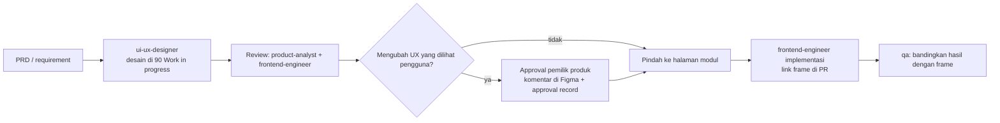

# Panduan Figma: Asset Tracker

Berlaku mulai 2026-11-16 ([APR-0001](../approvals/APR-0001-figma-sebagai-sumber-desain.md)). Figma adalah sumber kebenaran **tampilan dan tata letak**. Kode tetap menjadi sumber kebenaran **perilaku**: state, permission, aksesibilitas. Aturan komponen dan UX tetap mengikuti [09-ui-design-system.md](../09-ui-design-system.md).

## 1. Struktur File

Paket Starter (gratis) membatasi jumlah file dan halaman; cek batas saat ini di akun Figma. Karena itu semua desain web masuk ke **satu file** `Asset Tracker — Web`, dibagi per halaman Figma:

| Halaman Figma | Isi |
|---|---|
| `00 Cover` | Nama produk, versi, tautan ke repo dan dokumen ini |
| `01 Foundations` | Warna, tipografi, jarak, sudut, bayangan dari `figma-tokens.json` |
| `02 Components` | Komponen dari `frontend/src/components/ui/` (§3) |
| `03 Patterns` | Pola halaman: daftar, detail, form/dialog, empty/error/loading, layout (sidebar + topbar), mobile 375px |
| `10 Aset` | `/aset`, `/aset/:id`, form tambah/ubah, Multiple Edit, impor |
| `11 Transaksi` | `/transaksi`, dialog catat transaksi per jenis |
| `12 Dashboard` | `/` (dashboard + widget), dashboard kustom |
| `13 Laporan` | `/laporan`, template, Report Designer |
| `14 Master Data` | `/master/kategori` (+ atribut kategori), `/master/lokasi` |
| `15 Pengguna & Akses` | Pengguna, undangan, role, approval |
| `16 Organisasi & Pengaturan` | Organisasi, pengaturan, modul barcode, ubah password |
| `17 Auth` | Login, daftar, undangan, verifikasi email, pilih/buat organisasi |
| `18 Platform` | Halaman `/platform/*` |
| `90 Work in progress` | Eksplorasi; belum disetujui |
| `99 Archive` | Desain lama yang sudah diganti |

Aplikasi mobile (Expo) masuk file kedua, `Asset Tracker — Mobile`, bila diperlukan.

## 2. Impor Token
1. Pasang plugin **Tokens Studio for Figma** (versi gratis).
2. Impor [figma-tokens.json](figma-tokens.json) (format W3C DTCG).
3. Buat Styles/Variables dari token: `color.*`, `semantic.*`, `font.*`, `radius.*`, `shadow.*`.
4. Pakai token `semantic.*` di komponen (mis. `semantic.action.primary.default`), bukan warna mentah, agar perubahan brand cukup di satu tempat.

Font: Lexend (500/600/700) untuk judul, Source Sans 3 (400–700) untuk isi. Keduanya gratis di Google Fonts.

## 3. Komponen Wajib di `02 Components`
Nama komponen dan variannya **sama dengan nama di kode**, supaya frontend-engineer langsung tahu padanannya:

| Figma | Kode | Varian / properti |
|---|---|---|
| `Button` | `Button.tsx` | `variant`: primary, secondary, danger, ghost · `size`: md (40px), sm (32px) · `state`: default, hover, active, disabled, loading |
| `IconButton` | `IconButton.tsx` | dengan tooltip `label` |
| `Card`, `PageHeader` | `Card.tsx` | title, description, badges, actions |
| `Field` + `Input` / `Select` / `Textarea` | `Field.tsx` | default, focus, error, disabled, wajib (`*`), hint |
| `DataTable`, `Pagination` | `Table.tsx` | header bisa diurutkan, baris terpilih, kolom `hideOnMobile` |
| `Filters` | `Filters.tsx` | search → filter lanjutan → chip aktif + Reset semua |
| `PillTabs`, `SegmentedControl` | `Tabs.tsx` | |
| `Modal`, `ConfirmDialog` | `Modal.tsx`, `ConfirmDialog.tsx` | batal kiri, aksi utama kanan |
| `Badge`, `StatusBadge` | `Badge.tsx`, `badgeTones.ts` | `tone`: green, amber, red, slate, blue; selalu **ikon + teks** |
| `Toast`, `Alert`, `EmptyState`, `Skeleton`, `ErrorState` | `Toaster.tsx`, `Feedback.tsx` | |
| `RowMenu`, `AddMenu`, `ColumnToggle` | file masing-masing | |

Ikon: Lucide (sama dengan kode, `lucide-react`). Pakai plugin Lucide atau impor SVG.

## 4. Sinkronisasi Desain dan Kode
- **Token berubah** → ui-ux-designer memperbarui `figma-tokens.json` **dan** `frontend/src/index.css` dalam satu PR; frontend-engineer mereview.
- **Komponen baru** → didesain di `02 Components` dengan nama yang akan dipakai di kode; ditambahkan ke tabel komponen di `09`.
- **Penyimpangan ditemukan** (kode ≠ Figma) → catat sebagai issue; yang benar adalah versi yang sudah disetujui terakhir, bukan yang paling baru diubah.

## 5. Alur Kerja (Tahap 4 pipeline)

- Setiap PR yang mengubah UI mencantumkan **link frame Figma**.
- Status frame ditandai di nama section: `[Draft]`, `[Review]`, `[Approved]`, `[Implemented]`.
- Desain di `90 Work in progress` tidak boleh dikodekan.

## 6. Urutan Pengerjaan Awal
1. `01 Foundations` dari token (T-14).
2. `02 Components` untuk semua komponen §3 (T-14).
3. `03 Patterns` dan layout aplikasi (T-15).
4. Redesain/penggambaran ulang halaman yang paling sering dipakai: Data Aset, Detail Aset, Transaksi, Dashboard (T-15).
5. Dashboard kustom dan Report Designer (sedang dikerjakan di kode): gambar ulang dari implementasi lalu review UX sebelum dirilis (T-16).
6. Halaman lain digambar saat halaman itu akan diubah berikutnya, tidak sekaligus.
