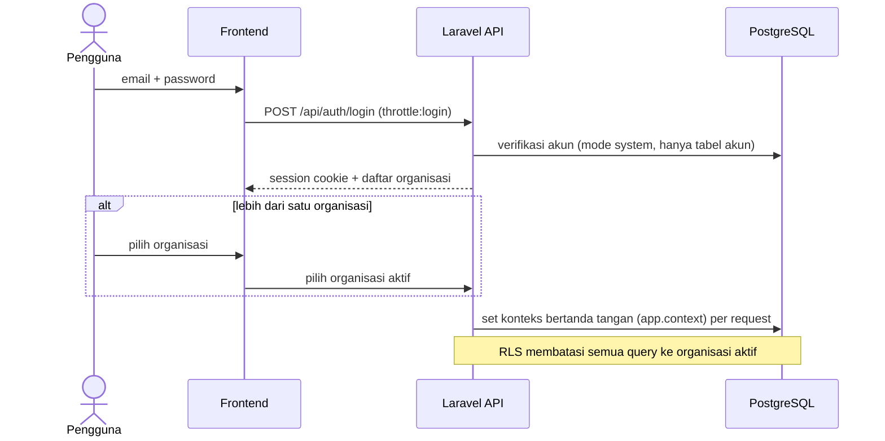
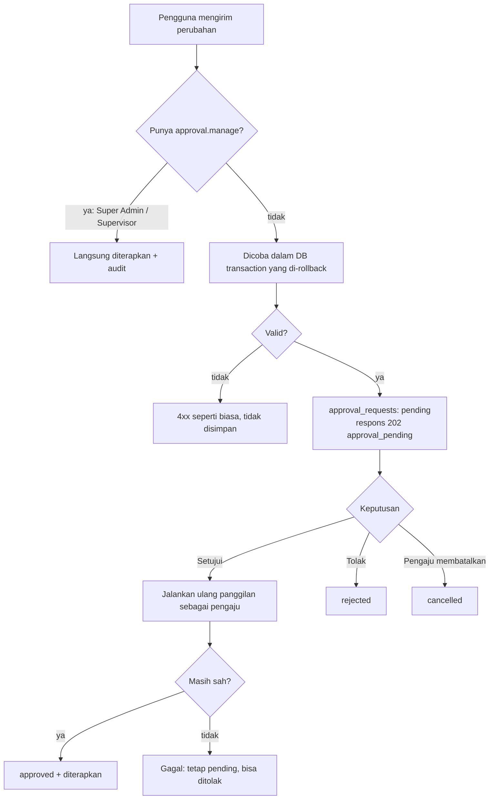
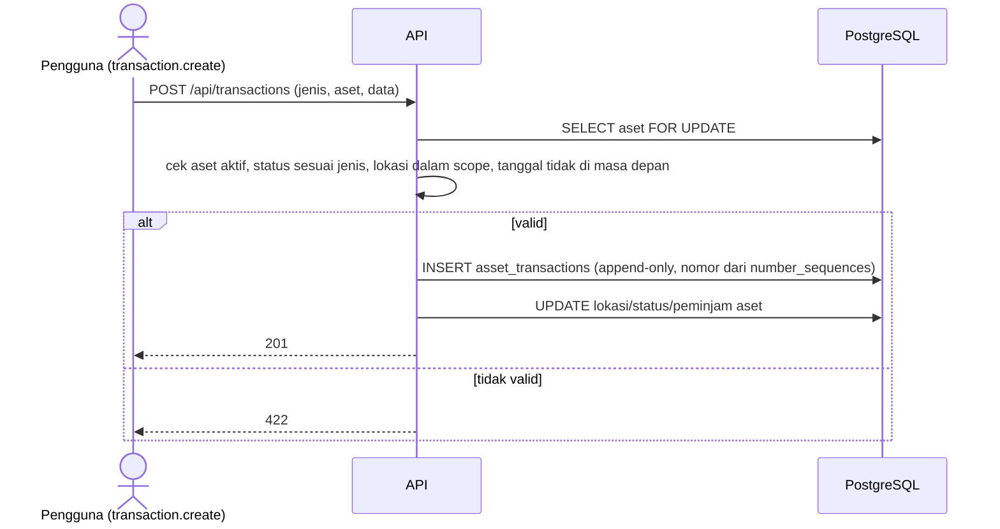
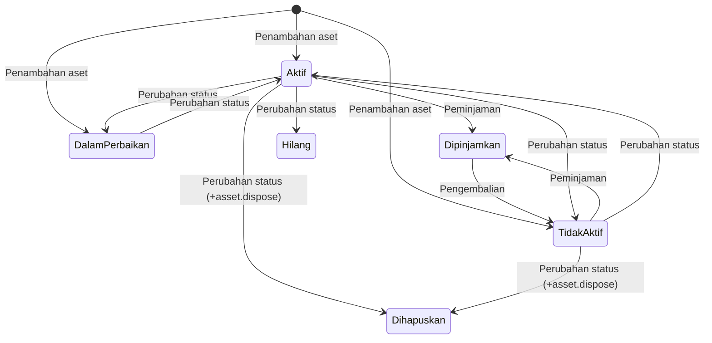
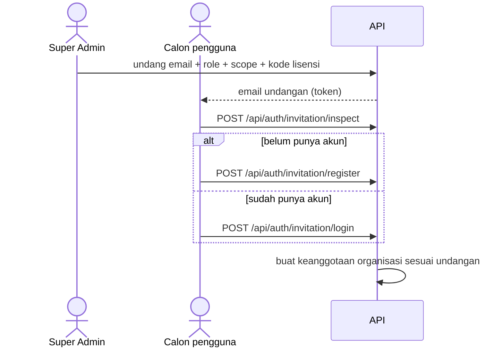

# System Flow: Asset Tracker (alur yang berlaku)

| Field | Value |
|---|---|
| Tahap | 3 — System Flow Design |
| Versi | 0.1 |
| Penyusun | system-architect |
| Sumber | `docs/08` §2–§9, route `backend/routes/`, per `c9d3256` |
| Status | Draft |

Dokumen ini **menggantikan** `06-lifecycle-and-workflow.md` untuk alur yang berlaku. Dokumen 06 menggambarkan workflow approval bertingkat dan state draft/submit/post yang sudah dihapus (`docs/08 §1`).

## 1. Aktor
| Aktor | Jenis | Keterangan |
|---|---|---|
| Super Admin | Manusia | Semua permission tenant, termasuk mengundang pengguna dan mengubah profil organisasi |
| Supervisor | Manusia | Memegang `approval.manage`; perubahannya langsung berlaku |
| Pengguna (Admin / role kustom) | Manusia | Perubahan aset dan master data menjadi pengajuan approval |
| Petugas mobile | Manusia | Memindai barcode, hanya baca |
| Operator platform | Manusia | Lisensi dan organisasi; tanpa akses data bisnis tenant |
| PostgreSQL (RLS, trigger) | Sistem | Menegakkan isolasi tenant, append-only, dan nomor aset |

## 2. Login dan Pemilihan Organisasi

## 3. Perubahan Aset / Master Data dengan Approval

Gambar aset tidak dicoba di tahap D (penyimpanan file tidak bisa di-rollback); validasinya baru saat disetujui.

## 4. Transaksi Aset (tanpa approval)

Kesalahan diperbaiki dengan transaksi baru. Transaksi tidak dapat diubah atau dihapus.

## 5. Status Aset

Pemindahan lokasi tidak mengubah status dan ditolak untuk aset Dipinjamkan, Hilang, atau Dihapuskan. *Nonaktif* (arsip) terpisah dari status dan ditolak untuk aset yang sedang dipinjam. Diagram ini menyederhanakan perubahan status; aturan lengkapnya ada di `docs/08 §4`.

## 6. Undangan Pengguna

## 7. Alur yang Belum Terdokumentasi (dilengkapi saat fitur di-commit)
- Dashboard kustom: membuat dashboard dari template, menambah/mengatur widget.
- Report Designer: mendesain laporan, binding data, validasi desain, pratinjau (`report.preview`).
- Aplikasi mobile: login mobile (`/api/auth/mobile/login`), pemindaian dan pencarian berdasarkan nomor seri.

## 8. Keterlacakan
| Area | Requirement (`docs/08`) | Alur |
|---|---|---|
| Login & organisasi | A1 (`docs/01`) | §2 |
| Approval | §8 | §3 |
| Transaksi | §4 | §4, §5 |
| Undangan | §9 | §6 |
