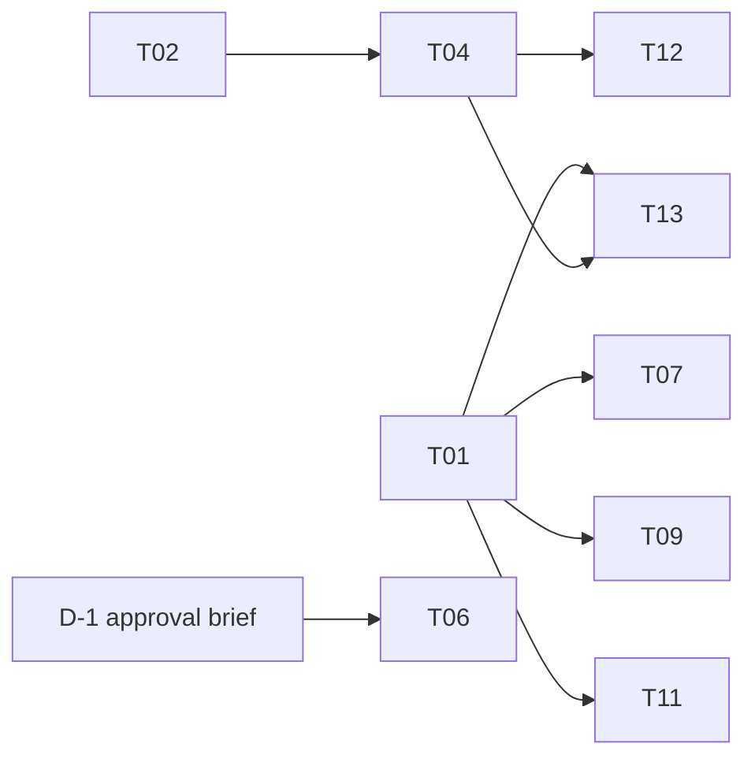

# Sprint Backlog: Asset Tracker — Sprint 1 (Stabilisasi)

| Field | Value |
|---|---|
| Tahap | 8 — Implementation Planning |
| Penyusun | project-manager |
| Tujuan sprint | Mengamankan pekerjaan yang ada, memasang verifikasi otomatis, dan menyelaraskan dokumen dengan kode sebelum fitur baru P1–P6 |
| Mode biaya | Langganan Claude yang sudah ada; tanpa biaya tambahan. Budget = batas token per ukuran task (`D:\Workspace\config\orchestrator.yaml`) |
| Status | **Approved** ([APR-0004](../approvals/APR-0004-sprint-1-stabilisasi.md)) · In progress |

## 1. Task

| ID | Judul | Agent pemilik | Skill | Bergantung | Lock scope | Ukuran | Tier | Verifier | Status |
|---|---|---|---|---|---|---|---|---|---|
| T-01 | Verifikasi dan commit Dashboard kustom + Report Designer (WIP), lalu push | backend-engineer + frontend-engineer | verification-before-completion, code-review | — | file WIP di `git status` | L | tier2 | qa, security, auditor | in_review |
| T-02 | Perbaiki error typecheck `usersPage.test.tsx` | frontend-engineer | — | — | `frontend/src/test/usersPage.test.tsx` | S | tier3 | qa (CI) | in_review |
| T-03 | Netralkan instruksi instalasi remote di `backend/AGENTS.md` dan `CLAUDE.md` (SEC-10) | security-engineer | ai-agent-security | — | `backend/AGENTS.md`, `backend/CLAUDE.md` | S | tier2 | auditor | in_review |
| T-04 | CI GitHub Actions: lint, typecheck, Vitest, PHPUnit (PostgreSQL service + 5 role), Gitleaks, Trivy | devops-engineer | ci-cd-pipeline | T-02 | `.github/**` | M | tier2 | security, auditor | in_review |
| T-05 | `docs/deployment-checklist.md`: APP_DEBUG, secure cookie, kunci konteks DB, role PostgreSQL, backup | devops-engineer | deployment-automation | — | `docs/deployment-checklist.md` | S | tier2 | security | todo |
| T-06 | PRD mutakhir: gabungkan `01` + `08`, beri ID requirement dan acceptance criteria | product-analyst | brd-prd-creation, acceptance-criteria | D-1 | `docs/01-requirements.md`, `docs/08-*` | M | tier2 | system-architect, qa | todo |
| T-07 | Tandai `06-lifecycle-and-workflow.md` usang; lengkapi `factory/03` §7 (Dashboard, Report Designer, mobile) | system-architect | system-flow-design | T-01 | `docs/06-*`, `docs/factory/03-*` | S | tier2 | product-analyst | todo |
| T-08 | ADR retroaktif: RLS + konteks bertanda tangan, penyederhanaan 08, approval via replay, penghapusan cabang/kondisi, modul + `MODULES_DISABLED` | system-architect | architecture-decision-records | — | `docs/adr/**` | M | tier1 | auditor | todo |
| T-09 | Regenerasi ERD dari migrasi aktual; perbarui `04-data-ownership-matrix` | database-engineer | erd-design | T-01 | `docs/03-*`, `docs/04-*` | M | tier2 | system-architect, security | todo |
| T-10 | Pindahkan atau hapus `backend/add_reference_column.sql` (cek apakah sudah tercakup migrasi `2026_10_28_072957`) | database-engineer | database-migration | — | `backend/add_reference_column.sql` | S | tier2 | auditor | todo |
| T-11 | Verifikasi ulang SEC-01..04 dan SEC-07 terhadap kode terkini; perbarui status audit | independent-auditor | security-audit, evidence-based-reporting | T-01 | `docs/asset-tracker-audit.md`, `docs/factory/07-*` | M | tier2 | security-engineer | todo |
| T-12 | Upgrade `zod` ke ≥ 4.6.6 (SEC-08) | frontend-engineer | dependency-security-audit | T-04 | `frontend/package.json`, `frontend/package-lock.json` | S | tier3 | security (Trivy di CI) | todo |
| T-17 | Perbaiki 2 test lama yang gagal (collation di `RegistrationTest`, pengundang Super Admin di `InvitationTest`) + assertion eksplisit di `DatabasePrivilegesTest` (L-3 ternyata sudah tercakup) | qa-engineer | regression-testing | — | `backend/tests/Feature/Auth/RegistrationTest.php`, `.../Tenant/InvitationTest.php`, `.../Security/DatabasePrivilegesTest.php`, `.../Reports/ReportDesignerBindingTest.php` | S | tier2 | backend-engineer, security | in_review |
| T-18 | Putuskan L-1/L-2 (efek tulis GET dashboard, kategori di navigasi) | backend-engineer | service-architecture | T-01 | `app/Domain/Dashboards/**`, `app/Http/Controllers/Tenant/Dashboards/**` | S | tier2 | security | todo |
| T-14 | Buat file Figma `Asset Tracker — Web`: impor `figma-tokens.json`, halaman `01 Foundations` dan `02 Components` | ui-ux-designer (manusia + AI) | design-system | — | Figma: `01`, `02`; `docs/design/**` | M | tier2 | frontend-engineer (cocokkan dengan kode) | todo |
| T-15 | Figma `03 Patterns` + layout; gambar Data Aset, Detail Aset, Transaksi, Dashboard sesuai implementasi | ui-ux-designer | wireframing, information-architecture | T-14 | Figma: `03`, `10`–`12` | L | tier2 | product-analyst, qa | todo |
| T-16 | Figma Dashboard kustom + Report Designer dari implementasi; review UX dan accessibility sebelum rilis | ui-ux-designer | usability-review, accessibility-review | T-01, T-14 | Figma: `12`, `13` | M | tier2 | product-analyst, pemilik produk (approval UX) | todo |
| T-13 | Playwright smoke: login → tambah aset → pemindahan → dashboard | qa-engineer | e2e-testing | T-01, T-04 | `frontend/e2e/**` | M | tier2 | auditor | todo |

Status: `todo`, `queued`, `in_progress`, `in_review`, `done`, `needs_human`, `blocked`.

## 2. Acceptance Criteria (ringkas)
- **T-01:** `php artisan test` dan `npm test` hijau; security-engineer mengonfirmasi query Report Designer/Dashboard menghormati RLS dan data scope; migrasi `000600` memiliki GRANT yang benar; tidak ada lagi perubahan yang belum di-commit; `origin/main` sama dengan `main`.
- **T-02:** `npm run typecheck` exit 0.
- **T-03:** tidak ada perintah unduh-dan-jalankan di file instruksi agent; panduan Laravel yang aman tetap ada.
- **T-04:** workflow berjalan pada PR dan push ke `main`; job PHPUnit memakai PostgreSQL dengan role `ate_owner`/`ate_app`/`ate_session`/`ate_queue`/`ate_ctx`; Gitleaks dan Trivy memblokir temuan Critical/High.
- **T-08:** setiap ADR memiliki Context, Options, Decision, Consequences, dengan status Accepted dan tanggal keputusan asli.
- **T-11:** setiap temuan berstatus Selesai atau Terbuka dengan bukti `path:baris` atau nama test.
- **T-04 (tambahan):** PHPUnit di CI dijalankan dengan `memory_limit` ≥ 512M (lihat `reviews/T-01-verification.md`).
- **T-17:** suite backend 449/449 hijau tanpa test risky; `InvitationTest` memakai pengundang Super Admin ber-scope lokasi dan tetap mengharapkan `SCOPE_ESCALATION`.
- **T-14:** semua token dan komponen §3 `figma-guide.md` ada di Figma dengan nama dan varian yang sama dengan kode; frontend-engineer menandai tidak ada selisih warna/ukuran.
- **T-15/T-16:** frame berstatus `[Approved]`; T-16 memiliki catatan accessibility review (kontras AA, keyboard, status ikon + teks).
- **T-13:** smoke test lulus lokal dan di CI dengan data `DemoSeeder`.

## 3. Graf Ketergantungan

## 4. Bisa Dikerjakan Paralel (lock scope tidak bertumpuk)
- Gelombang 1: T-01, T-02, T-03, T-05, T-08, T-10
- Gelombang 2: T-04, T-06, T-07, T-09, T-11
- Gelombang 3: T-12, T-13
- Jalur desain (paralel dengan semua gelombang; tidak menyentuh repo kecuali `docs/design/`): T-14 → T-15, T-16 (setelah T-01)

## 5. Sprint 2 dan Seterusnya (sudah disetujui, belum dijadwalkan rinci)

| ID | Judul | Agent pemilik | Dasar | Ukuran | Tier | Verifier |
|---|---|---|---|---|---|---|
| T-20 | Hapus API + tabel Tenant Definition sesuai syarat APR-0003 | database-engineer + backend-engineer | APR-0003, G-15 | M | tier2 | security, auditor |
| T-21 | Lupa password mandiri (SEC-06), respons seragam (SEC-02) | backend-engineer + frontend-engineer | APR-0005, G-08 | M | tier2 | security, qa, auditor |
| T-22 | Limiter per akun (SEC-05) | backend-engineer | APR-0005, G-09 | S | tier2 | security |

T-21 dan T-22 adalah **blocker rilis produksi**.

## 6. Setelah Sprint 2
Lanjut ke roadmap audit (`asset-tracker-audit.md §7`), dimulai dari P1 (onboarding tanpa organisasi, lupa password: SEC-06). Setiap fase melewati tahap 1–8 secara ringkas sebelum implementasi.
