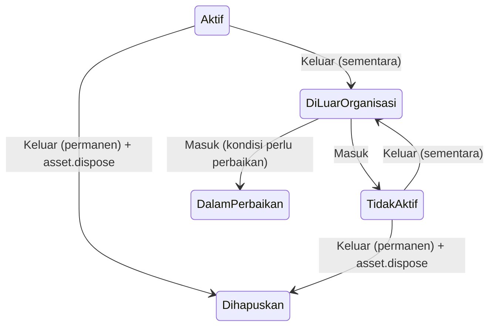
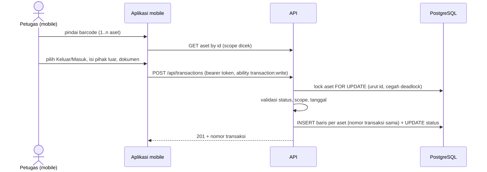

# F-02 · F-03 · F-04: Transaksi Keluar & Masuk, Mobile, dan Laporannya

| Field | Value |
|---|---|
| Tahap | 2–7 (ringkas): requirement, alur, data, security |
| Versi | 0.1 |
| Penyusun | product-analyst, system-architect, database-engineer, security-engineer |
| Status | **Approved** ([APR-0006](../../approvals/APR-0006-transaksi-keluar-masuk.md)) |
| Dasar | Jawaban pemilik produk 2026-11-17: aset keluar/masuk **organisasi**; mobile **scan lalu catat**; laporan lewat **Report Designer**; dikerjakan agent factory |

Bagian bertanda ⚑ adalah usulan yang perlu dikonfirmasi.

## 1. Tujuan
Mencatat aset yang **keluar dari organisasi** (dikirim, dijual, dihibahkan, diserahkan ke pihak luar) dan aset yang **masuk ke organisasi** (kembali dari pihak luar, diterima dari luar), termasuk dari aplikasi mobile dengan memindai barcode, lalu melaporkannya dengan format yang dibuat pengguna.

## 2. Definisi
| Istilah | Arti |
|---|---|
| **Transaksi keluar** | Satu atau beberapa aset meninggalkan organisasi menuju **pihak luar** |
| **Transaksi masuk** | Satu atau beberapa aset **yang sebelumnya keluar sementara** kembali masuk ke organisasi |
| **Pihak luar** | Penerima/pengirim di luar organisasi: nama wajib, instansi dan kontak opsional |
| **Dokumen** | Nomor dokumen pendukung opsional (surat jalan, BAST, faktur) |

Aset baru yang masuk dari luar (pembelian, hibah diterima) **tetap** lewat *Penambahan aset*, supaya hanya ada satu jalur pendaftaran aset (`docs/08 §1`) ⚑.

## 3. Aturan Bisnis

### 3.1 Transaksi keluar
| Field | Wajib | Keterangan |
|---|---|---|
| Aset | ya | satu atau beberapa (multi-aset, satu nomor transaksi seperti yang sudah didukung migrasi `2026_10_31_000100`) |
| Sifat | ya | **Sementara** (akan kembali) atau **Permanen** (tidak kembali) |
| Alasan | ya | Sementara: *dipinjamkan ke pihak luar, perbaikan di vendor, dikirim ke proyek/klien, lainnya*. Permanen: *dijual, dihibahkan, dikembalikan ke pemilik/vendor, lainnya* ⚑ |
| Pihak luar | ya | nama; instansi dan kontak opsional |
| Tanggal keluar | ya | boleh mundur, tidak boleh di masa depan (sama dengan transaksi lain) |
| Rencana tanggal kembali | ya bila *Sementara* | — |
| Nomor dokumen | tidak | surat jalan / BAST / faktur |
| Keterangan | tidak | — |

Syarat: aset aktif (tidak dinonaktifkan), dalam scope pengguna, dan berstatus **Aktif** atau **Tidak Aktif**. Aset yang Dipinjamkan, Dalam Perbaikan, Hilang, Dihapuskan, atau sudah di luar organisasi ditolak.

Efek:
- **Sementara** → status baru **Di Luar Organisasi** ⚑ (status baru, lihat D-7); lokasi tetap tercatat sebagai lokasi asal.
- **Permanen** → status **Dihapuskan** (butuh juga `asset.dispose`, sama dengan aturan yang ada).

### 3.2 Transaksi masuk
| Field | Wajib | Keterangan |
|---|---|---|
| Aset | ya | hanya aset berstatus **Di Luar Organisasi** |
| Tanggal masuk | ya | tidak boleh sebelum tanggal keluar |
| Kondisi saat kembali | ya | status hasil: **Tidak Aktif** (default) atau **Dalam Perbaikan** |
| Lokasi masuk | tidak | default lokasi asal; boleh lokasi lain dalam scope |
| Diterima dari | tidak | default pihak luar pada transaksi keluar |
| Nomor dokumen, keterangan | tidak | — |

Transaksi masuk **ditautkan** ke transaksi keluar yang membukanya (`outgoing_transaction_id`), sehingga laporan dapat menampilkan "keluar → masuk" dan durasinya.

### 3.3 Aturan umum (tetap)
- Transaksi langsung berlaku, append-only, tidak dapat diubah/dihapus; kesalahan diperbaiki dengan transaksi baru (`docs/08 §1`).
- Tidak memerlukan approval (sejak 2026-11-09) ⚑.
- "Perlu perhatian" di dashboard: **keluar sementara lewat rencana tanggal kembali**.

## 4. Alur

## 5. Perubahan Data (database-engineer)
| Perubahan | Keterangan |
|---|---|
| `TransactionType`: `outgoing`, `incoming` | Nomor transaksi: format `{TYPE}` yang ada, mis. `OUT-2026-000001`, `IN-2026-000001` ⚑ |
| Status aset baru `off_site` (*Di Luar Organisasi*) | Update CHECK constraint status aset dan `AssetStatus` |
| Kolom `asset_transactions` baru (nullable) | `direction_nature` (`temporary`/`permanent`), `reason_code`, `counterparty_name`, `counterparty_org`, `counterparty_contact`, `document_number`, `expected_return_date`, `outgoing_transaction_id` (composite FK ke transaksi keluar dalam organisasi yang sama) |
| CHECK per jenis | `outgoing` wajib `counterparty_name`, `direction_nature`, `reason_code`; `temporary` wajib `expected_return_date`; `incoming` wajib `outgoing_transaction_id` |
| Index | `(organization_id, type, transaction_date)`; partial index aset `off_site` untuk widget "lewat batas" |

Mengikuti aturan migrasi `001400`: GRANT eksplisit; tabel tetap RLS. Tabel append-only, jadi hanya kolom baru, bukan update baris lama.

## 6. Mobile (F-03)
- Aplikasi saat ini **hanya baca** dan memakai `MobileAccessToken` dengan `abilities`.
- Tambah ability **`transaction:write`**, diberikan saat login mobile hanya bila pengguna memiliki `transaction.create` dan permission jenisnya.
- Layar baru: **Keluar** dan **Masuk**: pindai 1..n aset → formulir ringkas (§3) → konfirmasi → nomor transaksi.
- Pencarian manual tetap lewat No Seri (No Aset tidak ditampilkan, `docs/08 §3`).
- **Tanpa mode offline** di versi ini ⚑: transaksi hanya terkirim saat online, mencegah konflik status.
- Kamera dan pemindai yang sudah ada dipakai ulang.

## 7. Laporan (F-04)
Mesin laporan tidak berubah. Report Designer sudah mendukung sumber `asset_transaction` dan mengikuti data scope (`ReportDataResolver::transactionQuery`).

- `FieldCatalog` sumber transaksi ditambah: jenis, sifat, alasan, pihak luar (nama/instansi/kontak), nomor dokumen, rencana kembali, tanggal masuk terkait, durasi di luar, status kembali (sudah/belum/terlambat).
- Filter laporan: jenis (`outgoing`/`incoming`), sifat, alasan, pihak luar, rentang tanggal, "belum kembali".
- **Template contoh (sistem)** yang dapat diduplikasi dan diubah pengguna: *Laporan Transaksi Keluar*, *Laporan Transaksi Masuk*, *Aset Belum Kembali*, *Bukti Serah Terima (BAST) per transaksi* ⚑.
- Pengguna membuat dan mengubah format sendiri dengan permission `report.create`/`report.update` yang sudah ada.

## 8. Security (security-engineer)
| Aspek | Ketentuan |
|---|---|
| Permission baru | `asset.outgoing`, `asset.incoming` (+ `transaction.create`); permanen juga `asset.dispose` |
| Scope | Aset harus dalam data scope; lokasi masuk harus dalam scope (sama dengan transfer) |
| Mobile | Ability `transaction:write` terpisah dari baca; token berumur pendek; dicabut saat permission dicabut |
| Data pribadi | Kontak pihak luar = data pribadi: tampil hanya untuk `transaction.view`; field laporan "kontak" memerlukan permission khusus (`required_permission` di `FieldCatalog`) ⚑ |
| Konkurensi | Lock aset berurutan `id` untuk transaksi multi-aset; test paralel untuk dua transaksi pada aset yang sama |
| Test wajib | `RouteSecurityTest` otomatis untuk route baru; test lintas tenant, lintas scope, mobile tanpa ability → 403 |

## 9. Keputusan yang Memerlukan Persetujuan
| ID | Keputusan | Usulan |
|---|---|---|
| D-6 | Aset **baru** dari luar tetap lewat *Penambahan aset*, bukan transaksi masuk | Ya |
| D-7 | Status aset baru **Di Luar Organisasi** untuk keluar sementara | Ya (alternatif: memakai *Dipinjamkan*, tapi itu mencampur pinjam internal dan pihak luar) |
| D-8 | Daftar alasan keluar (§3.1) dan format nomor `OUT-`/`IN-` | Sesuai tabel; daftar alasan dapat diperluas nanti |
| D-9 | Mobile tanpa mode offline di versi ini | Ya |
| D-10 | Kontak pihak luar diperlakukan sebagai data pribadi (permission khusus di laporan) | Ya |

## 10. Rencana Task (setelah disetujui)
| ID | Task | Agent | Bergantung |
|---|---|---|---|
| F-02a | Migrasi + `TransactionType` + status `off_site` + aturan service + test (termasuk konkurensi) | database-engineer, backend-engineer | approval | **in_review**: migrasi `2026_11_17_000000`, `OutgoingIncomingTransactionTest` (9 test) |
| F-02b | Frontend: formulir Keluar/Masuk (multi-aset), daftar transaksi + filter, detail aset | frontend-engineer | F-02a, desain Figma (T-15) |
| F-02c | Dashboard: widget "Keluar sementara lewat batas" dan ringkasan keluar/masuk | frontend + backend | F-01, F-02a |
| F-03 | Mobile: ability `transaction:write`, layar Keluar/Masuk via scan | frontend-engineer (mobile), security-engineer | F-02a |
| F-04 | `FieldCatalog` + filter + 4 template contoh | backend-engineer | F-02a |
| F-QA | E2E Playwright: keluar sementara → masuk → laporan | qa-engineer | F-02b, F-04 |
