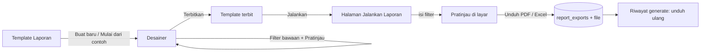

# F-05: Menjalankan Laporan dari Template (filter, pratinjau, PDF/Excel)

| Field | Value |
|---|---|
| Tahap | 2–7 (ringkas): requirement, alur, data, security |
| Versi | 0.1 |
| Penyusun | product-analyst, system-architect, security-engineer |
| Status | **Approved**: keputusan D-12..D-17 dan mockup disetujui pemilik produk 2026-11-17 ("Setuju") |
| Dasar | Pemilik produk 2026-11-17: "user bisa membuat laporan sendiri, formatnya dari user sendiri yang buat". Hasil cek 2026-11-17: desain dan terbit sudah ada, tetapi laporan belum dapat dijalankan, difilter, atau diunduh |

Bagian bertanda ⚑ disetujui bersama keputusan §8.

## 1. Masalah
Report Designer sudah dapat **menyusun** format (tabel, teks dinamis, header/footer, tanda tangan, QR) dan **menerbitkan** template. Dua hal yang dibutuhkan pengguna belum ada:

1. **Menjalankan laporan.** Tidak ada tombol pratinjau atau generate di UI, dan tidak ada endpoint yang menghasilkan PDF/Excel dari template; backend baru menyediakan pratinjau data (JSON). Padahal halaman Template Laporan menjanjikan "terbitkan, lalu generate PDF/Excel".
2. **Memfilter isi.** Template dengan sumber *Riwayat Transaksi* berisi semua jenis transaksi. Pengguna belum dapat membatasinya ke transaksi keluar, ke aset yang belum kembali, atau ke rentang tanggal, padahal backend sudah mendukung filter tersebut.

Yang sudah tersedia dan dipakai ulang:
- Tabel `report_exports` (riwayat generate, memakai versi template yang tetap) dan `report_export_files`.
- Izin `report.generate`, `report.download`, `report.history.view`, dan `report.preview`.
- `ReportPreviewResolver`, yang menghasilkan elemen desain terisi data beserta posisinya.
- Filter per sumber data (`ReportDataResolver::filterRules`) dan filter bawaan template (`design.filters`).
- TCPDF dan PhpSpreadsheet, keduanya sudah terpasang dan gratis.

## 2. Pengguna dan alur
| Peran | Yang dilakukan |
|---|---|
| Perancang laporan (`report.create`/`report.update`) | Menyusun format, mengatur **filter bawaan**, mencoba pratinjau, menerbitkan |
| Pengguna laporan (`report.generate`) | Memilih template terbit, mengisi filter, melihat pratinjau, mengunduh PDF/Excel |
| Pemantau (`report.history.view`) | Melihat riwayat generate organisasi |

## 3. Aturan

### 3.1 Filter
- **Filter bawaan** disimpan di template (`design.filters`) dan diatur di desainer, misalnya Jenis = Keluar atau Belum kembali = ya. Template contoh F-04 sudah membawa filter bawaan.
- Di halaman **Jalankan**, filter bawaan tampil terisi dan **boleh diubah** pengguna (perilaku backend saat ini) ⚑. Filter bawaan yang perlu dikunci (D-16) menyusul bila diminta.
- Daftar filter mengikuti sumber data:

| Sumber | Filter |
|---|---|
| Riwayat Transaksi | rentang tanggal, jenis transaksi, sifat keluar, alasan, belum kembali, pencarian (nomor, aset, pihak luar, dokumen) |
| Aset | pencarian, kategori, lokasi, status, nonaktif, rentang tanggal perolehan, rentang harga, data kosong |

- Data selalu dibatasi **data scope** pengguna yang menjalankan, bukan scope perancang.

### 3.2 Pratinjau
- Pratinjau memakai template terbit (versi aktif). Di desainer, pratinjau memakai versi draft.
- Halaman digambar di layar sesuai desain (ukuran kertas, posisi elemen). Bila baris melebihi batas, tampil peringatan "Menampilkan N dari M baris; persempit filter".
- Field yang dibatasi izin (mis. kontak pihak luar tanpa `transaction.contact.view`) tampil sebagai "—" dan diberi catatan (`restricted_fields`).

### 3.3 Unduh
| Format | Isi |
|---|---|
| **PDF** | Tata letak persis seperti desain: header, footer, nomor halaman, tanda tangan, QR. Dirender di server dengan TCPDF ⚑ (D-12) |
| **Excel** | **Data**, bukan tata letak: satu sheet berisi kolom-kolom tabel di template (atau semua field yang dipakai bila tidak ada tabel), ditambah baris judul berisi nama template, filter, waktu, dan pembuat ⚑ (D-15) |

- Setiap unduhan dicatat di `report_exports` dengan nomor `RPT-2026-000001`, format, salinan filter, jumlah baris, versi template, dan pembuat, lalu masuk audit trail.
- Generate berjalan **langsung (sinkron)** dengan batas baris per laporan ⚑ (D-13). Antrian dan latar belakang menyusul bila data besar.
- File disimpan **30 hari** lalu kedaluwarsa. Riwayatnya tetap ada, dan laporan dapat dijalankan ulang ⚑ (D-14).

### 3.4 Riwayat
- Daftar riwayat di halaman Jalankan dan di detail template: nomor, format, ringkasan filter, jumlah baris, pembuat, waktu, dan tombol **Unduh** (atau "Kedaluwarsa").
- Pengguna dengan `report.history.view` melihat riwayat seluruh organisasi; yang lain hanya riwayatnya sendiri ⚑.

### 3.5 Mulai dari contoh
- Di Template Laporan, tombol **Mulai dari contoh** membuka pilihan 4 contoh F-04: Transaksi Keluar, Transaksi Masuk, Aset Belum Kembali, dan BAST. Contoh yang dipilih disalin menjadi template draft milik organisasi yang bebas diubah (`POST /report-templates/from-sample`, sudah ada).

## 4. API
| Endpoint | Izin | Keterangan |
|---|---|---|
| `POST /report-templates/{id}/preview` | `report.preview` (draft) / `report.generate` (versi aktif) | sudah ada; untuk pengguna laporan hanya versi aktif |
| `GET /report-templates/{id}/filters` | `report.generate` | definisi filter sumber + filter bawaan + pilihan (jenis, alasan, kategori, lokasi) |
| `POST /report-templates/{id}/exports` | `report.generate` | `{format: pdf\|xlsx, filters}` → 201 + baris `report_exports` + tautan unduh |
| `GET /report-exports` | `report.history.view` atau milik sendiri | riwayat, filter per template |
| `GET /report-exports/{id}/download` | `report.download` | file; 410 bila kedaluwarsa |
| `GET /report-templates/samples` | `report.view` | sudah ada |

## 5. Data
Tidak ada tabel baru. Yang dipakai:
- `report_exports`: status, nomor, salinan filter, jumlah baris, ukuran, dan `expires_at`.
- `report_export_files`: path di disk privat.

Perlu pembersihan berkala untuk file kedaluwarsa (`schedule`), yang menandai status `expired` lalu menghapus file-nya.

## 6. Security
| Aspek | Ketentuan |
|---|---|
| Data scope | Generate dan pratinjau memakai scope pengguna yang menjalankan; test lintas scope dan lintas tenant wajib |
| Data pribadi | Field berizin khusus tetap disaring di PDF/Excel, bukan hanya di layar |
| File | Disimpan di disk privat; hanya diunduh lewat endpoint berizin; nama file tidak dapat ditebak; RLS pada kedua tabel (sudah) |
| Injection | Isi sel Excel yang diawali `=`, `+`, `-`, `@` diawali apostrof (formula injection) |
| Batas | Batas baris dan elemen per laporan; throttle generate per pengguna |
| Audit | `report.exported`, `report.downloaded` |

## 7. UI (mockup sebelum kode, APR-0008)
Mockup: [F-05 Jalankan laporan](../../design/mockups/F-05-jalankan-laporan.html). Isinya:
- Template Laporan: tombol **Mulai dari contoh**, dan aksi **Jalankan** di baris template terbit.
- Desainer: panel **Filter bawaan** dan tombol **Pratinjau**.
- Halaman **Jalankan laporan**: filter, pratinjau halaman, unduh PDF/Excel, dan riwayat. Keadaan yang dicakup: isi, kosong, memuat, gagal, error validasi, terpotong (melebihi batas), dan 375px.

## 8. Keputusan yang Memerlukan Persetujuan
| ID | Keputusan | Disetujui |
|---|---|---|
| D-12 | PDF dirender di server (TCPDF, sudah terpasang) agar hasilnya sama untuk semua orang dan dapat disimpan di riwayat; bukan "Cetak → Simpan PDF" dari browser | Server |
| D-13 | Generate sinkron dengan batas **500 baris** per laporan (`ReportDataResolver::MAX_ROWS`); lebih dari itu diminta mempersempit filter | Ya; antrian menyusul |
| D-14 | File hasil disimpan 30 hari lalu kedaluwarsa; riwayat tetap | 30 hari |
| D-15 | Excel berisi data (kolom tabel), bukan salinan tata letak | Ya |
| D-16 | Filter bawaan dapat diubah saat dijalankan (tidak dikunci) | Ya, kunci menyusul bila diminta |
| D-17 | Riwayat seluruh organisasi hanya untuk `report.history.view`; lainnya riwayat sendiri | Ya |

## 9. Rencana Task (setelah disetujui)
| ID | Task | Agent | Bergantung | Status |
|---|---|---|---|---|
| F-05a | Backend: `filters` endpoint, `exports` (PDF TCPDF + Excel), download, riwayat, pembersihan kedaluwarsa, audit; test scope, izin, formula injection | backend-engineer, security-engineer | approval | in_review (`ReportExportTest`, `RouteSecurityTest`) |
| F-05b | Frontend: halaman Jalankan (filter, pratinjau halaman, unduh, riwayat), aksi Jalankan, Mulai dari contoh | frontend-engineer | F-05a, mockup disetujui | in_review (`reportRun.test.tsx`) |
| F-05c | Desainer: panel Filter bawaan + Pratinjau draft | frontend-engineer | F-05a | todo |
| F-05d | Desainer laporan dan pembuatan template hanya di web pada layar ≥ 768px; di ponsel template hanya dilihat dan dijalankan (D-34, [APR-0009](../../approvals/APR-0009-dashboard-utama-dan-manajemen-aset.md)) | frontend-engineer | — | in_review |
| F-05-QA | E2E: buat template transaksi → filter Keluar → unduh PDF/Excel → riwayat | qa-engineer | F-05b | todo |
