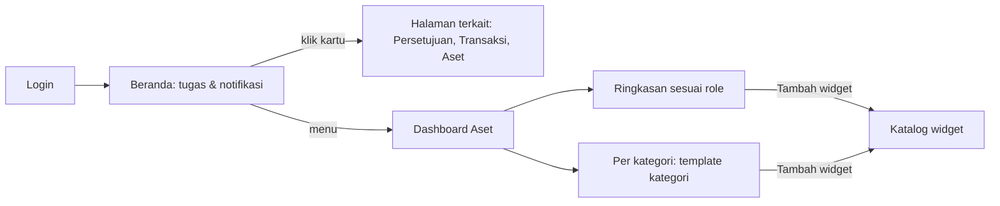

# F-06: Dashboard Utama per Role dan Dashboard Manajemen Aset

| Field | Value |
|---|---|
| Tahap | 2–7 (ringkas): requirement, alur, data, security |
| Versi | 0.1 |
| Penyusun | product-analyst, system-architect, ui-ux-designer |
| Status | **Approved** ([APR-0009](../../approvals/APR-0009-dashboard-utama-dan-manajemen-aset.md), 2026-11-18). Mockup: [F-06-dashboard.html](../../design/mockups/F-06-dashboard.html), **disetujui** 2026-11-18 |
| Dasar | Pemilik produk 2026-11-18: dashboard ada dua. (1) Dashboard utama berisi pekerjaan dan notifikasi pengguna, berbeda untuk Super Admin, Supervisor, dan Admin. (2) Dashboard tambahan untuk mengelola seluruh aset, berbeda per role, dengan banyak widget, termasuk dashboard per kategori yang punya template sendiri dan tombol **Tambah widget** |
| Hubungan | Memperluas [F-01](F-01-dashboard-builder-ui.md). Backend dashboard builder F-01 dipakai ulang untuk Dashboard Manajemen Aset. Frontend F-01 belum dibangun, jadi F-01b/F-01c diganti task F-06 |

## 1. Masalah
- Halaman `/` sekarang menampilkan satu dashboard angka tetap (`GET /api/dashboard`) yang sama untuk semua orang. Pengguna tidak melihat **apa yang harus ia kerjakan**: persetujuan yang menunggu, pengajuan yang ditolak, aset yang terlambat kembali.
- Backend sudah dapat menyimpan dashboard kustom, dashboard per kategori, template, dan katalog widget (F-01), tetapi baru ada 11 widget dan belum ada UI-nya.
- Template dashboard belum terkait ke role, jadi isi dashboard tidak dapat dibedakan per role.

## 2. Dua Dashboard

| | Dashboard Utama ("Beranda") | Dashboard Manajemen Aset |
|---|---|---|
| Pertanyaan yang dijawab | "Apa yang perlu saya kerjakan sekarang?" | "Bagaimana kondisi aset organisasi?" |
| Isi | Kartu tugas dan notifikasi milik pengguna | Widget analisis aset (KPI, grafik, daftar) |
| Berbeda per | Role **dan** pengguna (data selalu milik pengguna itu) | Role (template bawaan per role) dan kategori |
| Dapat diubah pengguna | Urutan dan sembunyikan kartu saja ⚑ (D-19) | Ya: **Tambah widget**, ubah ukuran, hapus (bila punya izin) |
| Lokasi | `/` (halaman pertama setelah login) | Menu **Dashboard Aset**: tab *Ringkasan* + satu tab per kategori yang punya dashboard |

## 3. Dashboard Utama (Beranda)

### 3.1 Isi per role ⚑ (D-18)
Kartu muncul berdasarkan **izin** yang dimiliki pengguna, bukan nama role. Dengan begitu role kustom buatan organisasi juga mendapat Beranda yang sesuai, dan isi untuk tiga role bawaan otomatis berbeda.

| Kartu | Isi | Muncul untuk | Super Admin | Supervisor | Admin |
|---|---|---|:-:|:-:|:-:|
| Menunggu keputusan saya | Jumlah dan 5 pengajuan tertua yang menunggu persetujuan, lama menunggu | `approval.manage` | ✓ | ✓ | |
| Pengajuan saya | Menunggu / disetujui / ditolak 30 hari terakhir; yang ditolak disorot dengan alasannya | semua | ✓ | ✓ | ✓ |
| Langkah transaksi menunggu saya | Transaksi yang sedang berada di langkah untuk role/pengguna ini (dari F-07) | role yang ditunjuk di alur | ✓ | ✓ | ✓ |
| Transaksi belum selesai | Transaksi yang saya mulai dan belum sampai langkah akhir | `transaction.create` | | ✓ | ✓ |
| Keluar sementara lewat batas | Aset yang belum kembali melewati rencana kembali | `transaction.view` | ✓ | ✓ | ✓ |
| Peminjaman lewat batas | Peminjaman internal yang melewati rencana kembali, peminjam dan berapa hari terlambat (ditambahkan 2026-11-20) | `transaction.view` | ✓ | ✓ | ✓ |
| Jatuh tempo 7 hari | Peminjaman / keluar sementara yang akan jatuh tempo | `transaction.view` | | ✓ | ✓ |
| Pengingat tanggal aset | Garansi, STNK, kalibrasi (atribut tanggal kategori) dalam 30 hari | `asset.view` | | ✓ | ✓ |
| Data aset belum lengkap | Aset tanpa lokasi, nomor seri, atau atribut wajib kategori | `asset.update` | | ✓ | ✓ |
| Lisensi & kursi | Sisa kursi, tanggal berakhir, peringatan 30 hari sebelum habis | `license.manage` | ✓ | | |
| Undangan menunggu | Undangan yang belum diterima, yang kedaluwarsa | `user.create` | ✓ | | |
| Pengguna & role | Pengguna baru 30 hari, pengguna nonaktif | `user.view` | ✓ | ✓ | |
| Laporan terakhir saya | 5 unduhan laporan terakhir, unduh ulang (F-05) | `report.generate` | ✓ | ✓ | ✓ |
| Aktivitas terbaru | Aktivitas organisasi (audit) 24 jam | `audit.view` | ✓ | ✓ | |

- Setiap kartu menampilkan angka, maksimal 5 baris, dan tombol menuju halaman lengkapnya dengan filter terisi.
- Data dihitung sesuai **data scope** pengguna: Admin berlingkup satu lokasi hanya melihat aset di lokasinya.
- Kartu tanpa isi tetap tampil ringkas ("Tidak ada yang menunggu") agar pengguna yakin tidak ada pekerjaan tertinggal ⚑.
- Badge jumlah di menu (Persetujuan, Langkah transaksi) memakai angka yang sama.

### 3.2 Perilaku
- Diperbarui saat halaman dibuka dan setiap 60 detik selama tab aktif. Tidak memakai websocket ⚑ (D-20).
- Pengguna dapat menyembunyikan dan mengurutkan kartu; pilihan disimpan per pengguna (`dashboard_preferences`). Pengaturan ini hanya di web pada layar lebar (D-34).

## 4. Dashboard Manajemen Aset

### 4.1 Template per role ⚑ (D-21)
Setiap organisasi mendapat tiga template bawaan yang dipetakan ke role bawaan. Super Admin dapat mengubah template dan pemetaannya (role kustom dapat dipetakan ke salah satu template, atau ke template buatan organisasi).

| Template | Fokus | Widget awal |
|---|---|---|
| **Super Admin**: Ringkasan Eksekutif | Nilai dan skala aset seluruh organisasi | Total aset, Nilai perolehan, Aset aktif/nonaktif, Nilai per kategori, Aset per lokasi, Tren penambahan aset 12 bulan, Kelengkapan data, Aset hilang/rusak |
| **Supervisor**: Pengawasan Operasional | Kepatuhan dan pergerakan aset | Keluar sementara lewat batas, Persetujuan menunggu, Transaksi per jenis 30 hari, Keluar vs masuk, Aset per status, Aset tanpa PIC/lokasi, Pengingat tanggal, Aset paling sering berpindah |
| **Admin**: Operasional Harian | Pekerjaan pencatatan sehari-hari | Aset dipinjam, Jatuh tempo 7 hari, Transaksi terbaru, Aset terbaru, Aset per kondisi, Data belum lengkap, Pengingat tanggal |

- Pengguna pertama kali membuka Dashboard Aset → mendapat salinan template role-nya. Perubahan pribadi tidak mengubah template.
- Tombol **Kembalikan ke template** mengulang salinan dari template role.
- **Atur tata letak**, **Tambah widget**, dan pengaturan template hanya tersedia di web pada layar ≥ 768px. Di ponsel dashboard tampil sebagai hasil jadi (D-34).
- Widget yang membutuhkan izin yang tidak dimiliki pengguna tidak ditawarkan di katalog dan tidak tampil.

### 4.2 Dashboard per kategori ⚑ (D-22)
- Setiap kategori aset dapat memiliki **template dashboard kategori**. Contoh untuk *Kendaraan*: jumlah per merek, STNK/pajak jatuh tempo, servis berkala, kendaraan sedang dipinjam, nilai perolehan per tahun.
- Template kategori berlaku juga untuk subkategori yang tidak punya template sendiri.
- Saat kategori baru dibuat, organisasi dapat memilih template contoh (Kendaraan, Perangkat IT, Mesin/Peralatan, Furnitur, Properti) atau template kosong.
- Semua widget di dashboard kategori otomatis terfilter ke kategori itu (dan subkategorinya).
- Tombol **Tambah widget** membuka katalog. Widget atribut (mis. "Distribusi nilai atribut") menawarkan atribut kategori itu sebagai pilihan.

### 4.3 Katalog widget
Widget bertanda ✱ sudah ada di backend (`SystemWidgets`); sisanya baru.

**KPI (kartu angka)**
| Widget | Keterangan |
|---|---|
| Total aset ✱, Aset aktif ✱, Aset nonaktif ✱ | Jumlah dengan filter kategori/lokasi |
| Nilai perolehan total | Jumlah harga perolehan, mata uang organisasi |
| Aset dipinjam | Jumlah peminjaman yang belum dikembalikan |
| Keluar sementara | Jumlah aset di luar organisasi, beserta yang lewat batas |
| Dalam perbaikan | Status *under maintenance* |
| Hilang / rusak | Status hilang dan kondisi rusak |
| Kelengkapan data | Persentase aset dengan lokasi, nomor seri, dan atribut wajib terisi |
| Persetujuan menunggu | Jumlah pengajuan menunggu (izin `approval.manage`) |

**Distribusi (donut / bar / daftar)**
| Widget | Keterangan |
|---|---|
| Per kategori ✱, per status ✱, per lokasi ✱, per kondisi ✱ | Sudah ada |
| Nilai per kategori / per lokasi | Jumlah harga perolehan, bukan jumlah unit |
| Umur aset | Kelompok umur sejak perolehan (komponen `AgeWidget` sudah ada) |
| Tahun perolehan | Jumlah dan nilai per tahun |
| Distribusi nilai atribut | Untuk atribut pilihan/teks kategori, mis. merek, jenis BBM |
| Ringkasan atribut angka | Jumlah/rata-rata/min/maks atribut angka, mis. kapasitas mesin |

**Tren (garis / kolom)**
| Widget | Keterangan |
|---|---|
| Penambahan aset per bulan | 6/12/24 bulan |
| Transaksi per bulan per jenis | Termasuk jenis transaksi buatan organisasi (F-07) |
| Keluar vs masuk | 30/90 hari |
| Nilai aset kumulatif | Nilai perolehan berjalan per bulan |

**Daftar**
| Widget | Keterangan |
|---|---|
| Aset terbaru ✱, Transaksi terbaru ✱, Riwayat perubahan ✱, Pengingat tanggal ✱ | Sudah ada |
| Keluar sementara lewat batas | Nomor, aset, pihak luar, terlambat berapa hari |
| Peminjaman lewat batas | Aset, peminjam, lokasi, rencana kembali, terlambat berapa hari (ditambahkan 2026-11-20; juga di template Admin) |
| Jatuh tempo 7 hari | Peminjaman / keluar sementara |
| Data aset belum lengkap | Aset dan isian yang kosong |
| Aset paling sering berpindah | 10 aset dengan transaksi pemindahan terbanyak |
| Aset tanpa aktivitas | Aset tanpa transaksi lebih dari N hari |
| Lokasi terpadat | Lokasi dengan aset terbanyak |
| Langkah transaksi menunggu | Transaksi F-07 per langkah |

**Lain-lain**
| Widget | Keterangan |
|---|---|
| Catatan | Teks bebas untuk tim, mis. jadwal stock opname |
| Pintasan | Tombol cepat: catat transaksi, tambah aset, jalankan laporan tertentu |

Setiap widget memiliki: judul yang dapat diubah, filter (kategori, lokasi, status, periode), pilihan visualisasi bila relevan, ukuran (lebar 3/4/6/12 kolom), dan keadaan memuat/kosong/gagal sendiri.

## 5. Data
| Perubahan | Keterangan |
|---|---|
| `dashboard_templates.role_id` (baru, nullable) | Pemetaan template → role. Satu template default per role |
| `dashboard_templates.category_id` | Sudah ada untuk dashboard kategori; dipakai untuk template kategori |
| `dashboard_preferences` | Tambah urutan/kartu tersembunyi Beranda |
| `SystemWidgets` | Widget baru §4.3; masing-masing dengan `required_permission` dan `data_sources` |
| Endpoint Beranda | `GET /home/cards`: semua kartu pengguna dalam satu respons, masing-masing dihitung dengan scope pengguna |

Endpoint lama `GET /api/dashboard` dihapus setelah UI baru lulus E2E (D-11, sudah disetujui).

## 6. Security
| Aspek | Ketentuan |
|---|---|
| Data scope | Semua kartu dan widget dihitung dengan scope pengguna yang melihat; test lintas scope dan lintas tenant wajib |
| Izin | Kartu/widget tidak dikirim bila izin tidak dimiliki (bukan hanya disembunyikan di UI) |
| Template | Hanya `dashboard.manage` yang mengubah template organisasi dan pemetaan role |
| Beban | Kartu Beranda di-cache per pengguna 60 detik; widget memakai agregasi di database, bukan memuat baris ke PHP |

## 7. UI (mockup sebelum kode, APR-0008)
Mockup [F-06-dashboard.html](../../design/mockups/F-06-dashboard.html) memuat: Beranda untuk tiga role, Dashboard Aset (ringkasan + tab kategori), katalog **Tambah widget**, mode atur tata letak, pengaturan template per role, dan tampilan 375px.

## 8. Keputusan yang Memerlukan Persetujuan
| ID | Keputusan | Usulan |
|---|---|---|
| D-18 | Isi Beranda ditentukan oleh **izin** pengguna (role kustom ikut terlayani), dengan tabel §3.1 sebagai hasil untuk tiga role bawaan | Ya |
| D-19 | Beranda hanya dapat diurutkan dan disembunyikan kartunya; tidak dapat ditambah widget analisis (itu tempatnya Dashboard Aset) | Ya |
| D-20 | Beranda diperbarui tiap 60 detik saat tab aktif, tanpa notifikasi real-time/websocket | Ya; push notifikasi menyusul bila diminta |
| D-21 | Tiga template Dashboard Aset bawaan dipetakan ke role; Super Admin dapat mengubah template dan pemetaannya; perubahan pengguna bersifat pribadi | Ya |
| D-22 | Dashboard kategori diwarisi subkategori yang tidak punya template; lima template contoh kategori disediakan | Ya |
| D-23 | Frontend F-01b/F-01c digantikan task F-06 (backend F-01 dipakai ulang) | Ya |
| D-24 | Penyusutan/nilai buku **tidak** termasuk: belum ada data penyusutan. Widget memakai nilai perolehan | Ya; penyusutan menjadi fitur terpisah bila diperlukan |
| D-34 | Semua editor (desainer laporan, atur tata letak/tambah widget dashboard, template dashboard, jenis/field/alur transaksi) hanya di web pada layar ≥ 768px. Di ponsel/layar sempit hanya tampil hasil jadinya (dilihat dan dipakai), tanpa tombol ubah | **Diputuskan** 2026-11-18 |

## 9. Rencana Task (setelah disetujui)
| ID | Task | Agent | Bergantung | Status |
|---|---|---|---|---|
| F-06a | Backend Beranda: `GET /home/cards`, kartu §3.1, cache, test scope/izin | backend-engineer, security-engineer | D-18..D-20 | in_review (`HomeCardsTest`); dua kartu F-07 menyusul di F-06g |
| F-06b | Backend widget baru §4.3 + `role_id` template + template role & kategori bawaan | backend-engineer, database-engineer | D-21, D-22 | in_review (`DashboardWidgetsTest`): `widget_catalog.required_permission`, widget catatan/pintasan, CRUD + urutan widget (`/dashboards/{id}/widgets`), data per widget (`/widgets/{id}/data`, izin widget + data scope), `dashboard_templates.role_id` (satu template aktif per role), Dashboard Aset pribadi `asset_board` dibuat dari template role saat pertama dibuka (`GET /dashboards/asset-board`), template kategori bawaan |
| F-06c | Mockup F-06 dan persetujuan | ui-ux-designer | requirement disetujui | done |
| F-06d | Frontend Beranda, termasuk menyimpan urutan/kartu tersembunyi per pengguna | frontend-engineer, backend-engineer | F-06a, F-06c | in_review (`home.test.tsx`, `HomeCardsTest`, E2E `home.spec.ts`): `/` menjadi Beranda untuk semua anggota (12 kartu §3.1, kosong tampil "tidak ada yang menunggu", diperbarui 60 detik), **Atur kartu** (urutan + sembunyikan, hanya layar ≥ 768px) disimpan di `user_dashboard_preferences.home_cards` lewat `PUT /home/preferences` (urutan dikirim bersama `GET /home/cards`). Kartu "Langkah transaksi menunggu saya" menggantikan `TaskInboxCard`. Dashboard analitik lama pindah ke menu **Dashboard Aset** (`/dashboard-aset`, `report.view`) sampai F-06e. Belum: badge jumlah di menu Beranda |
| F-06e | Frontend Dashboard Aset: tab ringkasan/kategori, Tambah widget, atur tata letak, template per role | frontend-engineer | F-06b, F-06c | in_review (`assetBoard.test.tsx`, `DashboardWidgetsTest`, E2E `asset-board.spec.ts`): `/dashboard-aset` (`dashboard.view`) memakai `features/assetBoard`: tab **Ringkasan** = salinan pribadi template role, satu tab per kategori utama (dashboard kategori, berlaku untuk subkategori); setiap widget memuat datanya sendiri dengan keadaan memuat/kosong/gagal dan error boundary sendiri; widget yang izinnya tidak dimiliki tidak tampil. **Atur tata letak** (urutan, lebar, sembunyikan, Kembalikan ke template), **Tambah widget** (katalog per kelompok + pencarian, judul, filter, lebar) dan pengaturan widget hanya di layar ≥ 768px (D-34). Tiga template sistem `asset_board_super_admin` / `_supervisor` / `_admin` disalin ke organisasi saat provisioning dan dipetakan ke role bawaannya (`role_id`, bukan `is_default`). Diperbaiki: widget *Hilang / Rusak* dan *Riwayat perubahan aset* menjawab 500; test baru memastikan setiap widget katalog menjawab data. Dashboard lama (`features/dashboard`) tidak lagi dipakai menu; dihapus di F-06f |
| F-06f | Hapus `GET /api/dashboard` lama, E2E tiga role | qa-engineer, backend + frontend | F-06d, F-06e | in_review: route, `DashboardController` dan `AssetAnalytics` dihapus (`QUALITY_FIELDS`/`filledCondition` pindah ke `Assets\AssetDataQuality`); frontend `features/dashboard` dihapus, komponen grafik pindah ke `components/charts`. Assertion `/api/dashboard` di `AssetAnalyticsTest` (→ `WidgetFiguresTest`), `AssetTransactionTest`, `OutgoingIncomingTransactionTest`, `DataScopeEscalationTest`, `DemoSeederTest` dipindah ke widget pengganti lewat helper `TestCase::widgetData`. E2E `asset-board.spec.ts`: Super Admin / Supervisor / Admin masing-masing mendapat templatenya dan semua widget termuat. Tanpa padanan widget: tingkat utilisasi, aset tertua, umur per kategori (`docs/08` §5); peminjaman lewat batas ditambahkan di F-06h |
| F-06h | Kartu Beranda dan widget **Peminjaman lewat batas** (pemilik produk 2026-11-20: pengganti bagian "perlu perhatian" dashboard lama) | backend + frontend | F-06f | in_review (`HomeCardsTest`, `WidgetFiguresTest`, `home.test.tsx`): kartu `overdue_loans` (`transaction.view`, data scope), widget `overdue_loans_list`, ditambahkan ke template Admin *Operasional Harian* |
| F-06g | Kartu "Langkah transaksi menunggu saya" dan "Transaksi belum selesai" | backend + frontend | F-07b | todo |
