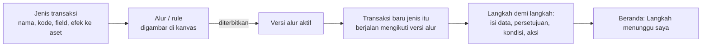
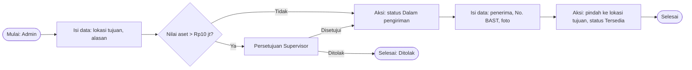

# F-07: Jenis Transaksi dan Alur (Rule) Transaksi Buatan Organisasi

| Field | Value |
|---|---|
| Tahap | 2–7 (ringkas): requirement, alur, data, security |
| Versi | 0.1 |
| Penyusun | product-analyst, system-architect, database-engineer, security-engineer |
| Status | **Approved** ([APR-0010](../../approvals/APR-0010-jenis-dan-alur-transaksi-kustom.md), 2026-11-18). Mockup: [F-07-jenis-dan-alur-transaksi.html](../../design/mockups/F-07-jenis-dan-alur-transaksi.html), **disetujui** 2026-11-18 |
| Dasar | Pemilik produk 2026-11-18: setiap perusahaan punya jenis dan aturan transaksi sendiri. Pengguna membuat jenis transaksi beserta field-nya, lalu menggambar alurnya di halaman khusus (kotak/oval yang dihubungkan garis: "harus ini dulu baru bisa ke sini; kalau begini tidak bisa begitu"). Alur itu otomatis berlaku untuk setiap transaksi jenis tersebut |

## 1. Masalah
- Jenis transaksi saat ini tetap di kode (`TransactionType`): pemindahan, perubahan status, peminjaman, pengembalian, keluar, masuk, aktivitas lain. Organisasi tidak dapat menambah jenis seperti *Mutasi antar cabang*, *Kalibrasi*, *Stock opname*, atau *Penghapusan aset*.
- Field setiap jenis juga tetap. Organisasi tidak dapat meminta nomor PO, nama teknisi, atau lampiran berita acara.
- Aturan ditulis di `AssetTransactionService`, misalnya "aset yang dipinjam harus dikembalikan dulu". Transaksi langsung tercatat dalam satu langkah, tanpa urutan *diajukan → disetujui → diserahkan → selesai*.

## 2. Konsep

| Istilah | Arti |
|---|---|
| **Jenis transaksi** | Definisi milik organisasi: nama, kode nomor, ikon, kategori aset yang boleh, daftar field, dan efek ke aset |
| **Field** | Isian formulir transaksi: teks, angka, tanggal, pilihan, ya/tidak, lampiran, pengguna, lokasi, pihak luar |
| **Alur (rule)** | Diagram langkah dan garis penghubung yang menentukan urutan, syarat, dan siapa yang mengerjakan |
| **Langkah (node)** | Satu kotak/oval di diagram (jenis §4.1) |
| **Garis (edge)** | Penghubung antar langkah, dapat berlabel: *Disetujui*, *Ditolak*, *Ya*, *Tidak* |
| **Versi alur** | Alur dibekukan saat diterbitkan. Transaksi yang sudah berjalan tetap memakai versinya ⚑ (D-28) |

## 3. Jenis Transaksi

### 3.1 Pengaturan jenis
| Isian | Keterangan |
|---|---|
| Nama, kode, prefix nomor | Mis. "Mutasi Cabang", `MUT` → `MUT-2026-000001` |
| Berlaku untuk kategori | Semua kategori atau kategori tertentu (beserta subkategori) |
| Jumlah aset | Satu aset atau banyak aset per transaksi |
| Field | Daftar field §3.2, dapat diurutkan, dikelompokkan per bagian |
| Efek ke aset | Dipilih di langkah **Aksi** di alur (§4.1), bukan di jenis, sehingga efek terjadi pada langkah yang tepat |
| Berpasangan | Opsional: jenis ini menutup jenis lain, mis. *Kembali dari kalibrasi* menutup *Kirim kalibrasi* |
| Status | Draft / Aktif / Nonaktif. Jenis yang sudah dipakai tidak dapat dihapus, hanya dinonaktifkan |

### 3.2 Jenis field
| Tipe | Pengaturan |
|---|---|
| Teks pendek / panjang | wajib, panjang maksimal, pola (mis. format nomor PO) |
| Angka / uang | wajib, min/maks, desimal |
| Tanggal / tanggal-waktu | wajib, tidak boleh sebelum hari ini, relatif ke field lain |
| Pilihan tunggal / ganda | daftar opsi |
| Ya/Tidak | nilai bawaan |
| Lampiran | jenis file, ukuran (mengikuti `max_upload_mb`) |
| Pengguna | memilih anggota organisasi (mis. penerima, teknisi) |
| Lokasi | memilih lokasi dalam scope pengguna |
| Pihak luar | nama + kontak, disaring izin `transaction.contact.view` seperti F-02 |

- Field dapat diatur **wajib di langkah tertentu**, mis. "No. BAST" baru wajib di langkah *Serah terima*.
- Field otomatis tersedia di Report Designer (sumber Riwayat Transaksi) dan di widget dashboard F-06 ⚑ (D-31).

### 3.3 Jenis bawaan ⚑ (D-26)
Tujuh jenis yang ada sekarang menjadi **jenis sistem** dengan alur bawaan yang setara perilaku saat ini. Organisasi dapat menambah field dan langkah persetujuan pada jenis sistem, tetapi tidak dapat menghapus aturan inti yang menjaga konsistensi data (mis. aset yang dipinjam tidak dapat dipindah). Jenis *Penambahan aset*, *Penonaktifan*, dan *Pengaktifan kembali* tetap dicatat oleh aksi aset dan tidak dapat diubah.

## 4. Editor Alur

### 4.1 Jenis langkah
| Bentuk | Langkah | Fungsi | Pengaturan |
|---|---|---|---|
| Oval hijau | **Mulai** | Transaksi dibuat; satu per alur | Siapa yang boleh memulai (role/izin) |
| Kotak | **Isi data** | Pengguna mengisi/melengkapi field | Role atau pengguna penanggung jawab, field yang diisi/wajib di langkah ini, batas waktu |
| Kotak biru | **Persetujuan** | Menyetujui atau menolak; dua garis keluar: *Disetujui* / *Ditolak* | Penyetuju (role, pengguna, atasan lokasi), jumlah minimal penyetuju, boleh menyetujui pengajuan sendiri atau tidak, batas waktu |
| Belah ketupat | **Kondisi** | Percabangan otomatis; garis keluar *Ya* / *Tidak* (atau beberapa cabang + *Lainnya*) | Syarat atas field transaksi, data aset (status, kondisi, kategori, nilai, lokasi), atau pengguna (role) |
| Kotak ungu | **Aksi sistem** | Mengubah data otomatis | Ubah status aset, ubah kondisi, pindah lokasi (dari field), tetapkan pemegang, catat ke riwayat aset, kirim notifikasi |
| Kotak oranye | **Tunggu** | Berhenti sampai sesuatu terjadi | Sampai tanggal (field), sampai transaksi pasangan dibuat (mis. aset kembali), sampai lampiran diunggah |
| Oval merah/abu | **Selesai** | Akhir alur; boleh lebih dari satu | Hasil: *Selesai*, *Ditolak*, *Dibatalkan* |

Contoh alur *Mutasi Cabang*:

### 4.2 Aturan syarat ("kalau begini tidak bisa begitu")
- **Prasyarat di langkah Mulai.** Transaksi ditolak saat dibuat bila syarat tidak terpenuhi, dengan pesan buatan organisasi. Contoh: "Aset dengan status *Dipinjam* tidak dapat dimutasi. Kembalikan terlebih dahulu."
- **Kondisi bercabang** mengarahkan transaksi ke jalur berbeda, misalnya nilai di atas batas harus melalui persetujuan.
- **Aturan inti sistem** (§3.3) tetap berlaku di atas aturan organisasi dan tidak dapat dimatikan.
- Operator syarat: sama dengan, tidak sama, lebih/kurang dari, termasuk salah satu, kosong/terisi, *dan*/*atau*.

### 4.3 Perilaku editor
- Kanvas: langkah diseret dari panel kiri, garis ditarik dari titik sambung satu langkah ke langkah lain, pengaturan di panel kanan. Tata letak serupa desainer laporan, termasuk zoom, *Pas layar*, urungkan/ulangi, dan simpan draft.
- **Validasi sebelum terbit:** tepat satu *Mulai*; setiap langkah terhubung dan dapat mencapai *Selesai*; *Persetujuan* memiliki garis *Disetujui* dan *Ditolak*; *Kondisi* memiliki semua cabang; perulangan hanya boleh melalui langkah manusia (mencegah loop tanpa akhir); field yang dirujuk ada.
- **Uji alur:** pengguna memilih aset contoh dan mengisi nilai, lalu melihat jalur yang akan ditempuh tanpa menyimpan transaksi.
- Riwayat versi seperti template laporan: draft → terbit → versi lama tetap terbaca.
- Editor hanya di web pada layar ≥ 768px (D-34). Di ponsel, jenis, field, dan alur tampil sebagai hasil jadi (diagram diperkecil, hanya dilihat).

## 5. Menjalankan Transaksi
- Formulir transaksi dibentuk dari field jenisnya, dan field yang wajib mengikuti langkah yang sedang berjalan.
- Transaksi berstatus: *Berjalan* (di langkah X), *Selesai*, *Ditolak*, *Dibatalkan*.
- Langkah manusia (Isi data, Persetujuan) menjadi **tugas** penanggung jawabnya dan tampil di Beranda F-06 (*Langkah transaksi menunggu saya*) serta di badge menu.
- Detail transaksi menampilkan diagram alur dengan langkah yang sudah lewat, langkah aktif, dan riwayat (siapa, kapan, catatan).
- Efek ke aset terjadi tepat di langkah *Aksi*. Aset dikunci selama transaksi berjalan agar tidak ditransaksikan ganda ⚑ (D-29).
- Pembatalan: oleh pembuat sebelum ada efek ke aset, atau oleh `transaction.reverse` dengan transaksi pembalik.
- Mobile (F-03): langkah *Isi data* dan *Persetujuan* dapat dikerjakan dari mobile pada fase berikutnya ⚑ (D-32).

## 6. Data (usulan database-engineer)
| Tabel | Isi |
|---|---|
| `transaction_type_definitions` | jenis per organisasi: kode, nama, prefix, ikon, kategori, multi-aset, status, `system_type` untuk jenis bawaan |
| `transaction_type_fields` | field per jenis: key, label, tipe, pengaturan (JSON), urutan |
| `transaction_flows` / `transaction_flow_versions` | alur per jenis dan versinya; `graph` JSONB (node + edge + posisi kanvas), status draft/terbit |
| `asset_transactions` (ubah) | `type_definition_id`, `flow_version_id`, `state` (running/completed/rejected/cancelled), `current_node_id`, `field_values` JSONB |
| `transaction_steps` | riwayat langkah: node, pelaksana, keputusan, catatan, waktu masuk/keluar |
| `transaction_tasks` | tugas terbuka per langkah manusia: penanggung jawab (role/pengguna), batas waktu |

Semua tabel memakai RLS tenant dan pola `TenantSchema` yang sudah ada. Nomor transaksi tetap memakai generator nomor saat ini dengan prefix jenis.

## 7. Security
| Aspek | Ketentuan |
|---|---|
| Izin baru | `transaction_type.manage` (membuat jenis/field), `transaction_flow.manage` (menggambar dan menerbitkan alur). Usulan: Super Admin dan Supervisor ⚑ (D-27) |
| Penanggung jawab langkah | Server memeriksa bahwa pelaksana benar-benar penanggung jawab langkah aktif. UI tidak dipercaya |
| Persetujuan | Tetap hanya role yang boleh memegang approval (`RoleTemplates::mayHoldApproval`). Larangan menyetujui pengajuan sendiri mengikuti pengaturan organisasi |
| Data scope | Pemilihan aset, lokasi, dan data di kondisi memakai scope pelaksana langkah |
| Mesin aturan | Syarat dievaluasi oleh evaluator berdaftar (operator dan field yang diizinkan), **bukan** ekspresi/kode bebas. Tidak ada eksekusi skrip buatan pengguna |
| Batas | Maks. 50 langkah per alur, 40 field per jenis; batas kedalaman evaluasi untuk mencegah loop |
| Audit | `transaction_type.*`, `transaction_flow.published`, `transaction.step_completed`, `transaction.approved/rejected` |

## 8. Keputusan yang Memerlukan Persetujuan
| ID | Keputusan | Usulan |
|---|---|---|
| D-25 | Editor alur memakai pustaka **React Flow (`@xyflow/react`, lisensi MIT, gratis)** untuk kanvas, garis, zoom, dan minimap, alih-alih membuat kanvas graf sendiri. Ini menambah dependency frontend | Ya. Gratis, sesuai mode tanpa biaya |
| D-26 | Tujuh jenis yang ada menjadi jenis sistem dengan alur bawaan; organisasi boleh menambah field dan persetujuan, tetapi tidak dapat menghapus aturan inti | Ya |
| D-27 | Hanya Super Admin dan Supervisor yang dapat membuat jenis dan alur (izin baru §7) | Ya |
| D-28 | Transaksi yang sudah berjalan tetap memakai versi alur saat dibuat; versi baru hanya untuk transaksi baru | Ya |
| D-29 | Aset dikunci selama transaksi berjalan (tidak dapat ikut transaksi lain sampai selesai/ditolak/dibatalkan), kecuali jenis yang ditandai "tidak mengunci", mis. *Catatan* | Ya |
| D-30 | Persetujuan di alur memakai tugas langkah (`transaction_tasks`), bukan mekanisme replay `ApprovalRequest` yang ada; menu Persetujuan menampilkan keduanya | Ya |
| D-31 | Field kustom otomatis tersedia di Report Designer dan widget dashboard | Ya |
| D-32 | Fase pertama tanpa mobile; langkah di mobile menyusul | Ya |
| D-33 | Dikerjakan bertahap (§9): jenis + field dahulu dengan alur lurus sederhana, lalu editor alur, lalu migrasi jenis bawaan | Ya |
| D-34 | Semua editor (desainer laporan, atur tata letak/tambah widget dashboard, template dashboard, jenis/field/alur transaksi) hanya di web pada layar ≥ 768px. Di ponsel/layar sempit hanya tampil hasil jadinya (dilihat dan dipakai), tanpa tombol ubah. Mencatat dan mengerjakan langkah transaksi tetap bisa dari ponsel | **Diputuskan** 2026-11-18 |
| D-35 | **Ubah kondisi** = mengisi field bawaan *Kondisi Aset* (Baru/Baik/Cukup/Rusak Ringan/Rusak Berat) dengan nilai tetap atau dari field pilihan. Perubahan tercatat di riwayat aset sebagai *Aktivitas lain* bernomor transaksi alur. Kategori tanpa field itu menolak aksi dengan pesan jelas. Syarat *Kondisi* juga dapat membaca nilai ini (`asset.condition`) | Usulan, sudah diimplementasikan |
| D-36 | **Tetapkan pemegang** = aksi *Pinjamkan ke pengguna* (pengguna dari field Pengguna, tanggal kembali dari field Tanggal) dan aksi *Kembalikan*. Keduanya memakai aturan inti peminjaman dan pengembalian, karena aset belum memiliki kolom pemegang tersendiri | Usulan, sudah diimplementasikan |
| D-37 | **Atasan lokasi** = anggota yang memegang role penyetuju (Super Admin/Supervisor) dan cakupan datanya meliputi lokasi semua aset transaksi. Sistem belum memiliki data kepala lokasi | Usulan, sudah diimplementasikan |
| D-38 | **Kirim notifikasi** = email ke pembuat, pengguna tertentu, pengguna dari field, atau pemegang role, dikirim setelah langkah tersimpan. Email yang gagal tidak membatalkan langkah. Notifikasi di dalam aplikasi berupa kartu Beranda *Langkah transaksi menunggu saya* | Usulan, sudah diimplementasikan |
| D-39 | **Tunggu transaksi pasangan**: alur menunggu sampai setiap asetnya mendapat transaksi jenis penutup (*Berpasangan*). Transaksi penutup boleh dicatat pada aset yang dikunci alur itu (pengecualian D-29). **Tunggu lampiran** tidak dibuat sebagai jenis tunggu tersendiri, karena sudah tercakup oleh *Isi data* dengan field lampiran wajib dan batas waktu | Usulan, sudah diimplementasikan |

## 9. Rencana Task (setelah disetujui)
| ID | Task | Agent | Bergantung | Status |
|---|---|---|---|---|
| F-07a | Skema + backend jenis transaksi dan field; formulir transaksi dinamis; alur default lurus (Mulai → Isi data → Selesai) | database-engineer, backend-engineer, security-engineer | D-26, D-27, D-33 | in_review (`TransactionTypeTest`). Tipe field *lampiran* dan "wajib di langkah tertentu" dikerjakan di F-07b karena butuh unggah berkas dan langkah alur |
| F-07b | Mesin alur: versi, langkah, tugas, kondisi, aksi, tunggu; penguncian aset; audit; test aturan dan lintas tenant | backend-engineer, security-engineer | F-07a, D-28..D-30, D-35..D-39 | in_review (`TransactionFlowTest`, `TransactionFlowStepsTest`; suite penuh 499 lulus). Draft/terbit/versi, validasi §4.3, uji alur. Langkah: Mulai (role + prasyarat), Isi data (field wajib per langkah), Persetujuan (role/pengguna/atasan lokasi, minimal 1–5 penyetuju berbeda, larangan menyetujui sendiri), Kondisi (termasuk kondisi aset), Aksi (ubah status, pindah lokasi, ubah kondisi, pinjamkan, kembalikan, notifikasi email), Tunggu (tanggal via `transactions:resume` harian, atau transaksi pasangan), Selesai. Tipe field lampiran (unggah/unduh, `transactions:prune-attachments` harian). Penguncian aset termasuk saat penonaktifan. Pembatalan. Kartu Beranda `transaction_tasks` |
| F-07c | Mockup: pengaturan jenis & field, editor alur, detail transaksi berjalan | ui-ux-designer | requirement disetujui | done (mockup disetujui 2026-11-18) |
| F-07d | Frontend pengaturan jenis dan field + formulir dinamis | frontend-engineer | F-07a, F-07c | in_review (`transactionTypes.test.tsx`; Vitest 226 lulus). Halaman `/transaksi/jenis` (daftar dengan versi alur) dan `/transaksi/jenis/:id` (jenis + 13 tipe field, urutan, pengaturan per tipe). Formulir transaksi menampilkan jenis organisasi; field yang diisi di langkah alur berikutnya tidak ditanyakan saat mulai. Unggah lampiran. Nilai field tampil sebagai teks (`display` dari API) di riwayat. Endpoint baru: `/transaction-members` (nama saja), `/transaction-flow-options` |
| F-07e | Frontend editor alur (React Flow), validasi, uji alur, versi | frontend-engineer | F-07b, F-07c, D-25 | in_review. Editor `/transaksi/jenis/:id/alur`: palet langkah (klik untuk menambah), garis bercabang otomatis Disetujui/Ditolak dan Ya/Tidak, panel pengaturan per langkah, urungkan/ulangi, validasi dengan sorotan langkah bermasalah, uji alur dengan sorotan jalur, simpan draft, terbitkan, riwayat versi. Hanya tampil di ponsel (D-34). Halaman `/transaksi/berjalan` dan detailnya (progres, diagram, riwayat, mengerjakan langkah, batalkan). Badge menu dan kartu "Langkah transaksi menunggu Anda" di halaman awal |
| F-07f | Migrasi tujuh jenis bawaan ke jenis sistem + alur bawaan, tanpa mengubah perilaku (regression test seluruh `AssetTransactionTest`) | backend-engineer, qa-engineer | F-07b | todo |
| F-07g | Field kustom di Report Designer dan widget dashboard | backend + frontend | F-07a, F-06b | in_review backend (`TransactionCustomFieldsTest`: field kustom muncul di katalog `/report-fields`, bisa di-bind ke template laporan, resolve nilai terformat, widget daftar transaksi memuat kolom field; frontend Report Designer otomatis via endpoint yang sama, widget frontend menyusul di F-06e) |
| F-07-QA | E2E: buat jenis *Mutasi Cabang* → gambar alur dengan kondisi & persetujuan → jalankan dua jalur → laporan | qa-engineer | F-07e | todo |
