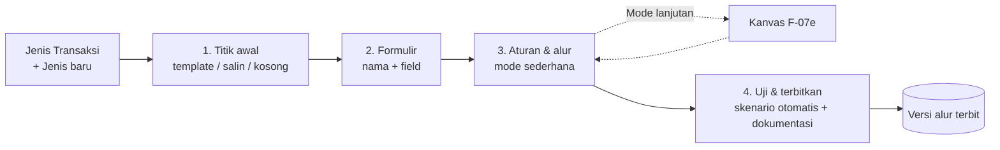

# F-08: Transaction Builder Terpandu

| Field | Value |
|---|---|
| Tahap | 2–7 (ringkas): requirement, alur, data, security |
| Versi | 0.1 |
| Penyusun | product-analyst, ui-ux-designer, system-architect, security-engineer |
| Status | **Draft**, menunggu persetujuan pemilik produk (APR-0011). Mockup: [F-08-transaction-builder-terpandu.html](../../design/mockups/F-08-transaction-builder-terpandu.html), menunggu persetujuan |
| Dasar | Pemilik produk 2026-11-20: Custom Transaction Builder boleh *powerful*, tetapi UX-nya harus (1) template first, (2) guided setup, (3) human-readable rules, (4) contextual configuration, (5) simulation, (6) auto documentation, (7) simple by default, advanced on demand |
| Hubungan | Mengubah UX [F-07](F-07-jenis-dan-alur-transaksi-kustom.md) (jenis, field, dan editor alur). Mesin alur F-07b, versi alur, dan izin D-27 **tidak berubah**. Memakai ulang jenis sistem F-07f sebagai template |

## 1. Masalah

Builder F-07d/F-07e sudah lengkap fiturnya, tetapi pengguna harus menyusun semuanya sendiri dari nol.

| Prinsip | Kondisi sekarang (F-07d/F-07e) |
|---|---|
| 1. Template first | Jenis baru dimulai dari formulir kosong; alur dimulai dari `Mulai → Selesai` |
| 2. Guided setup | Jenis dan field ada di satu halaman panjang (`/transaksi/jenis/:id`); alur di halaman terpisah (`/alur`); tidak ada urutan langkah |
| 3. Human-readable rules | Syarat disusun dari tiga dropdown (data, operator, nilai); tidak pernah ditampilkan sebagai kalimat |
| 4. Contextual configuration | Saat menulis syarat atau memilih field per langkah, formulir transaksi tidak terlihat; field dan alur diatur di dua halaman |
| 5. Simulation | ✓ "Uji alur" dengan aset contoh dan keputusan per persetujuan. Pengguna harus memikirkan sendiri jalur mana yang perlu dicoba |
| 6. Auto documentation | Tidak ada; hanya catatan perubahan per versi |
| 7. Simple by default | Palet langsung menampilkan tujuh jenis langkah dan semua pengaturan field langsung terbuka |

## 2. Alur Pengguna

- Wizard 4 langkah dengan indikator langkah. Setiap langkah dapat disimpan sebagai **draft** dan dilanjutkan kemudian; berpindah langkah tidak menghapus isian.
- Jenis yang sudah ada dibuka di halaman yang sama dengan langkah sebagai tab (bukan wizard berurutan), sehingga pengguna yang sudah paham langsung ke bagian yang ingin diubah.
- Panel **Pratinjau** di sisi kanan selalu terlihat di langkah 2 dan 3: formulir transaksi sebagaimana dilihat pengisi, dan ringkasan "Cara kerja transaksi ini" (§6). Panel inilah yang membuat konfigurasi kontekstual (prinsip 4).
- Tetap hanya untuk Super Admin dan Supervisor (D-27) di web layar ≥ 768px (D-34). Di ponsel: daftar jenis + dokumentasi "Cara kerja" (dilihat saja).

## 3. Prinsip dan Acceptance Criteria

### 3.1 Template first
| ID | Acceptance criteria |
|---|---|
| F08-01 | "Jenis baru" membuka langkah **Titik awal** dengan tiga pilihan: *Mulai dari template* (dipilih bawaan), *Salin jenis yang ada*, *Mulai dari kosong* |
| F08-02 | Galeri template menampilkan kartu per template: nama, satu kalimat kegunaan, jumlah field, jumlah langkah persetujuan, dan tombol *Lihat cara kerja* (dokumentasi §6 tanpa membuat apa pun) |
| F08-03 | Memakai template membuat **draft** jenis baru (nama dan kode boleh diubah) dengan field dan alur hasil salinan. Template tidak pernah ikut berubah dan tidak terhubung lagi dengan jenis hasil salinannya |
| F08-04 | Rujukan template ke role memakai role bawaan (Supervisor, Super Admin). Bila organisasi menghapus/mengganti role itu, langkah 3 menandai langkah persetujuan yang perlu dipilih ulang sebelum dapat diterbitkan |
| F08-05 | *Salin jenis yang ada* menyalin field dan versi alur terbit terakhir (atau draft bila belum pernah terbit) dari jenis organisasi yang sama |

Template awal (§4) disimpan di kode seperti `SystemTemplates` dashboard, bukan dibuat pengguna ⚑ (D-40).

### 3.2 Guided setup
| ID | Acceptance criteria |
|---|---|
| F08-06 | Langkah 2 **Formulir** menanyakan nama (kode/prefix diusulkan otomatis dari nama, mis. *Kirim Kalibrasi* → `KAL`), keterangan, jumlah aset per transaksi, lalu daftar field |
| F08-07 | Langkah 3 **Aturan & alur** bertanya dalam urutan tetap: *Siapa yang boleh mencatat?* → *Syarat sebelum mencatat* → *Perlu persetujuan?* → *Apa yang terjadi pada aset?* → *Perlu langkah lanjutan?* (mis. serah terima). Setiap pertanyaan punya jawaban bawaan yang aman |
| F08-08 | Tombol *Lanjut* dinonaktifkan dengan pesan yang menyebut isian yang kurang; kesalahan validasi server (`FLOW_INVALID`) ditampilkan di pertanyaan yang bersangkutan, bukan hanya di atas halaman |
| F08-09 | Langkah 4 tidak dapat menerbitkan selama ada masalah validasi atau ada skenario wajib (§3.5) yang belum dijalankan |

### 3.3 Human-readable rules
| ID | Acceptance criteria |
|---|---|
| F08-10 | Setiap syarat tampil sebagai kalimat di bawah isiannya dan di dokumentasi, mis. *"Status aset adalah Dipinjamkan"*, *"Nilai perolehan lebih dari Rp 10.000.000"*, *"Kategori aset termasuk Kendaraan (beserta subkategorinya)"* |
| F08-11 | Gabungan syarat memakai kata *dan* / *atau* sesuai pilihan; prasyarat mulai ditulis sebagai larangan: *"Transaksi tidak dapat dicatat bila status aset adalah Dipinjamkan. Pesan: 'Kembalikan aset terlebih dahulu.'"* |
| F08-12 | Nilai memakai label, tidak pernah kode atau UUID: nama lokasi, nama kategori, label status/kondisi, label pilihan field, nama role, nominal dalam mata uang organisasi |
| F08-13 | Kalimat dibangkitkan dari graph oleh satu penerjemah yang sama untuk editor, dokumentasi, dan detail transaksi berjalan ⚑ (D-41) |

Tata bahasa kalimat (semua subjek dan operator `FlowGraph::SUBJECTS` / `OPERATORS`):

| Subjek | Contoh kalimat |
|---|---|
| `asset.status` | Status aset **adalah / bukan / salah satu dari** Aktif, Tidak Aktif |
| `asset.condition` | Kondisi aset adalah Rusak Berat |
| `asset.category` | Kategori aset termasuk Kendaraan |
| `asset.location` | Lokasi aset berada di Gudang Pusat |
| `asset.acquisition_cost` | Nilai perolehan **lebih dari / paling sedikit / kurang dari / paling banyak** Rp 10.000.000 (untuk banyak aset: *total nilai* atau *setiap aset*) |
| `starter.role` | Pencatat memiliki role Admin |
| `field.<key>` | *(label field)* adalah / terisi / kosong / lebih dari … |

| Langkah | Contoh kalimat |
|---|---|
| Mulai | Dapat dicatat oleh Admin dan Supervisor |
| Isi data | Supervisor lokasi mengisi *No. BAST* dan *Foto serah terima* (wajib) dalam 2 hari |
| Persetujuan | Perlu disetujui 1 Supervisor yang cakupannya meliputi lokasi aset. Bila ditolak, transaksi selesai sebagai Ditolak |
| Kondisi | Bila nilai perolehan lebih dari Rp 10.000.000, lanjut ke *Persetujuan Super Admin*; bila tidak, lanjut ke *Kirim ke vendor* |
| Aksi | Status aset diubah menjadi Dalam Perbaikan · Aset dipindah ke lokasi pada field *Lokasi tujuan* · Email dikirim ke pencatat |
| Tunggu | Menunggu sampai tanggal pada field *Rencana kembali* · Menunggu transaksi *Kembali dari Kalibrasi* untuk setiap aset |
| Selesai | Transaksi selesai |

### 3.4 Contextual configuration
| ID | Acceptance criteria |
|---|---|
| F08-14 | Pratinjau formulir di langkah 2 berubah seketika saat field ditambah, diubah, atau diurutkan |
| F08-15 | Di langkah 3, memilih field untuk langkah *Isi data* atau syarat menyorot field itu di pratinjau formulir; field yang belum dipakai di mana pun diberi tanda "belum dipakai di alur" |
| F08-16 | Pertanyaan *Apa yang terjadi pada aset?* hanya menawarkan aksi yang field-nya tersedia (mis. *Pindah lokasi* butuh field Lokasi), dengan tautan *Tambah field Lokasi* yang menambahkannya tanpa meninggalkan langkah 3 |
| F08-17 | Pratinjau alur (diagram kecil hanya-baca, komponen `FlowDiagram` yang ada) selalu menunjukkan hasil jawaban langkah 3 |

### 3.5 Simulation
| ID | Acceptance criteria |
|---|---|
| F08-18 | Langkah 4 membangkitkan **skenario** otomatis dari graph: satu skenario per jalur yang berbeda (setiap cabang Kondisi *Ya/Tidak*, setiap Persetujuan *Disetujui/Ditolak*), maksimal 12. Setiap skenario diberi nama kalimat, mis. *"Nilai > Rp 10 jt, disetujui Supervisor, disetujui Super Admin"* |
| F08-19 | Menjalankan skenario memakai endpoint simulasi yang ada (tanpa menyimpan transaksi) dan menampilkan hasil per langkah sebagai kalimat, termasuk perubahan aset yang **akan** terjadi (status lama → baru, lokasi lama → baru) |
| F08-20 | Skenario prasyarat ditolak dijalankan dengan aset contoh yang melanggar syarat bila ada; hasilnya menampilkan pesan penolakan yang akan dilihat pencatat |
| F08-21 | *Jalankan semua skenario* menandai setiap skenario lulus/gagal. Skenario yang tidak pernah sampai *Selesai* adalah kesalahan; skenario yang belum dijalankan setelah alur diubah ditandai *perlu dijalankan ulang* |
| F08-22 | Uji manual (aset contoh + nilai field + keputusan) F-07e tetap tersedia sebagai *Skenario sendiri* |

### 3.6 Auto documentation
| ID | Acceptance criteria |
|---|---|
| F08-23 | Setiap jenis memiliki **Cara kerja transaksi ini**: judul, kegunaan (keterangan jenis), siapa yang mencatat, syarat, isian formulir, urutan langkah bernomor dalam kalimat (§3.3), efek ke aset, dan siapa yang mendapat tugas/email |
| F08-24 | Dokumentasi tampil di: langkah 4 (untuk ditinjau sebelum terbit), halaman jenis (tab *Cara kerja*, juga di ponsel), dan formulir pencatatan dalam bentuk ringkas (*"Transaksi ini perlu disetujui Supervisor sebelum aset dipindah"*) |
| F08-25 | Saat menerbitkan versi baru, dokumentasi menampilkan **perbedaan dari versi sebelumnya** dalam kalimat (langkah ditambah/dihapus, syarat berubah) dan mengisi otomatis usulan *Catatan perubahan* yang dapat disunting |
| F08-26 | Dokumentasi dibangkitkan dari data, deterministik, tanpa layanan AI/LLM ⚑ (D-43). Dapat dicetak (tampilan cetak bersih) |

### 3.7 Simple by default, advanced on demand
| ID | Acceptance criteria |
|---|---|
| F08-27 | Langkah 3 bawaan adalah **mode sederhana** (pertanyaan §3.2). *Mode lanjutan* membuka kanvas F-07e untuk alur yang sama |
| F08-28 | Mode sederhana mencakup alur lurus dengan: prasyarat, maksimal 2 persetujuan berurutan, satu syarat "persetujuan tambahan bila …", aksi ke aset, satu langkah *Isi data* lanjutan, dan satu *Tunggu* ⚑ (D-42). Alur di luar bentuk itu hanya dapat diubah di mode lanjutan; mode sederhana lalu menampilkan dokumentasinya (hanya-baca) dengan tombol *Buka mode lanjutan* |
| F08-29 | Berpindah dari mode lanjutan ke sederhana tidak pernah mengubah alur diam-diam: bila alur tidak dapat dinyatakan dalam mode sederhana, pengguna diberi tahu bagian mana yang membuatnya lanjutan |
| F08-30 | Di langkah 2, setiap field hanya menampilkan label, tipe, dan *wajib*. Pengaturan per tipe (panjang, min/maks, desimal, tanggal relatif, ukuran lampiran, wajib di langkah tertentu) ada di bawah *Pengaturan lanjutan* yang tertutup bawaan |
| F08-31 | Pilihan mode tersimpan per pengguna; jenis yang dibuka dalam mode lanjutan tetap dibuka di mode itu |

## 4. Template Awal

| Template | Kegunaan | Field | Alur (ringkas) |
|---|---|---|---|
| Mutasi antar lokasi | Memindah aset ke lokasi lain dengan persetujuan | Lokasi tujuan, Alasan, Penerima, No. BAST, Foto | Prasyarat: bukan Dipinjamkan/Di Luar Organisasi → Persetujuan Supervisor lokasi (+ Super Admin bila nilai > Rp 10 jt) → status Dalam Pengiriman → Isi data penerima → pindah lokasi, status Aktif |
| Kirim kalibrasi | Aset ke vendor kalibrasi, menunggu kembali | Vendor, No. PO, Rencana kembali, Sertifikat | Persetujuan Supervisor → status Dalam Perbaikan → Tunggu *Kembali dari kalibrasi* |
| Kembali dari kalibrasi | Pasangan *Kirim kalibrasi* (Berpasangan) | Tanggal kembali, Sertifikat (lampiran, wajib), Hasil | Isi data → status Aktif / Rusak sesuai Hasil |
| Perbaikan ke vendor | Aset rusak diperbaiki pihak luar | Vendor, Keluhan, Estimasi biaya | Persetujuan Supervisor (+ Super Admin bila estimasi > Rp 5 jt) → status Dalam Perbaikan |
| Serah terima ke karyawan | Aset dipinjamkan ke pengguna | Pemegang (pengguna), Rencana kembali, Foto | Prasyarat: status Aktif/Tidak Aktif → Pinjamkan ke pemegang → Email ke pemegang |
| Penghapusan aset | Usulan penghapusan dengan dua persetujuan | Alasan (pilihan), Nilai jual, Berita acara | Persetujuan Supervisor → Persetujuan Super Admin → status Dihapuskan |
| *Tujuh jenis sistem* (F-07f) | Pemindahan, Perubahan status, Peminjaman, Pengembalian, Keluar, Masuk, Aktivitas lain | sesuai jenis | Alur bawaan setara perilaku sekarang; disalin sebagai jenis organisasi yang dapat ditambah field/persetujuan |

Setiap template lulus validasi alur F-07b dan memiliki test yang menerbitkan dan menjalankan semua skenarionya.

## 5. Data dan API (usulan system-architect)

Tidak ada perubahan mesin alur, tabel transaksi, atau RLS. Tambahan:

| Bagian | Usulan |
|---|---|
| Katalog template | `App\Domain\AssetTransactions\Templates\TransactionTemplates` (di kode, seperti `Dashboards\Catalog\SystemTemplates`): key, nama, kegunaan, field, graph. Diuji agar setiap graph valid |
| Kolom | `transaction_type_definitions.source_template_key` (nullable, varchar): asal template untuk dokumentasi dan analitik. `user_preferences`/preferensi dashboard: mode builder per pengguna (F08-31) |
| `GET /transaction-type-templates` | Daftar template + dokumentasi masing-masing (`transaction.view`) |
| `POST /transaction-types/from-template` · `POST /transaction-types/{id}/duplicate` | Membuat draft jenis dari template / dari jenis lain (`transaction_type.manage`) |
| `GET /transaction-types/{id}/flow/describe?version=` | Dokumentasi terstruktur: kalimat per langkah, syarat, efek, dan perbedaan dari versi sebelumnya (`transaction.view`) |
| `POST /transaction-types/{id}/flow/scenarios` | Daftar skenario jalur dari graph draft (`transaction_flow.manage`); dijalankan memakai `flow/simulate` yang ada |
| `FlowDescriber` (backend) | Penerjemah graph → kalimat (D-41), dipakai `describe`, detail transaksi berjalan, dan email notifikasi |

## 6. Security (security-engineer)
| Aspek | Ketentuan |
|---|---|
| Izin | Tidak ada izin baru: membuat dari template/salin = `transaction_type.manage`; alur = `transaction_flow.manage`; dokumentasi = `transaction.view` |
| Template | Data statis di kode, tanpa skrip; hasil salinan melewati validasi `FlowGraph` yang sama dengan alur buatan pengguna |
| Salin jenis | Hanya jenis dalam organisasi yang sama (RLS + composite FK); rujukan pengguna/lokasi di graph diperiksa ulang terhadap organisasi |
| Kalimat | Teks buatan pengguna (nama langkah, label field, pesan) di-escape; frontend merender kalimat sebagai teks, bukan HTML |
| Skenario | Simulasi tetap tanpa efek tulis (transaksi DB di-rollback seperti F-07b) dan memakai data scope penguji; batas 12 skenario per permintaan |

## 7. Di Luar Cakupan
- Template buatan organisasi (menyimpan jenis sendiri sebagai template untuk dibagikan) ⚑ (D-44: fase berikutnya).
- Asisten AI untuk menyusun alur dari kalimat bebas (mode tanpa biaya; D-43).
- Perubahan pada mesin alur, jenis langkah, atau aturan inti F-07.

## 8. Keputusan yang Memerlukan Persetujuan
| ID | Keputusan | Usulan |
|---|---|---|
| D-40 | Template awal (§4) ditulis di kode dan dirilis bersama aplikasi; organisasi memakai salinannya | Ya |
| D-41 | Kalimat aturan dan dokumentasi dibangkitkan di **backend** (`FlowDescriber`), satu sumber untuk web, ponsel, dan email | Ya |
| D-42 | Batas mode sederhana seperti F08-28; alur yang lebih rumit hanya di mode lanjutan | Ya |
| D-43 | Dokumentasi deterministik dari data, tanpa AI/LLM (mode tanpa biaya) | Ya |
| D-44 | Template buatan organisasi ditunda ke fase berikutnya | Ya |
| D-45 | F-08 dikerjakan setelah F-07f (jenis sistem menjadi template) dan menggantikan halaman `/transaksi/jenis/:id`; kanvas F-07e dipertahankan sebagai mode lanjutan | Ya |

## 9. Rencana Task (setelah disetujui)
| ID | Task | Agent | Bergantung | Status |
|---|---|---|---|---|
| F-08a | Mockup wizard, galeri template, mode sederhana, skenario, dokumentasi (desktop + 375px) | ui-ux-designer | requirement | in_review (mockup menunggu persetujuan) |
| F-08b | `FlowDescriber` + `GET flow/describe` (kalimat per langkah/syarat, perbedaan versi) + test semua subjek/operator/jenis langkah | backend-engineer | D-41 | todo |
| F-08c | Katalog template + `from-template` + `duplicate` + `source_template_key`; test setiap template valid dan semua skenarionya sampai Selesai | backend-engineer, database-engineer | F-07f, D-40 | todo |
| F-08d | `flow/scenarios`: enumerasi jalur (maks. 12), aset contoh untuk prasyarat | backend-engineer, security-engineer | F-07b | todo |
| F-08e | Frontend wizard + pratinjau formulir/alur + mode sederhana ⇄ lanjutan + pengaturan lanjutan field | frontend-engineer | F-08a disetujui, F-08b, F-08c | todo |
| F-08f | Frontend langkah 4 (skenario, dokumentasi, perbedaan versi, catatan perubahan otomatis) + tab *Cara kerja* + ringkasan di formulir pencatatan | frontend-engineer | F-08b, F-08d | todo |
| F-08-QA | E2E: template *Mutasi antar lokasi* → ubah batas nilai di mode sederhana → jalankan semua skenario → terbitkan → catat transaksi → dokumentasi tampil | qa-engineer | F-08e, F-08f | todo |
