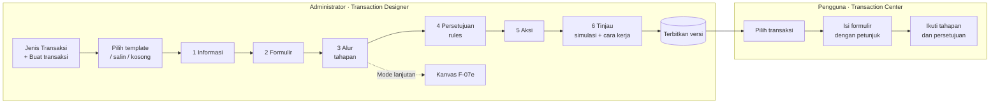

# F-08: Transaction Builder Terpandu

| Field | Value |
|---|---|
| Tahap | 2–7 (ringkas): requirement, alur, data, security |
| Versi | 0.3 |
| Penyusun | product-analyst, ui-ux-designer, system-architect, security-engineer |
| Status | v0.1 **Approved** ([APR-0011](../../approvals/APR-0011-transaction-builder-terpandu.md), mockup [v0.1](../../design/mockups/F-08-transaction-builder-terpandu.html)). v0.2 + v0.3 **Approved** 2026-11-21 ([APR-0012](../../approvals/APR-0012-transaction-designer-dan-center.md), mockup [F-08-v2-transaction-designer.html](../../design/mockups/F-08-v2-transaction-designer.html)) |
| Dasar | Pemilik produk 2026-11-20: Custom Transaction Builder boleh *powerful*, tetapi UX-nya harus (1) template first, (2) guided setup, (3) human-readable rules, (4) contextual configuration, (5) simulation, (6) auto documentation, (7) simple by default, advanced on demand. **Revisi v0.2** (pemilik produk, 2026-11-20): *guided customization*: Jenis transaksi, Rules, dan Workflow dipisah tetapi terhubung di satu **Transaction Designer** (administrator); pengguna menjalankan transaksi di **Transaction Center**; rule bernama dan berprioritas. **Revisi v0.3** (2026-11-21): diselaraskan dengan roadmap fleksibel ([APR-0013](../../approvals/APR-0013-penanggung-jawab-aset-dan-roadmap-ux.md)) dan [F-09](F-09-penanggung-jawab-aset.md): cabang sudah dihapus, aset kini punya penanggung jawab dan departemen (§1b, §3.11) |
| Hubungan | Mengubah UX [F-07](F-07-jenis-dan-alur-transaksi-kustom.md) (jenis, field, dan editor alur). Mesin alur F-07b, versi alur, dan izin D-27 **tidak berubah**. Memakai ulang jenis sistem F-07f sebagai template |

## 1. Masalah

Builder F-07d/F-07e sudah lengkap fiturnya, tetapi pengguna harus menyusun semuanya sendiri dari nol.

| Prinsip | Kondisi sekarang (F-07d/F-07e) |
|---|---|
| 1. Template first | Jenis baru dimulai dari formulir kosong; alur dimulai dari `Mulai → Selesai` |
| 2. Guided setup | Jenis dan field ada di satu halaman panjang (`/transaksi/jenis/:id`); alur di halaman terpisah (`/alur`); tidak ada urutan langkah |
| 3. Human-readable rules | Syarat disusun dari tiga dropdown (data, operator, nilai); tidak pernah ditampilkan sebagai kalimat |
| 4. Contextual configuration | Saat menulis syarat atau memilih field per langkah, formulir transaksi tidak terlihat; field dan alur diatur di dua halaman |
| 5. Simulation | ✓ "Uji alur" dengan aset contoh dan keputusan per persetujuan. Pengguna harus memikirkan sendiri jalur mana yang perlu dicoba |
| 6. Auto documentation | Tidak ada; hanya catatan perubahan per versi |
| 7. Simple by default | Palet langsung menampilkan tujuh jenis langkah dan semua pengaturan field langsung terbuka |

## 1a. Revisi v0.2: Transaction Designer dan Transaction Center

v0.2 mempertahankan semua acceptance criteria v0.1 kecuali yang disebut *diganti* di bawah, dan menambah §3.8–§3.10.

| Bagian | v0.1 | v0.2 |
|---|---|---|
| Sisi administrator | Wizard 4 langkah, lalu halaman jenis bertab langkah | **Transaction Designer**: wizard 6 langkah untuk jenis baru (Informasi → Formulir → Alur → Persetujuan → Aksi → Tinjau); jenis yang ada dibuka sebagai tab *Ringkasan · Formulir · Alur · Rules · Aksi · Simulasi* (§3.2, mengganti F08-06/F08-07) |
| Rules | Syarat tertanam di langkah alur | **Rule bernama**: nama, deskripsi, kondisi (JIKA … MAKA …), hasil, prioritas, aktif/nonaktif; daftar rule per transaksi (§3.8). Disimpan bersama versi alur dan diterjemahkan ke langkah alur saat terbit, sehingga mesin F-07b tidak berubah (D-46) |
| Workflow | Langkah alur | **Tahapan** bernama yang dilihat pengguna (mis. Diajukan → Disetujui → Dilaksanakan → Selesai). Tahapan adalah nama langkah alur; status mesin tetap Berjalan/Selesai/Ditolak/Dibatalkan (D-48) |
| Sisi pengguna | Menu Transaksi dan Transaksi berjalan | **Transaction Center**: pilih transaksi yang tersedia, isi formulir dengan petunjuk, ikuti tahapan dan persetujuan (§3.9) |
| Jenis sistem | Hanya template yang disalin | Jenis sistem dapat **diubah langsung** (field dan alur di sekitar Aksi inti, F-07f) **atau disalin** sebagai jenis organisasi yang tetap membawa Aksi inti (`core_type`, D-47) |

## 1b. Revisi v0.3: Selaras dengan Roadmap Fleksibel dan F-09

v0.2 ditulis sebelum APR-0013. Sejak itu dua hal berubah: cabang dihapus (migrasi `000600_remove_branches`), dan aset punya **penanggung jawab** (`custodian_user_id`) serta **departemen** (`department_id`) (D-51). v0.3 hanya mengubah bagian yang bergantung pada keduanya; bagian v0.2 lain tetap.

| Bagian | v0.2 | v0.3 |
|---|---|---|
| Contoh "lintas …" | *Persetujuan lintas cabang* (`target.branch_differs`, penyetuju *Supervisor lokasi tujuan*) | *Persetujuan lintas departemen*: departemen asal penerima berbeda dengan departemen aset → perlu persetujuan Supervisor departemen penerima (§3.11, D-49 direvisi) |
| Data kondisi | status, kondisi, kategori, lokasi, nilai perolehan, role pencatat, field | + **departemen aset**, **penanggung jawab aset** (ada/kosong), **pencatat adalah penanggung jawab**, **lintas departemen** (§3.11) |
| Penyetuju | Super Admin/Supervisor, pengguna, Supervisor lokasi | + **Penanggung jawab aset** ⚑ (D-57) dan **Supervisor departemen penerima**; *Supervisor lokasi* ditampilkan sebagai *Supervisor yang membawahi aset* karena cakupan kini lokasi **atau** departemen (F-09c) |
| Serah terima | Template *Serah terima ke karyawan* = peminjaman | Dipisah sesuai D-53: *Peminjaman ke karyawan* (sementara, pemegang) dan template baru **Serah terima penanggung jawab** (tetap, mengganti penanggung jawab lewat aksi `set_custodian`, D-58) |

## 2. Alur Pengguna

- **Transaction Designer** (administrator): wizard 6 langkah untuk jenis baru dengan indikator langkah. Setiap langkah tersimpan sebagai **draft**; berpindah langkah tidak menghapus isian. Langkah 4–5 boleh dilewati (*Tidak perlu persetujuan*, *Tidak mengubah aset*), sehingga transaksi sederhana selesai di langkah 3.
- Jenis yang sudah ada dibuka sebagai **tab** *Ringkasan · Formulir · Alur · Rules · Aksi · Simulasi*, dengan tombol *Terbitkan* di kepala halaman. Tab *Ringkasan* adalah "Cara kerja transaksi ini" (§3.6).
- Panel **Pratinjau** di sisi kanan selalu terlihat di langkah/tab Formulir, Alur, Persetujuan, Rules, dan Aksi: formulir sebagaimana dilihat pengisi, tahapan, dan rule yang berlaku. Rule yang terhubung selalu tampil di konteks transaksi yang sedang diedit (prinsip 4).
- **Transaction Center** (pengguna yang mencatat): daftar transaksi siap pakai, formulir dengan petunjuk, dan tahapan transaksi miliknya. Pengguna biasa tidak pernah melihat cara transaksi disusun (§3.9).
- Designer tetap hanya untuk Super Admin dan Supervisor (D-27) di web layar ≥ 768px (D-34). Di ponsel: Transaction Center penuh, sedangkan Designer hanya *Ringkasan* (dilihat saja).

## 3. Prinsip dan Acceptance Criteria

### 3.1 Template first
| ID | Acceptance criteria |
|---|---|
| F08-01 | "Jenis baru" membuka langkah **Titik awal** dengan tiga pilihan: *Mulai dari template* (dipilih bawaan), *Salin jenis yang ada*, *Mulai dari kosong* |
| F08-02 | Galeri template menampilkan kartu per template: nama, satu kalimat kegunaan, jumlah field, jumlah langkah persetujuan, dan tombol *Lihat cara kerja* (dokumentasi §6 tanpa membuat apa pun) |
| F08-03 | Memakai template membuat **draft** jenis baru (nama dan kode boleh diubah) dengan field dan alur hasil salinan. Template tidak pernah ikut berubah dan tidak terhubung lagi dengan jenis hasil salinannya |
| F08-04 | Rujukan template ke role memakai role bawaan (Supervisor, Super Admin). Bila organisasi menghapus/mengganti role itu, langkah 3 menandai langkah persetujuan yang perlu dipilih ulang sebelum dapat diterbitkan |
| F08-05 | *Salin jenis yang ada* menyalin field dan versi alur terbit terakhir (atau draft bila belum pernah terbit) dari jenis organisasi yang sama |

Template awal (§4) disimpan di kode seperti `SystemTemplates` dashboard, bukan dibuat pengguna ⚑ (D-40).

### 3.2 Guided setup
| ID | Acceptance criteria |
|---|---|
| F08-06 | *(diganti v0.2)* Wizard jenis baru punya 6 langkah: **1 Informasi** (nama, kode/prefix diusulkan dari nama mis. *Kirim Kalibrasi* → `KAL`, deskripsi, ikon, kategori aset yang berlaku) · **2 Formulir** (field, wajib/opsional, petunjuk pengisian; validasi per tipe di *Pengaturan lanjutan*) · **3 Alur** (tahapan dari awal sampai akhir, §3.10; siapa yang boleh mencatat) · **4 Persetujuan** (*Perlu persetujuan?* → siapa, berapa tingkat, dan rule persetujuan bersyarat, §3.8) · **5 Aksi** (yang terjadi pada aset: ubah status, pindah lokasi, pinjamkan/kembalikan, notifikasi; riwayat aset selalu tercatat) · **6 Tinjau** (ringkasan, peringatan isian yang belum lengkap, simulasi, cara kerja, terbitkan) |
| F08-07 | *(diganti v0.2)* Setiap langkah punya jawaban bawaan yang aman dan dapat dilewati bila tidak relevan: langkah 4 *Tidak perlu persetujuan*, langkah 5 *Tidak mengubah aset* (jenis pencatatan saja). Template mengisi keenam langkah; pengguna hanya menyesuaikan |
| F08-07a | Jenis yang sudah ada dibuka di **Transaction Designer** sebagai tab *Ringkasan · Formulir · Alur · Rules · Aksi · Simulasi*. Kepala halaman menampilkan nama, status (Draft/Terbit vN, ada perubahan belum terbit), dan *Terbitkan*. Setiap tab menampilkan jumlah masalah validasinya |
| F08-08 | Tombol *Lanjut* dinonaktifkan dengan pesan yang menyebut isian yang kurang; kesalahan validasi server (`FLOW_INVALID`) ditampilkan di pertanyaan yang bersangkutan, bukan hanya di atas halaman |
| F08-09 | Langkah 4 tidak dapat menerbitkan selama ada masalah validasi atau ada skenario wajib (§3.5) yang belum dijalankan |

### 3.3 Human-readable rules
| ID | Acceptance criteria |
|---|---|
| F08-10 | Setiap syarat tampil sebagai kalimat di bawah isiannya dan di dokumentasi, mis. *"Status aset adalah Dipinjamkan"*, *"Nilai perolehan lebih dari Rp 10.000.000"*, *"Kategori aset termasuk Kendaraan (beserta subkategorinya)"* |
| F08-11 | Gabungan syarat memakai kata *dan* / *atau* sesuai pilihan; prasyarat mulai ditulis sebagai larangan: *"Transaksi tidak dapat dicatat bila status aset adalah Dipinjamkan. Pesan: 'Kembalikan aset terlebih dahulu.'"* |
| F08-12 | Nilai memakai label, tidak pernah kode atau UUID: nama lokasi, nama kategori, label status/kondisi, label pilihan field, nama role, nominal dalam mata uang organisasi |
| F08-13 | Kalimat dibangkitkan dari graph oleh satu penerjemah yang sama untuk editor, dokumentasi, dan detail transaksi berjalan ⚑ (D-41) |

Tata bahasa kalimat (semua subjek dan operator `FlowGraph::SUBJECTS` / `OPERATORS`):

| Subjek | Contoh kalimat |
|---|---|
| `asset.status` | Status aset **adalah / bukan / salah satu dari** Aktif, Tidak Aktif |
| `asset.condition` | Kondisi aset adalah Rusak Berat |
| `asset.category` | Kategori aset termasuk Kendaraan |
| `asset.location` | Lokasi aset berada di Gudang Pusat |
| `asset.acquisition_cost` | Nilai perolehan **lebih dari / paling sedikit / kurang dari / paling banyak** Rp 10.000.000 (untuk banyak aset: *total nilai* atau *setiap aset*) |
| `starter.role` | Pencatat memiliki role Admin |
| `field.<key>` | *(label field)* adalah / terisi / kosong / lebih dari … |

| Langkah | Contoh kalimat |
|---|---|
| Mulai | Dapat dicatat oleh Admin dan Supervisor |
| Isi data | Supervisor lokasi mengisi *No. BAST* dan *Foto serah terima* (wajib) dalam 2 hari |
| Persetujuan | Perlu disetujui 1 Supervisor yang cakupannya meliputi lokasi aset. Bila ditolak, transaksi selesai sebagai Ditolak |
| Kondisi | Bila nilai perolehan lebih dari Rp 10.000.000, lanjut ke *Persetujuan Super Admin*; bila tidak, lanjut ke *Kirim ke vendor* |
| Aksi | Status aset diubah menjadi Dalam Perbaikan · Aset dipindah ke lokasi pada field *Lokasi tujuan* · Email dikirim ke pencatat |
| Tunggu | Menunggu sampai tanggal pada field *Rencana kembali* · Menunggu transaksi *Kembali dari Kalibrasi* untuk setiap aset |
| Selesai | Transaksi selesai |

### 3.4 Contextual configuration
| ID | Acceptance criteria |
|---|---|
| F08-14 | Pratinjau formulir di langkah 2 berubah seketika saat field ditambah, diubah, atau diurutkan |
| F08-15 | Di langkah 3, memilih field untuk langkah *Isi data* atau syarat menyorot field itu di pratinjau formulir; field yang belum dipakai di mana pun diberi tanda "belum dipakai di alur" |
| F08-16 | Pertanyaan *Apa yang terjadi pada aset?* hanya menawarkan aksi yang field-nya tersedia (mis. *Pindah lokasi* butuh field Lokasi), dengan tautan *Tambah field Lokasi* yang menambahkannya tanpa meninggalkan langkah 3 |
| F08-17 | Pratinjau alur (diagram kecil hanya-baca, komponen `FlowDiagram` yang ada) selalu menunjukkan hasil jawaban langkah 3 |

### 3.5 Simulation
| ID | Acceptance criteria |
|---|---|
| F08-18 | Langkah 4 membangkitkan **skenario** otomatis dari graph: satu skenario per jalur yang berbeda (setiap cabang Kondisi *Ya/Tidak*, setiap Persetujuan *Disetujui/Ditolak*), maksimal 12. Setiap skenario diberi nama kalimat, mis. *"Nilai > Rp 10 jt, disetujui Supervisor, disetujui Super Admin"* |
| F08-19 | Menjalankan skenario memakai endpoint simulasi yang ada (tanpa menyimpan transaksi) dan menampilkan hasil per langkah sebagai kalimat, termasuk perubahan aset yang **akan** terjadi (status lama → baru, lokasi lama → baru) |
| F08-20 | Skenario prasyarat ditolak dijalankan dengan aset contoh yang melanggar syarat bila ada; hasilnya menampilkan pesan penolakan yang akan dilihat pencatat |
| F08-21 | *Jalankan semua skenario* menandai setiap skenario lulus/gagal. Skenario yang tidak pernah sampai *Selesai* adalah kesalahan; skenario yang belum dijalankan setelah alur diubah ditandai *perlu dijalankan ulang* |
| F08-22 | Uji manual (aset contoh + nilai field + keputusan) F-07e tetap tersedia sebagai *Skenario sendiri* |

### 3.6 Auto documentation
| ID | Acceptance criteria |
|---|---|
| F08-23 | Setiap jenis memiliki **Cara kerja transaksi ini**: judul, kegunaan (keterangan jenis), siapa yang mencatat, syarat, isian formulir, urutan langkah bernomor dalam kalimat (§3.3), efek ke aset, dan siapa yang mendapat tugas/email |
| F08-24 | Dokumentasi tampil di: langkah 4 (untuk ditinjau sebelum terbit), halaman jenis (tab *Cara kerja*, juga di ponsel), dan formulir pencatatan dalam bentuk ringkas (*"Transaksi ini perlu disetujui Supervisor sebelum aset dipindah"*) |
| F08-25 | Saat menerbitkan versi baru, dokumentasi menampilkan **perbedaan dari versi sebelumnya** dalam kalimat (langkah ditambah/dihapus, syarat berubah) dan mengisi otomatis usulan *Catatan perubahan* yang dapat disunting |
| F08-26 | Dokumentasi dibangkitkan dari data, deterministik, tanpa layanan AI/LLM ⚑ (D-43). Dapat dicetak (tampilan cetak bersih) |

### 3.7 Simple by default, advanced on demand
| ID | Acceptance criteria |
|---|---|
| F08-27 | Langkah 3 bawaan adalah **mode sederhana** (pertanyaan §3.2). *Mode lanjutan* membuka kanvas F-07e untuk alur yang sama |
| F08-28 | Mode sederhana mencakup alur lurus dengan: prasyarat, maksimal 2 persetujuan berurutan, satu syarat "persetujuan tambahan bila …", aksi ke aset, satu langkah *Isi data* lanjutan, dan satu *Tunggu* ⚑ (D-42). Alur di luar bentuk itu hanya dapat diubah di mode lanjutan; mode sederhana lalu menampilkan dokumentasinya (hanya-baca) dengan tombol *Buka mode lanjutan* |
| F08-29 | Berpindah dari mode lanjutan ke sederhana tidak pernah mengubah alur diam-diam: bila alur tidak dapat dinyatakan dalam mode sederhana, pengguna diberi tahu bagian mana yang membuatnya lanjutan |
| F08-30 | Di langkah 2, setiap field hanya menampilkan label, tipe, dan *wajib*. Pengaturan per tipe (panjang, min/maks, desimal, tanggal relatif, ukuran lampiran, wajib di langkah tertentu) ada di bawah *Pengaturan lanjutan* yang tertutup bawaan |
| F08-31 | Pilihan mode tersimpan per pengguna; jenis yang dibuka dalam mode lanjutan tetap dibuka di mode itu |

### 3.8 Rules bernama (v0.2)
Rule adalah ketentuan yang berlaku pada satu jenis transaksi, dikelola di tab/langkah *Rules* dan *Persetujuan*, dan **selalu terlihat di konteks jenisnya**.

| ID | Acceptance criteria |
|---|---|
| F08-32 | Setiap rule memiliki **nama** (wajib, mis. *Approval Aset Bernilai Tinggi*), **deskripsi**, **kondisi**, **hasil**, **prioritas**, dan **status Aktif/Nonaktif**. Nama seperti "Rule 01" tidak diusulkan: nama bawaan dibentuk dari kondisi dan hasilnya |
| F08-33 | Kondisi disusun dengan builder kalimat **JIKA** *(data)* *(pembanding)* *(nilai)* [**dan/atau** …] dengan subjek `FlowGraph::SUBJECTS` dan field jenis itu; tidak pernah menampilkan ekspresi atau kode. Di bawah builder selalu tampil kalimat lengkap (F08-10) |
| F08-34 | Hasil rule satu dari: **Tolak transaksi** (dengan pesan untuk pencatat) · **Perlu persetujuan** *(siapa, minimal berapa orang)* · **Lewati persetujuan** *(nama langkah persetujuan)*. Penyetuju: role Super Admin/Supervisor, pengguna yang memegangnya, Supervisor yang membawahi aset (D-27), dan sejak v0.3 penanggung jawab aset atau Supervisor departemen penerima (§3.11) |
| F08-35 | Daftar rule per jenis: tabel *Nama · Kondisi (kalimat) · Hasil · Prioritas · Status*, dapat diurutkan dengan seret untuk prioritas; rule nonaktif tampil redup dan tidak berlaku |
| F08-36 | Saat terbit, rule aktif **diterjemahkan ke langkah alur** (D-46): *Tolak transaksi* → prasyarat langkah Mulai; *Perlu persetujuan* → langkah Kondisi + Persetujuan sebelum langkah Aksi, berurutan sesuai prioritas; *Lewati persetujuan* → langkah Kondisi yang melompati persetujuan itu. Pratinjau alur menampilkan hasil penerjemahan sebelum terbit |
| F08-37 | Rule tersimpan di versi alur (draft/terbit), sehingga transaksi berjalan tetap memakai rule versinya (D-28) dan dokumentasi menampilkan rule yang ditambah, diubah, dinonaktifkan, atau dihapus dibanding versi sebelumnya |
| F08-38 | Dua rule yang bertentangan (mis. sama kondisi, satu *Tolak* satu *Perlu persetujuan*) ditandai di tab Rules; rule berprioritas lebih tinggi yang berlaku, dan peringatan ini ikut di langkah *Tinjau* |
| F08-39 | Alur yang diubah di kanvas (mode lanjutan) sehingga tidak lagi berasal dari rule ditandai: tab Rules menampilkan rule-nya hanya-baca dengan pesan *"Alur diubah di mode lanjutan; ubah persetujuan di kanvas"* (setara F08-29) |

Contoh rule template (nama · kondisi · hasil):

| Nama | Kondisi | Hasil |
|---|---|---|
| Approval aset bernilai tinggi | Nilai perolehan lebih dari Rp 10.000.000 | Perlu persetujuan Super Admin |
| Larangan memindah aset rusak | Kondisi aset adalah Rusak Berat | Tolak: "Aset rusak berat diperbaiki atau dihapuskan, bukan dipindah." |
| Persetujuan lintas departemen *(v0.3)* | Departemen asal *Penerima* berbeda dengan departemen aset | Perlu persetujuan Supervisor departemen penerima (D-49) |
| Persetujuan penanggung jawab *(v0.3)* ⚑ | Aset punya penanggung jawab **dan** pencatat bukan penanggung jawabnya | Perlu persetujuan Penanggung jawab aset (D-57) |
| Persetujuan peminjaman | (selalu) | Perlu persetujuan Supervisor yang membawahi aset |

### 3.9 Transaction Center (v0.2)
Tempat pengguna yang mencatat menjalankan transaksi; tidak menampilkan cara transaksi disusun.

| ID | Acceptance criteria |
|---|---|
| F08-40 | Menu **Transaksi** membuka Transaction Center dengan tiga tab: **Buat transaksi** (kartu jenis yang dapat dipakai pengguna: ikon, nama, satu kalimat kegunaan, ringkasan *"Perlu persetujuan Supervisor"*), **Perlu tindakan saya** (tugas isi data/persetujuan, dengan jumlah), dan **Transaksi saya** (berjalan dan selesai, dengan tahapan saat ini). Riwayat transaksi lengkap tetap di tab/halaman *Riwayat* |
| F08-41 | Kartu hanya menampilkan jenis aktif yang izinnya dimiliki pengguna (mis. Peminjaman butuh `asset.assign`); jenis sistem dan jenis organisasi tampil berdampingan, dikelompokkan per kategori template (Perpindahan, Peminjaman, Perawatan, Lainnya) |
| F08-42 | Formulir menampilkan **petunjuk** per field (teks bantuan dari Designer), ringkasan *Cara kerja* (2–4 kalimat, F08-24), dan setelah aset dipilih: rule yang akan berlaku (*"Perlu persetujuan Super Admin karena nilai aset Rp 15.000.000"*) atau penolakan sebelum dikirim |
| F08-43 | Detail transaksi milik pengguna menampilkan **tahapan** sebagai stepper (selesai / sekarang / berikutnya), siapa yang ditunggu, dan riwayat keputusan; aksi *Batalkan* mengikuti aturan F-07b |
| F08-44 | Transaction Center berfungsi penuh di ponsel 375px (D-34 hanya membatasi Designer) |

### 3.10 Tahapan (v0.2)
| ID | Acceptance criteria |
|---|---|
| F08-45 | Langkah 3 *Alur* menampilkan tahapan sebagai daftar bernama dari awal sampai akhir: **Diajukan** (tetap, saat pencatat mengirim) → tahapan tengah → **Selesai** / **Ditolak** (tetap). Tahapan tengah dibentuk dari langkah 4–5 (mis. *Menunggu persetujuan*, *Dilaksanakan*) dan dapat ditambah sebagai langkah *Isi data* (mis. *Serah terima*) |
| F08-46 | Nama tahapan dapat diubah; nama itulah yang dilihat pengguna di Transaction Center, notifikasi, dan dokumentasi (D-48) |
| F08-47 | Draft transaksi milik pengguna (formulir yang disimpan sebelum dikirim) **di luar cakupan** v0.2; tahapan pertama selalu *Diajukan* |

### 3.11 Penanggung jawab dan departemen di rule (v0.3)
| ID | Acceptance criteria |
|---|---|
| F08-48 | Builder kondisi menawarkan data baru: **Departemen aset** (adalah / bukan / salah satu dari / kosong), **Penanggung jawab aset** (ada / kosong), **Pencatat adalah penanggung jawab aset** (ya / tidak), dan **Lintas departemen** (pilih field *Pengguna* yang menjadi penerima). Kalimatnya: *"departemen aset adalah Keuangan"*, *"pencatat bukan penanggung jawab aset"*, *"departemen asal Penerima berbeda dengan departemen aset"* |
| F08-49 | *Lintas departemen* benar bila departemen asal anggota di field itu (`organization_members.home_department_id`) ≠ departemen aset. Bila salah satunya kosong, kondisi **tidak berlaku** (salah), dan simulasi serta pratinjau Transaction Center menyebut alasannya (*"Aset belum punya departemen, rule lintas departemen tidak berlaku"*) |
| F08-50 | Penyetuju **Penanggung jawab aset** ⚑ (D-57): tugas persetujuan diberikan ke penanggung jawab setiap aset dalam transaksi (satu tugas per orang; aset dengan penanggung jawab yang sama digabung). Penanggung jawab boleh anggota tanpa role Supervisor, tetapi hanya melihat transaksi itu dan hanya dapat menyetujui/menolak tugasnya sendiri |
| F08-51 | Bila aset tidak punya penanggung jawab, atau penanggung jawabnya nonaktif (D-55), tugas jatuh ke **Supervisor yang membawahi aset**; riwayat mencatat alasannya. Bila pencatat sendiri adalah penanggung jawab, persetujuannya dianggap diberikan dan tercatat *"Disetujui otomatis: pencatat adalah penanggung jawab"*. Tidak ada transaksi yang macet karena tidak ada penyetuju |
| F08-52 | Penyetuju **Supervisor departemen penerima**: Super Admin atau Supervisor yang cakupan datanya meliputi departemen asal penerima; bila tidak ada, tugas jatuh ke role Super Admin dengan alasan tercatat |
| F08-53 | Aksi alur baru **Ganti penanggung jawab** (`set_custodian`, D-58): mengisi penanggung jawab aset dari field *Pengguna* (anggota aktif organisasi) dan, bila dipilih, departemen aset dari departemen asal orang itu. Riwayat aset mencatat *dari → ke* dan nomor transaksinya |
| F08-54 | Formulir aset (F-09b) tetap dapat mengisi penanggung jawab saat aset dibuat dan untuk koreksi oleh pengguna ber-`asset.update`. Serah terima sehari-hari memakai template *Serah terima penanggung jawab*; detail aset dan Transaction Center menampilkan tombol *Serah terima* yang membuka template itu (satu jalan untuk satu tugas, roadmap §1.2) |

## 4. Template Awal

| Template | Kegunaan | Field | Alur (ringkas) |
|---|---|---|---|
| Mutasi antar lokasi | Memindah aset ke lokasi lain dengan persetujuan | Lokasi tujuan, Alasan, Penerima, No. BAST, Foto | Prasyarat: bukan Dipinjamkan/Di Luar Organisasi → Persetujuan Supervisor lokasi (+ Super Admin bila nilai > Rp 10 jt) → status Dalam Pengiriman → Isi data penerima → pindah lokasi, status Aktif |
| Kirim kalibrasi | Aset ke vendor kalibrasi, menunggu kembali | Vendor, No. PO, Rencana kembali, Sertifikat | Persetujuan Supervisor → status Dalam Perbaikan → Tunggu *Kembali dari kalibrasi* |
| Kembali dari kalibrasi | Pasangan *Kirim kalibrasi* (Berpasangan) | Tanggal kembali, Sertifikat (lampiran, wajib), Hasil | Isi data → status Aktif / Rusak sesuai Hasil |
| Perbaikan ke vendor | Aset rusak diperbaiki pihak luar | Vendor, Keluhan, Estimasi biaya | Persetujuan Supervisor (+ Super Admin bila estimasi > Rp 5 jt) → status Dalam Perbaikan |
| Peminjaman ke karyawan *(v0.3: dulu "Serah terima ke karyawan")* | Aset dipinjamkan sementara ke pengguna (D-53) | Pemegang (pengguna), Rencana kembali, Foto | Prasyarat: status Aktif/Tidak Aktif → Pinjamkan ke pemegang → Email ke pemegang |
| Serah terima penanggung jawab *(v0.3)* | Penanggung jawab tetap berganti, mis. karyawan pindah tugas | Penanggung jawab baru (pengguna), Alasan, Berita acara (lampiran) | Persetujuan Penanggung jawab lama (F08-50/51) → rule *Persetujuan lintas departemen* → Isi data penerima (konfirmasi) → Ganti penanggung jawab (+ departemen) → Email ke keduanya |
| Penghapusan aset | Usulan penghapusan dengan dua persetujuan | Alasan (pilihan), Nilai jual, Berita acara | Persetujuan Supervisor → Persetujuan Super Admin → status Dihapuskan |
| *Tujuh jenis sistem* (F-07f) | Pemindahan, Perubahan status, Peminjaman, Pengembalian, Keluar, Masuk, Aktivitas lain | sesuai jenis | Alur bawaan setara perilaku sekarang; disalin sebagai jenis organisasi yang dapat ditambah field/persetujuan |

Setiap template lulus validasi alur F-07b dan memiliki test yang menerbitkan dan menjalankan semua skenarionya.

v0.2: setiap template juga membawa **rule bernamanya** (§3.8) dan **tahapan** (§3.10), mis. *Mutasi antar lokasi*: rule *Larangan memindah aset rusak* (Tolak) dan *Approval aset bernilai tinggi* (Perlu persetujuan Super Admin); tahapan Diajukan → Menunggu persetujuan → Dalam pengiriman → Diterima → Selesai. Galeri Designer mengelompokkan template per kategori: **Perpindahan**, **Peminjaman**, **Perawatan**, **Penghapusan**, **Jenis sistem**, dan kartu **Transaksi custom** (mulai dari kosong).

## 5. Data dan API (usulan system-architect)

Tidak ada perubahan mesin alur, tabel transaksi, atau RLS. Tambahan:

| Bagian | Usulan |
|---|---|
| Katalog template | `App\Domain\AssetTransactions\Templates\TransactionTemplates` (di kode, seperti `Dashboards\Catalog\SystemTemplates`): key, nama, kegunaan, field, graph. Diuji agar setiap graph valid |
| Kolom | `transaction_type_definitions.source_template_key` (nullable, varchar): asal template untuk dokumentasi dan analitik. `user_preferences`/preferensi dashboard: mode builder per pengguna (F08-31) |
| `GET /transaction-type-templates` | Daftar template + dokumentasi masing-masing (`transaction.view`) |
| `POST /transaction-types/from-template` · `POST /transaction-types/{id}/duplicate` | Membuat draft jenis dari template / dari jenis lain (`transaction_type.manage`) |
| `GET /transaction-types/{id}/flow/describe?version=` | Dokumentasi terstruktur: kalimat per langkah, syarat, efek, dan perbedaan dari versi sebelumnya (`transaction.view`) |
| `POST /transaction-types/{id}/flow/scenarios` | Daftar skenario jalur dari graph draft (`transaction_flow.manage`); dijalankan memakai `flow/simulate` yang ada |
| `FlowDescriber` (backend) | Penerjemah graph → kalimat (D-41), dipakai `describe`, detail transaksi berjalan, dan email notifikasi |
| **v0.2** Rules | `transaction_flow_versions.rules` (jsonb, default `[]`): `[{id, name, description, priority, active, match, conditions[], outcome{kind: reject\|approval\|skip_approval, message?, approver?, min_approvals?, step?}}]`. Divalidasi seperti syarat F-07 (subjek/operator terdaftar). `RuleCompiler` menerjemahkan rule aktif ke graph saat simpan draft (pratinjau) dan terbit (D-46); graph hasil tetap divalidasi `FlowGraph::issues` dan dijalankan mesin F-07b tanpa perubahan |
| **v0.2** Asal graph | `transaction_flow_versions.graph_source` (`rules` \| `canvas`): `canvas` setelah graph diubah di mode lanjutan (F08-39) |
| **v0.2** Salinan jenis sistem | `transaction_type_definitions.core_type` (F-07f, D-47): salinan jenis sistem membawa Aksi inti; tanpa alur terbit salinan tidak dapat dicatat (`FLOW_REQUIRED`). `POST /transaction-types/{id}/duplicate` juga menerima jenis sistem |
| **v0.2** Petunjuk field | `transaction_type_fields.settings.help` (teks ≤ 200, tampil di Transaction Center) |
| **v0.3** Subjek kondisi | `FlowGraph::SUBJECTS` + `asset.department`, `asset.custodian`, `starter.is_custodian`, `target.department_differs` (`value` = key field bertipe pengguna, divalidasi seperti `field.*`). Dibaca di `FlowConditions::assetValue` per aset, mengikuti mode `any`/`all` yang ada |
| **v0.3** Penyetuju | tipe penugasan `asset_custodian` dan `target_department_supervisor` (`field` = key field pengguna) di `FlowGraph`/`FlowEngine`/`RunAccess`, dengan fallback F08-51/52 diselesaikan saat tugas dibuat dan dicatat di tugas. Tidak ada tabel baru |
| **v0.3** Aksi | `set_custodian {user_field, set_department: bool}` di `FlowActions`, melewati `AssetScope::allowsAsset` seperti aksi pindah lokasi (aturan tulis F-09 §3.3) |
| **v0.2** Transaction Center | `GET /transaction-center` (jenis yang dapat dipakai pengguna + ringkasan cara kerja + jumlah tugas); detail memakai `transaction-runs` yang ada. Pratinjau rule untuk aset terpilih memakai `flow/simulate` yang ada (tanpa menyimpan) |

## 6. Security (security-engineer)
| Aspek | Ketentuan |
|---|---|
| Izin | Tidak ada izin baru: membuat dari template/salin = `transaction_type.manage`; alur = `transaction_flow.manage`; dokumentasi = `transaction.view` |
| Template | Data statis di kode, tanpa skrip; hasil salinan melewati validasi `FlowGraph` yang sama dengan alur buatan pengguna |
| Salin jenis | Hanya jenis dalam organisasi yang sama (RLS + composite FK); rujukan pengguna/lokasi di graph diperiksa ulang terhadap organisasi |
| Kalimat | Teks buatan pengguna (nama langkah, label field, pesan) di-escape; frontend merender kalimat sebagai teks, bukan HTML |
| Penyetuju penanggung jawab *(v0.3)* | Anggota tanpa role Supervisor hanya mendapat akses ke run yang memuat tugasnya (`RunAccess` sudah memberi akses lewat tugas terbuka); tidak mendapat `transaction_flow.manage` atau akses aset lain. Test: penanggung jawab tidak dapat menyetujui tugas orang lain, dan kehilangan akses setelah tugasnya selesai bila asetnya di luar cakupannya |
| Ganti penanggung jawab *(v0.3)* | Penanggung jawab baru harus anggota aktif organisasi yang sama (composite FK F-09); departemen hasil aksi tidak boleh mendorong aset keluar cakupan pencatat (push-out F-09 §3.3); test di `tests/Feature/Security` |
| Skenario | Simulasi tetap tanpa efek tulis (transaksi DB di-rollback seperti F-07b) dan memakai data scope penguji; batas 12 skenario per permintaan |

## 7. Di Luar Cakupan
- Template buatan organisasi (menyimpan jenis sendiri sebagai template untuk dibagikan) ⚑ (D-44: fase berikutnya).
- v0.2: draft transaksi milik pengguna (F08-47); halaman manajemen rule lintas jenis (rule dikelola per jenis; daftar semua rule organisasi menyusul bila dibutuhkan); status mesin baru selain Berjalan/Selesai/Ditolak/Dibatalkan (D-48).
- Asisten AI untuk menyusun alur dari kalimat bebas (mode tanpa biaya; D-43).
- Perubahan pada mesin alur, jenis langkah, atau aturan inti F-07.

## 8. Keputusan yang Memerlukan Persetujuan
| ID | Keputusan | Usulan |
|---|---|---|
| D-40 | Template awal (§4) ditulis di kode dan dirilis bersama aplikasi; organisasi memakai salinannya | Ya |
| D-41 | Kalimat aturan dan dokumentasi dibangkitkan di **backend** (`FlowDescriber`), satu sumber untuk web, ponsel, dan email | Ya |
| D-42 | Batas mode sederhana seperti F08-28; alur yang lebih rumit hanya di mode lanjutan | Ya |
| D-43 | Dokumentasi deterministik dari data, tanpa AI/LLM (mode tanpa biaya) | Ya |
| D-44 | Template buatan organisasi ditunda ke fase berikutnya | Ya |
| D-45 | F-08 dikerjakan setelah F-07f (jenis sistem menjadi template) dan menggantikan halaman `/transaksi/jenis/:id`; kanvas F-07e dipertahankan sebagai mode lanjutan | Ya |
| D-46 | *(v0.2)* Rule bernama disimpan di versi alur dan **diterjemahkan ke langkah alur** (`RuleCompiler`) saat simpan/terbit; mesin F-07b, simulasi, dan versi tidak berubah | Ya |
| D-47 | *(v0.2)* Jenis sistem dapat diubah langsung **dan** disalin; salinan membawa Aksi inti (`core_type`) dan hanya dapat dicatat lewat alur terbitnya | Ya |
| D-48 | *(v0.2)* Workflow pengguna berupa **tahapan bernama** = nama langkah alur; status mesin tetap empat (Berjalan, Selesai, Ditolak, Dibatalkan) | Ya |
| D-49 | *(direvisi v0.3, menggantikan `target.branch_differs`)* Subjek kondisi `asset.department`, `asset.custodian`, `starter.is_custodian`, `target.department_differs` dan penyetuju *Supervisor departemen penerima*; perubahan kecil di `FlowConditions`/penugasan, bukan alur baru | Ya |
| D-50 | *(v0.2)* Menu **Transaksi** menjadi Transaction Center (Buat transaksi · Perlu tindakan saya · Transaksi saya · Riwayat); Designer tetap di *Pengaturan → Jenis Transaksi* untuk Super Admin/Supervisor | Ya |
| D-57 | *(v0.3)* ⚑ **Penanggung jawab aset** boleh menjadi penyetuju meskipun bukan Supervisor, hanya untuk tugas persetujuan atas aset yang ia pegang, dengan fallback F08-51 | Ya |
| D-58 | *(v0.3)* Aksi alur **Ganti penanggung jawab** + template *Serah terima penanggung jawab* (D-52, D-53); formulir aset tetap untuk pengisian awal dan koreksi (F08-54) | Ya |

## 9. Rencana Task (setelah disetujui)
| ID | Task | Agent | Bergantung | Status |
|---|---|---|---|---|
| F-08a | Mockup wizard, galeri template, mode sederhana, skenario, dokumentasi (desktop + 375px) | ui-ux-designer | requirement | done (disetujui 2026-11-20) |
| F-08b | `FlowDescriber` + `GET flow/describe` (kalimat per langkah/syarat, perbedaan versi) + test semua subjek/operator/jenis langkah | backend-engineer | D-41 | done (`FlowDescriberTest`). `?version=` memilih versi; tanpa itu draft, lalu versi aktif. Ringkasan membedakan persetujuan yang selalu diperlukan dan yang bersyarat. `stepSentence()` siap dipakai halaman transaksi berjalan dan email (F-08f) |
| F-08c | Katalog template + `from-template` + `duplicate` + `source_template_key`; test setiap template valid dan semua skenarionya sampai Selesai | backend-engineer, database-engineer | F-07f, D-40 | done backend (`TransactionTemplatesTest`). Enam template: Mutasi antar lokasi, Kirim kalibrasi + Kembali dari kalibrasi (dibuat berpasangan), Perbaikan ke vendor, Peminjaman ke karyawan, Penghapusan aset. `GET /transaction-type-templates` (kartu + dokumentasi `FlowDescriber`), `POST /transaction-types/from-template` (`template`, `code?`, `name?`, `pair{code,name}?`). Role penyetuju diisi role organisasi ber-template Supervisor/Super Admin; bila tidak ada, langkahnya kosong dan menghalangi terbit (F08-04). Status "Dalam Pengiriman" tidak ada di aksi alur, jadi menjadi nama tahapan; Penghapusan memakai Aksi inti Keluar (sifat Permanen dipilih pencatat). Serah terima penanggung jawab dan template lintas departemen menyusul di F-08i/F-08k; rule bernama template menyusul di F-08g |
| F-08d | `flow/scenarios`: enumerasi jalur (maks. 12), aset contoh untuk prasyarat | backend-engineer, security-engineer | F-07b | todo |
| F-08e | Frontend wizard + pratinjau formulir/alur + mode sederhana ⇄ lanjutan + pengaturan lanjutan field | frontend-engineer | F-08a disetujui, F-08b, F-08c | todo |
| F-08f | Frontend langkah 4 (skenario, dokumentasi, perbedaan versi, catatan perubahan otomatis) + tab *Cara kerja* + ringkasan di formulir pencatatan | frontend-engineer | F-08b, F-08d | todo |
| F-08-QA | E2E: template *Mutasi antar lokasi* → ubah batas nilai di mode sederhana → jalankan semua skenario → terbitkan → catat transaksi → dokumentasi tampil | qa-engineer | F-08e, F-08f | todo |
| F-08a2 | *(v0.2)* Mockup Transaction Designer (wizard 6 langkah, tab, Rules bernama, tahapan) dan Transaction Center (desktop + 375px) | ui-ux-designer | revisi v0.2, v0.3 | done (disetujui 2026-11-21, APR-0012); v0.3: contoh lintas departemen, rule penanggung jawab, pilihan data dan penyetuju baru |
| F-08g | *(v0.2)* `rules` + `graph_source` di versi alur, `RuleCompiler`, validasi rule, perbedaan rule antar versi; test setiap hasil rule dan prioritas | backend-engineer | D-46 | done backend (`TransactionRulesTest`). `PUT flow` dengan `rules` = mode Designer (graph dikompilasi, `graph_source=rules`); tanpa `rules` = kanvas (graph disimpan apa adanya, rule tetap untuk dibaca, F08-39). Respons memuat `rules`, `graph_source`, `base_graph` (alur tanpa langkah rule). *Tolak* = `rejections` di langkah Mulai, dicek mesin saat mulai dan simulasi dengan pesan per rule (tambahan kecil di `FlowEngine`, bukan langkah baru); *Perlu persetujuan* = Kondisi + Persetujuan (`rc_`/`ra_<id>`) setelah persetujuan bawaan alur dan sebelum langkah kerja pertama, ditolak → `r_ditolak`; *Lewati persetujuan* = Kondisi `rs_<id>` di depan langkah itu. Prioritas 1 lebih dulu; rule bertentangan (kondisi sama, hasil beda) yang prioritasnya lebih rendah tidak dikompilasi dan diberi catatan. Template Mutasi dan Perbaikan kini memakai rule bernama |
| F-08h | *(v0.2)* `core_type` + `duplicate` untuk jenis sistem | backend-engineer | D-47 | done backend (`TransactionTypeCopyTest`); tombol *Salin* di frontend ikut F-08e |
| F-08i | *(v0.3)* Subjek departemen/penanggung jawab (F08-48/49) + penyetuju `asset_custodian` dan `target_department_supervisor` dengan fallback (F08-50..52); test akses penyetuju | backend-engineer, security-engineer | D-49, D-57 | done backend (`TransactionCustodianApprovalTest`). Subjek `asset.department`, `asset.custodian` (kosong/terisi), `starter.is_custodian` (ya/tidak), `target.department_differs` (`value` = field pengguna; eq = berbeda, neq = sama; tidak berlaku bila salah satu kosong), plus `core.outgoing_nature` (dipakai rule *Penghapusan selalu permanen* di template Penghapusan). Penanggung jawab: **satu tugas** berisi daftar penanggung jawab di `transaction_tasks.details`; setiap orang menyetujui sekali, aset tanpa penanggung jawab aktif menambah satu bagian untuk Supervisor yang membawahi (cakupan meliputi semua aset run), aset milik pencatat dianggap disetujui. Supervisor departemen penerima: tugas `department_supervisor` (assignee = departemen asal penerima) untuk Super Admin/Supervisor bercakupan organisasi atau departemen itu; tanpa departemen atau tanpa penyetuju selain pencatat → role Super Admin. Alasan fallback di `open_task.reasons` |
| F-08k | *(v0.3)* Aksi `set_custodian` + template *Serah terima penanggung jawab* + tombol *Serah terima* di detail aset (F08-53/54) | backend-engineer, frontend-engineer | D-58, F-08c | todo |
| F-08j | *(v0.2)* Frontend Transaction Center + `GET /transaction-center` + petunjuk field | frontend-engineer, backend-engineer | APR-0012, D-50 | todo |
| F-08-QA2 | *(v0.2)* E2E: admin memakai template Peminjaman → tambah rule *Approval aset bernilai tinggi* → simulasi Rp 15 jt → terbitkan; pengguna mencatat di Transaction Center → melihat rule yang berlaku → tahapan sampai Selesai | qa-engineer | F-08e..j | todo |
